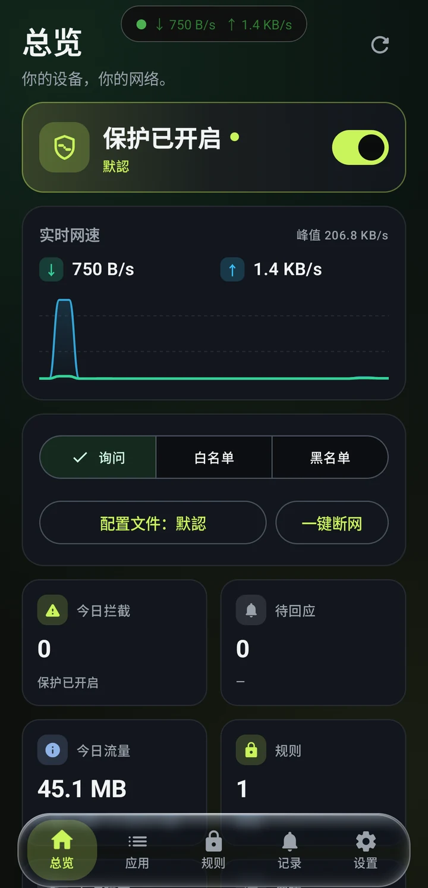
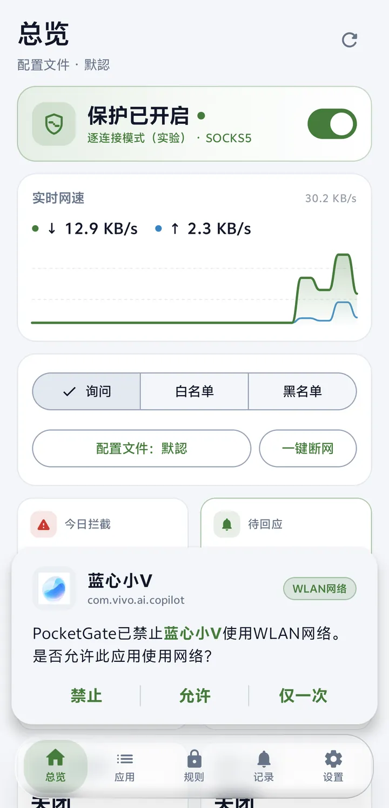
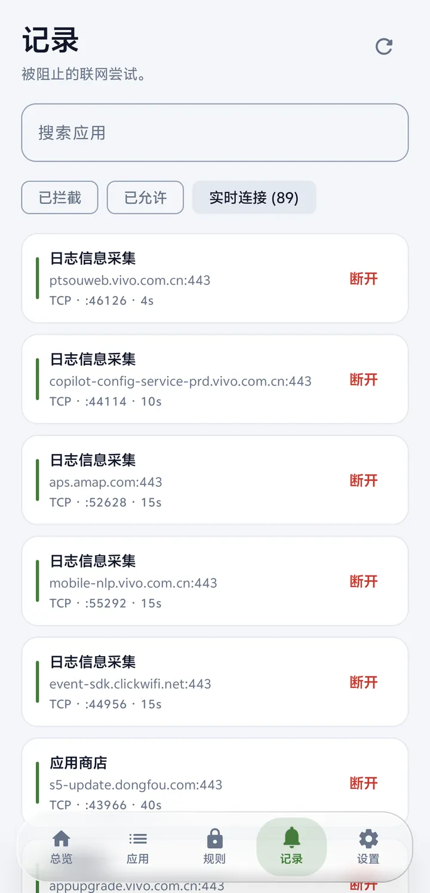
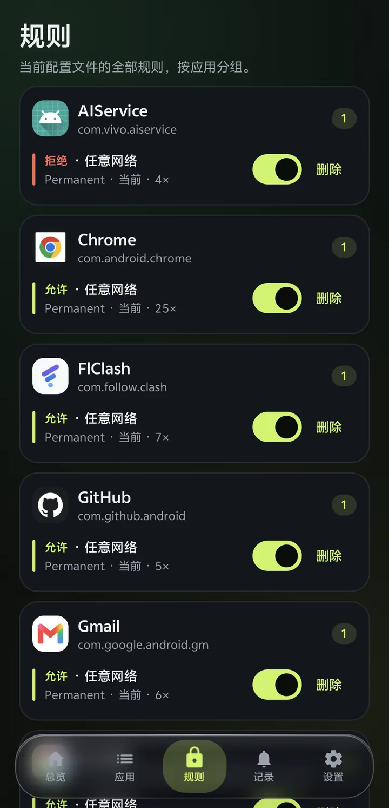
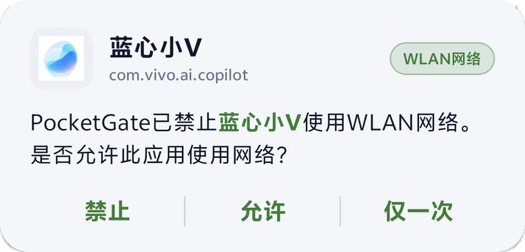
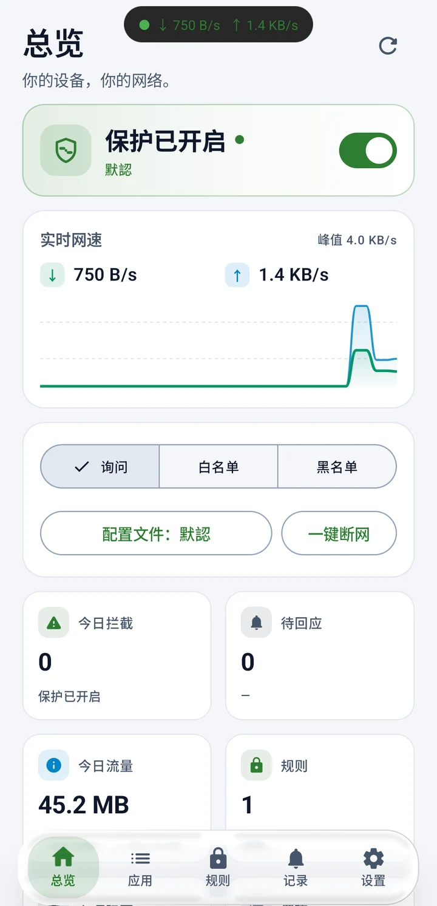
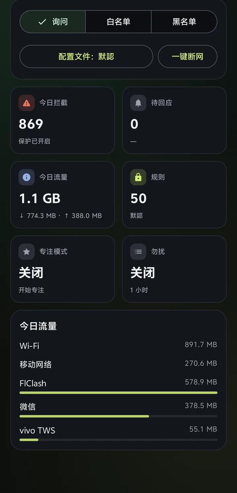
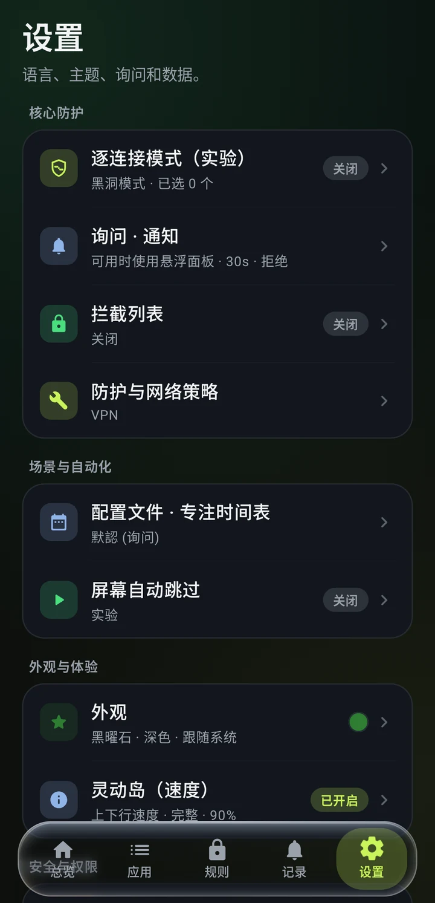
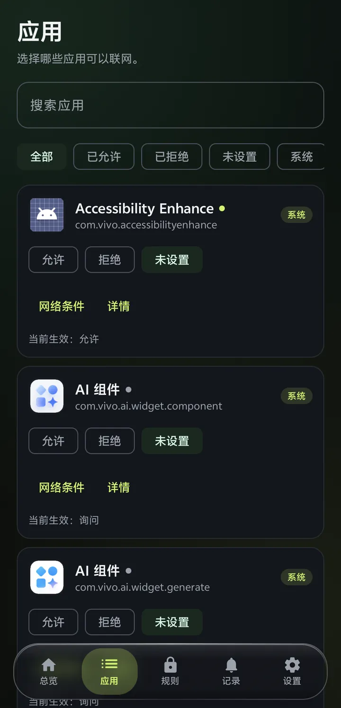
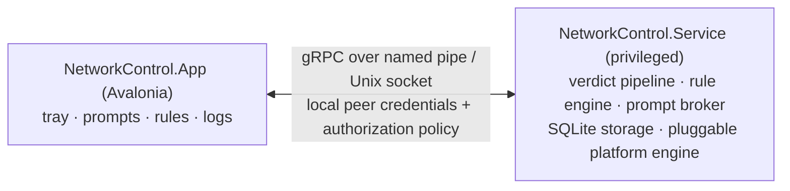

<div align="center">


# PocketGate

[简体中文](README.md) · [繁體中文](README.zh-TW.md) · **English**

**Every app asks you before it first goes online.**

Per-app network control for Android and Windows: a prompt when an app connects for the first time,<br>
rules down to domain, IP and port, running entirely on your device with zero data collection.

[](https://github.com/Barryyue/PocketGate/releases)
[](https://github.com/Barryyue/PocketGate/releases)
[](LICENSE)
[](#android)
[](#privacy)

[Download](https://github.com/Barryyue/PocketGate/releases) ·
[Gitee mirror](https://gitee.com/yuexiaobai/PocketGate) ·
[Android page](site/android.html) ·
[Website](site/index.html) ·
[Docs](#documentation)

<br>

&nbsp;
&nbsp;
&nbsp;


<sub>Real-device screenshots of the Android app (vivo, Android 17). The app UI shown is in Simplified Chinese; English and Traditional Chinese are built in.</sub>

</div>

---

## Why PocketGate

System firewalls only block **inbound** connections and never ask where apps are sending data. PocketGate adds that missing layer:

- **Ask first**: a new app is held back the first time it goes online, and you decide: allow, deny or just this once.
- **See everything**: which app opened each connection, where it goes and for how long, including the data collection built into the system itself.
- **Stay local**: no account, no server, no analytics SDK. The Android app can even turn off its own update checks.

---

## Android

> Native Kotlin + Jetpack Compose · Android 10+ · `arm64-v8a` · about 5.6 MB · no root

### Asked once, the moment an app connects



- While you're using an app, the prompt floats right on top of it; inside PocketGate it appears as an in-page card; on the lock screen it becomes a notification you can answer from its buttons.
- Both allow and deny come with a lifetime: **once** (revoked when you leave the app), timed or permanent. Several connections from the same app are merged into one prompt.
- Floating prompts need both "Display over other apps" and "Usage access"; without either one, prompts arrive as notifications.

### Two blocking engines

| | Blackhole mode (default) | Per-connection mode |
|---|---|---|
| How it works | Denied apps are routed into the VPN and dropped | All traffic is forwarded on the device through `hev-socks5-tunnel`, and each connection gets its own verdict |
| Granularity | Per app | App + domain + address + port + protocol |
| Exit | — | Built-in direct exit, or your own SOCKS5 proxy (FlClash, Clash Meta, v2rayNG and others) |
| Highlights | Lightest on battery; allowed apps never pass through PocketGate | Live connection view, one-tap two-way RST disconnect, DNS bypass protection, QUIC judged by domain too |

### Features at a glance

| Protection | Situations | Experience |
|---|---|---|
| 5 global modes: ask / allowlist / blocklist / block all / off | Focus mode and schedules: only a few apps stay online | 6 visual themes, including Android 12+ dynamic color |
| 7 public blocklists plus tracker detection, custom subscriptions | Profiles switch automatically by network type, Wi-Fi SSID or SIM card | Bento overview dashboard, live speed graph, traffic ranking |
| Live active connections, one-tap disconnect | Offline when locked, except allowlisted apps | Speed Island and a native status-bar speed icon |
| 3-step external proxy diagnosis (port / handshake & auth / internet) | Cloned apps inherit the main app's rules or are controlled separately | 4 home-screen widgets, Quick Settings tile, app shortcuts |
| App Lock: system screen-lock verification before rules change | Do not disturb and daily summary | Android 16 Live Updates notifications |
| Offline mode: PocketGate itself never goes online | End-to-end encrypted WebDAV sync (PBKDF2 + AES-256-GCM) | In-app updates that pick GitHub, Gitee or a mirror automatically |

### Six themes

&nbsp;
&nbsp;
&nbsp;


Obsidian Cyber · Classic · Frost Minimal · Aurora Glass · AMOLED Black · Dynamic Color, following your system's light or dark mode.

### Download and install

1. Download `PocketGate-<version>.apk` from [GitHub Releases](https://github.com/Barryyue/PocketGate/releases) or [Gitee Releases](https://gitee.com/yuexiaobai/PocketGate/releases).
   - Tags `v*` are the Kotlin app described here; `atomui-v*` is a separate .NET + Avalonia implementation (see below).
2. Allow your browser or file manager to "install unknown apps", then follow the first-run guide to grant VPN and notification access.
3. **Upgrading from 0.14 or earlier**: 0.15.0 switched to the official signing key, so it can't install over older builds. Export your rules in Settings, uninstall the old version, install the new one and import them again.
4. Android allows only one VPN at a time. To use a proxy app alongside PocketGate, turn off the proxy app's VPN mode and set its SOCKS5 endpoint as the exit in PocketGate's per-connection mode.

After that, the app tells you when updates are available. Build instructions are in [android-kotlin/README.md](android-kotlin/README.md).

---

## Windows

> .NET 10 · Avalonia 12 + AtomUI · user-mode WFP · Windows 10 1809+ / 11 · x64, ARM64

Currently a **0.3.0 preview**: block first, then ask, with the same rule model, prompt lifetimes and logs as the Android app. It ships as an installer and a portable build, and you can cut off the network from the tray in one click.



---

## Privacy

- No telemetry, no analytics or statistics SDKs.
- Rules and logs live in a local SQLite database; WebDAV sync encrypts on the device first, so the server only sees ciphertext.
- Only VPN access (Android) or the service permission (Windows) is required. Every other permission is optional, and the in-app permission check explains each one.
- PocketGate itself goes online only to check for updates and download blocklists; with offline mode on, the Android app does neither.

---

## Repository layout

| Path | Description |
|---|---|
| `android-kotlin/` | **The Android app** (Kotlin + Jetpack Compose + hev-socks5-tunnel), a standalone Gradle project |
| `src/NetworkControl.Core` | Platform-independent core: domain model, rule engine, verdict pipeline, prompt broker |
| `src/NetworkControl.Storage` | SQLite storage (`config.db` / `activity.db`) and migrations |
| `src/NetworkControl.Ipc` | `.proto` contracts, IPC endpoints, diagnostics bundle tools |
| `src/NetworkControl.Service` | Windows service host: local IPC, gRPC services, engine wiring |
| `src/NetworkControl.Engine.Windows` | Windows user-mode WFP engine |
| `src/NetworkControl.App` | Desktop UI: Avalonia 12 + AtomUI, three languages, tray prompts |
| `src/NetworkControl.App.Android` etc. | The .NET + Avalonia Android implementation (AtomUI build), sharing the desktop core, kept for technology comparison |
| `site/` | Product pages: [home](site/index.html) and [Android](site/android.html), in three languages with light and dark themes |

## Development

```bash
# Desktop (requires .NET SDK 10.0.400+)
dotnet build NetworkControl.slnx
dotnet test --solution NetworkControl.slnx
dotnet run --project src/NetworkControl.App      # Debug builds start a development service with the simulated engine
```

```powershell
# Android (Kotlin)
.\scripts\android-kotlin.ps1 test      # unit tests
.\scripts\android-kotlin.ps1 build     # debug APK
.\scripts\android-kotlin.ps1 publish   # release APK, written to artifacts\kotlin-android\
```

## Documentation

The project documentation under `docs/` is written in Traditional Chinese.

- [Development guide](docs/development.md): running locally, extension points, coding conventions
- [Requirements](docs/requirements.md) · [Design](docs/design.md) · [Progress board](docs/progress.md)
- [Android Kotlin plan and status](docs/android-kotlin.md) · [Feature log](docs/kotlin-feature-log.md)
- [AGENTS.md](AGENTS.md): shared guide for AI coding assistants

## License

PocketGate is released under the [GNU General Public License v3.0](LICENSE).
