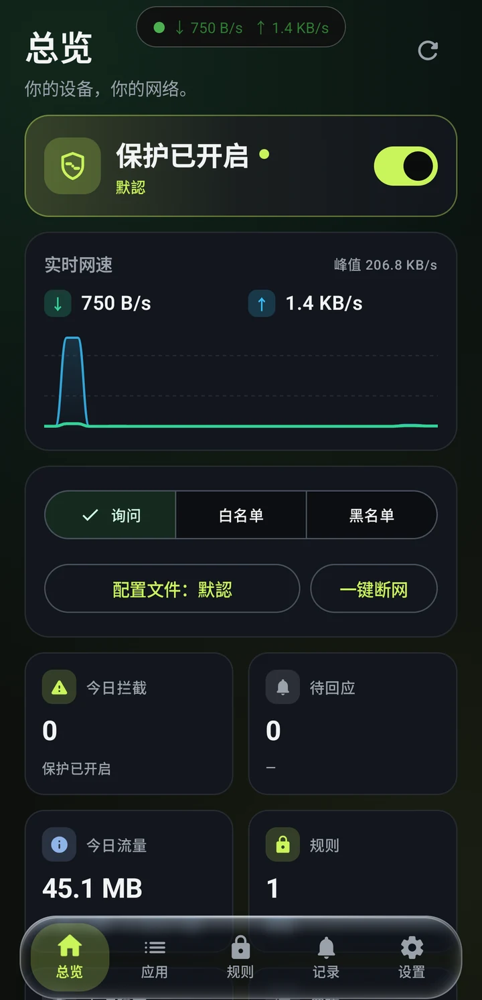
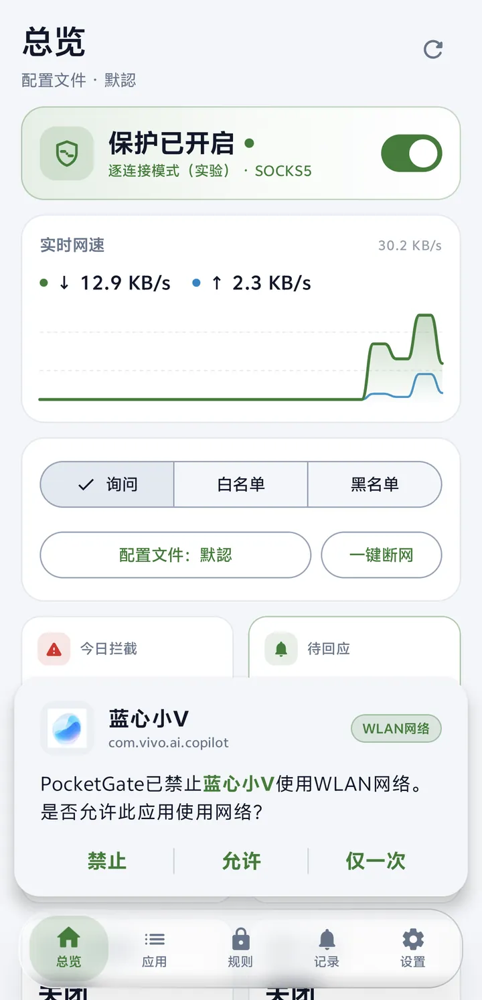
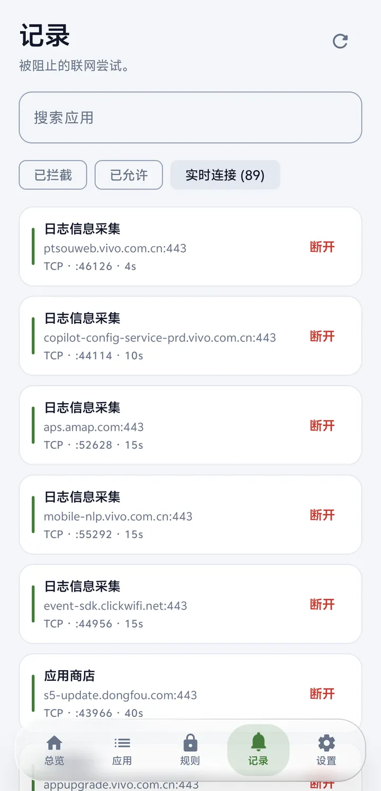
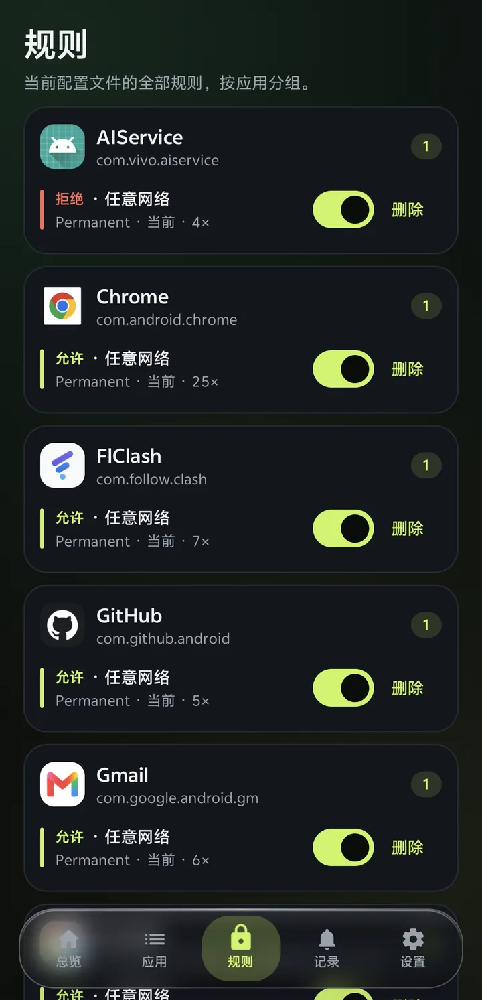
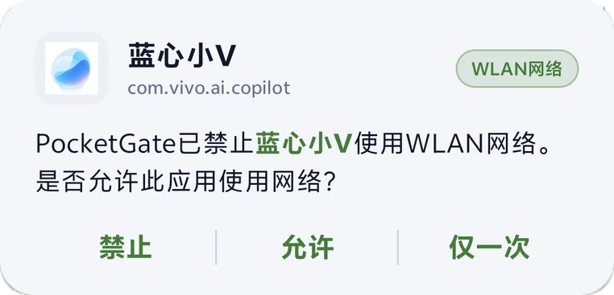
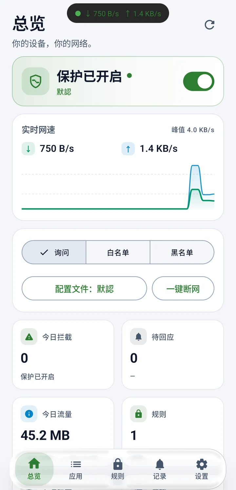
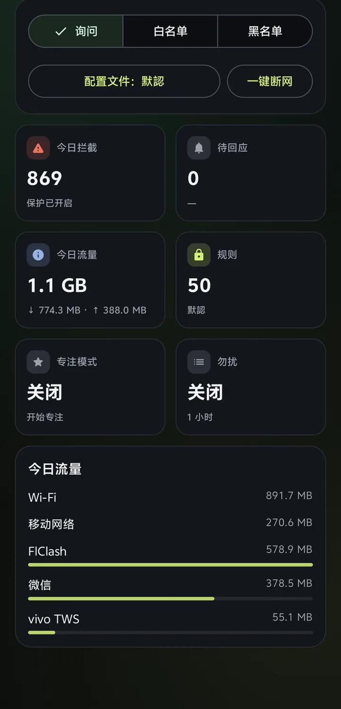
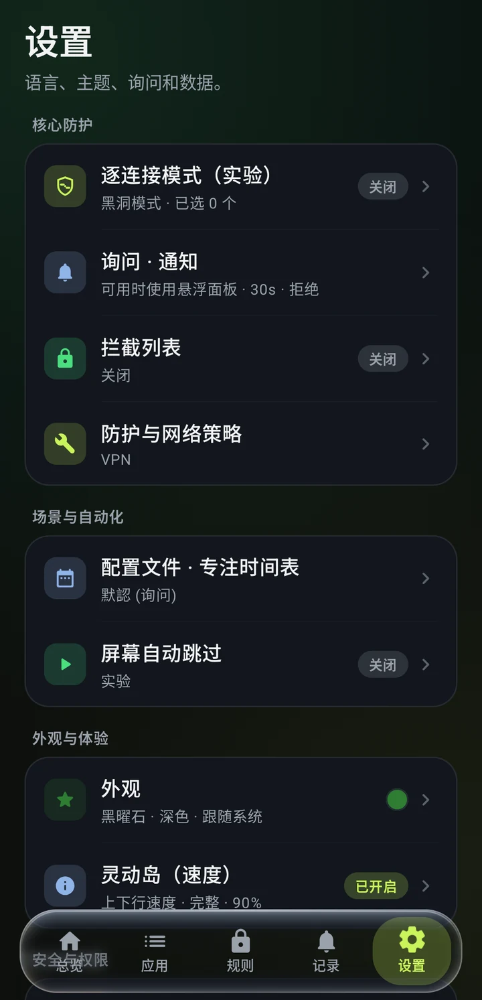
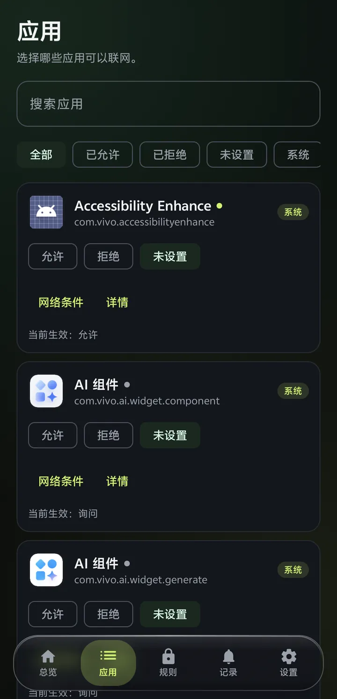
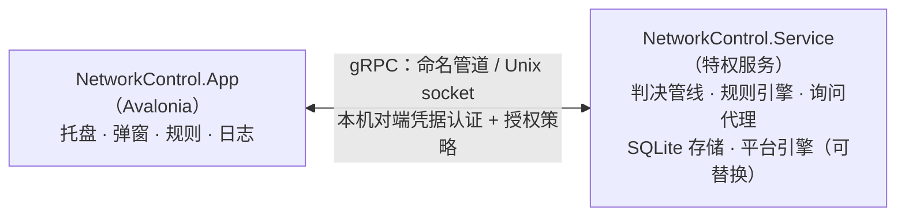

<div align="center">


# PocketGate

**简体中文** · [繁體中文](README.zh-TW.md) · [English](README.en.md)

**每个应用第一次联网，都先问你。**

跨平台（Android / Windows）的按应用联网控制工具：应用首次联网时弹窗询问，<br>
规则精确到域名、IP 与端口，全程在本机运行，不收集任何数据。

[](https://github.com/Barryyue/PocketGate/releases)
[](https://github.com/Barryyue/PocketGate/releases)
[](LICENSE)
[](#android-版)
[](#隐私)

[下载](https://github.com/Barryyue/PocketGate/releases) ·
[Gitee 镜像](https://gitee.com/yuexiaobai/PocketGate) ·
[Android 版介绍](site/android.html) ·
[产品首页](site/index.html) ·
[文档](#文档)

<br>

&nbsp;
&nbsp;
&nbsp;


<sub>以上为 Android 版真机截图（vivo，Android 17）</sub>

</div>

---

## 为什么需要它

系统防火墙只挡**入站**连接，从不过问应用要往外连到哪里。PocketGate 补上这一层：

- **先问再放行**：新应用第一次联网时先被拦下，由你决定允许、拒绝还是仅此一次。
- **看得见**：每一条连接来自哪个应用、连到哪里、持续多久，都列得清清楚楚；系统自带的数据收集也无所遁形。
- **只在本机**：没有账号、没有服务器、没有分析 SDK；Android 版连自己的检查更新都可以关掉。

---

## Android 版

> Kotlin + Jetpack Compose 原生开发 · Android 10+ · `arm64-v8a` · 安装包约 5.6 MB · 免 Root

### 联网的那一刻，问你一次



- 正在使用的应用联网时，询问直接浮在它上面；在 PocketGate 里显示为页内卡片；锁屏时改发通知，通知按钮可以直接回答。
- 允许或拒绝都能选时效：**仅一次**（离开应用后自动收回）、限时、永久；同一应用的多条连接合并成一条询问。
- 悬浮询问需要「悬浮窗」与「使用情况访问」两项权限，缺一项会改用通知询问。

### 两种拦截引擎

| | 黑洞模式（默认） | 逐连接模式 |
|---|---|---|
| 原理 | 被拒绝的应用进入 VPN 后直接丢弃 | 所有流量经本机 `hev-socks5-tunnel` 转发，每条连接单独判决 |
| 粒度 | 按应用 | 按应用 + 域名 + 地址 + 端口 + 协议 |
| 出口 | — | 内置直连出口，或标准本地 SOCKS5 端口（用于抓包调试或上游串联） |
| 特点 | 最省电，被允许的应用完全不经过 PocketGate | 实时连接列表、一键双向 RST 中断、DNS 防绕过、QUIC 也能按域名判决 |

### 功能一览

| 防护 | 场景 | 体验 |
|---|---|---|
| 5 种全局模式：询问 / 白名单 / 黑名单 / 全部阻断 / 停用 | 专注模式与时间表：只留几个应用连接 | 6 套视觉主题，含 Android 12+ 系统取色 |
| 7 份公开拦截清单 + 追踪器识别，支持自定义订阅 | 按网络类型、Wi-Fi SSID、SIM 卡自动切换配置文件 | Bento 总览仪表盘、实时网速波形、流量排行 |
| 实时活跃连接，一键中断 | 锁屏断网，只放行白名单应用 | 灵动岛与状态栏原生网速图标 |
| 外部代理三段诊断（端口 / 握手验证 / 外网） | 应用分身沿用主应用规则，或独立管控 | 4 款桌面小部件、快速设置磁贴、应用快捷方式 |
| 应用锁：修改规则前验证系统锁屏 | 勿扰与每日摘要 | Android 16 实时活动通知（Live Updates） |
| 纯离线模式：PocketGate 自己绝不联网 | WebDAV 端到端加密同步（PBKDF2 + AES-256-GCM） | 应用内自动更新，GitHub / Gitee / 镜像自动择优 |

### 六套主题

&nbsp;
&nbsp;
&nbsp;


黑曜石极客 · 经典 · 极简霜白 · 极光流光 · 纯黑省电 · 系统取色，跟随系统深浅色自动切换。

### 下载与安装

1. 到 [GitHub Releases](https://github.com/Barryyue/PocketGate/releases) 或 [Gitee Releases](https://gitee.com/yuexiaobai/PocketGate/releases) 下载 `PocketGate-<版本>.apk`。
   - 标签 `v*` 是本页介绍的 Kotlin 版（**推荐下载版本**）；`atomui-v*` 是实验性的 .NET + Avalonia 版本（**实验版本**，见下文）。
2. 允许浏览器或文件管理器「安装未知应用」，安装后按首次引导授权 VPN 与通知即可开始。
3. **从 0.14 或更早版本升级**：0.15.0 起改用正式签名，无法直接覆盖安装。请先在「设置」导出规则，卸载旧版，装好新版后再导入。
4. 系统同一时间只允许一个本地虚拟网卡接口。如需串联本地抓包或网络调试工具，请关闭其虚拟网卡模式，并在 PocketGate 的逐连接模式里将出口设为对应本地 SOCKS5 端口。

之后的版本，应用会自己提示更新。构建方法见 [android-kotlin/README.md](android-kotlin/README.md)。

---

## Windows 版

> .NET 10 · Avalonia 12 + AtomUI · 用户态 WFP · Windows 10 1809+ / 11 · x64、ARM64

目前是 **0.3.0 试用版**：先阻断再询问，规则模型、询问时效与日志和 Android 版一致；提供安装程序与便携版，可以从托盘一键断网。



---

## 隐私

- 不收集任何遥测，没有分析或统计 SDK。
- 规则、日志都存在本机 SQLite；WebDAV 同步时先在本机加密，服务器只看得到密文。
- 只有 VPN 授权（Android）或服务权限（Windows）是必要的，其余权限都可选，用途在应用内的权限检查里逐项说明。
- PocketGate 自己主动联网的只有检查更新与下载拦截清单；Android 版打开「纯离线模式」后连这两件事也不做。

---

## 项目结构

| 目录 | 说明 |
|---|---|
| `android-kotlin/` | **Android 版（推荐下载版本）**（Kotlin + Jetpack Compose + hev-socks5-tunnel），独立 Gradle 项目 |
| `src/NetworkControl.Core` | 平台无关核心：领域模型、规则引擎、判决管线、询问代理 |
| `src/NetworkControl.Storage` | SQLite 存储（`config.db` / `activity.db`）与迁移 |
| `src/NetworkControl.Ipc` | `.proto` 契约、IPC 端点、诊断包工具 |
| `src/NetworkControl.Service` | Windows 服务宿主：本机 IPC、gRPC 服务、引擎装配 |
| `src/NetworkControl.Engine.Windows` | Windows 用户态 WFP 引擎 |
| `src/NetworkControl.App` | 桌面界面：Avalonia 12 + AtomUI，三语与托盘弹窗 |
| `src/NetworkControl.App.Android` 等 | Android 的 .NET + Avalonia 实现（AtomUI 版，**实验版本**），与桌面共用核心，用于技术选型对照 |
| `site/` | 产品介绍页：[首页](site/index.html)、[Android 版](site/android.html)（三语、深浅主题） |

## 开发

```bash
# 桌面版（需要 .NET SDK 10.0.400+）
dotnet build NetworkControl.slnx
dotnet test --solution NetworkControl.slnx
dotnet run --project src/NetworkControl.App      # 调试构建会自动拉起使用模拟引擎的开发服务
```

```powershell
# Android 版（Kotlin）
.\scripts\android-kotlin.ps1 test      # 单元测试
.\scripts\android-kotlin.ps1 build     # Debug APK
.\scripts\android-kotlin.ps1 publish   # Release APK，输出到 artifacts\kotlin-android\
```

## 文档

- [开发指南](docs/development.md)：本地运行、扩展点、编码约定
- [需求规格](docs/requirements.md) · [设计实现](docs/design.md) · [进度看板](docs/progress.md)
- [Android Kotlin 版计划与状态](docs/android-kotlin.md) · [功能完成记录](docs/kotlin-feature-log.md)
- [AGENTS.md](AGENTS.md)：AI 编码助手共用的工作指南

## 开源协议

本项目以 [GNU General Public License v3.0](LICENSE) 协议发布。
