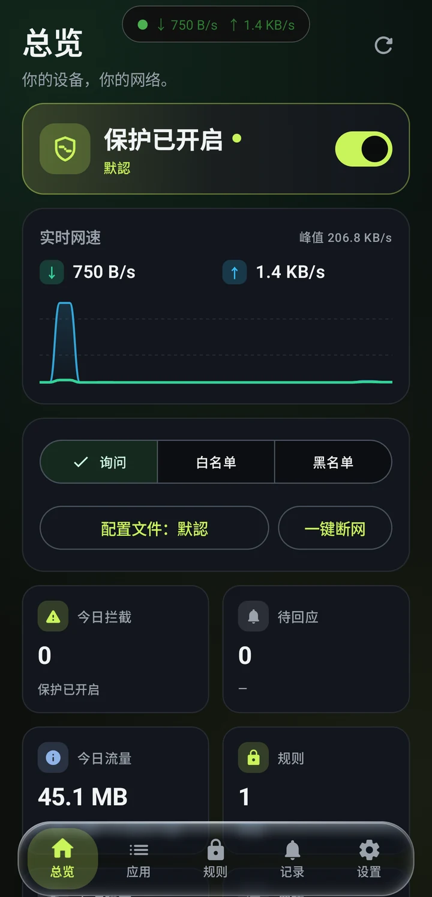
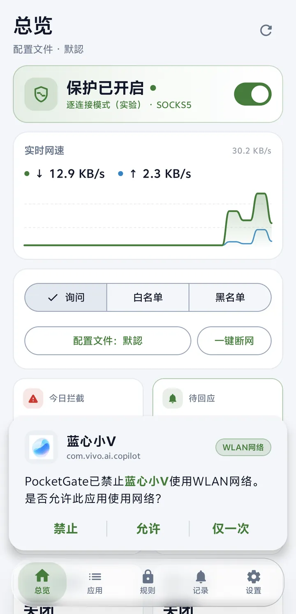
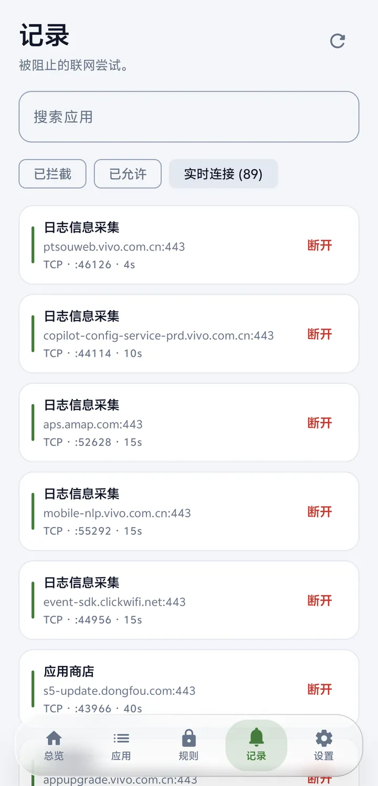
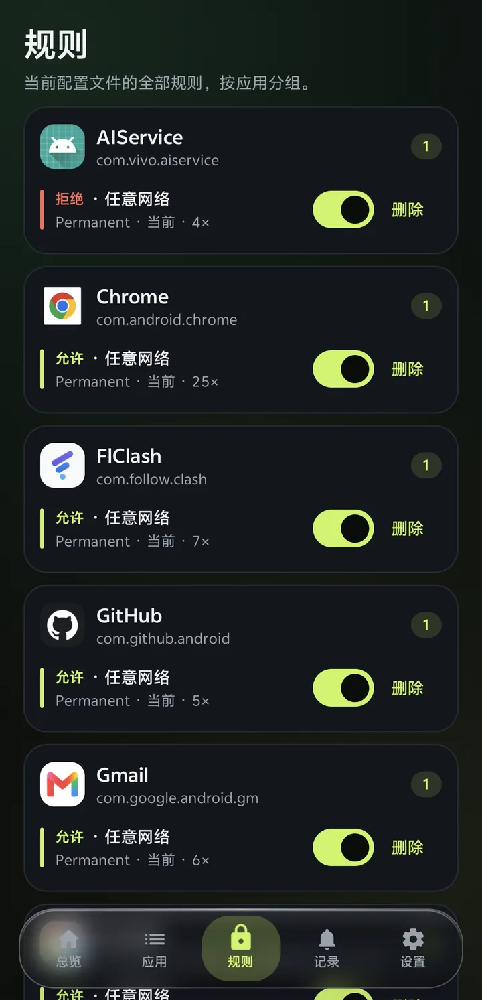
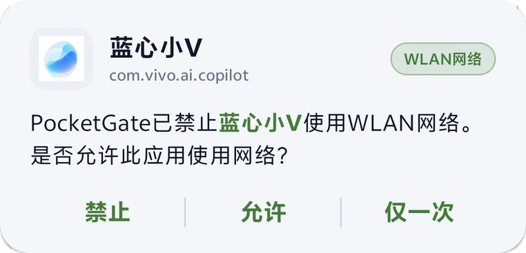
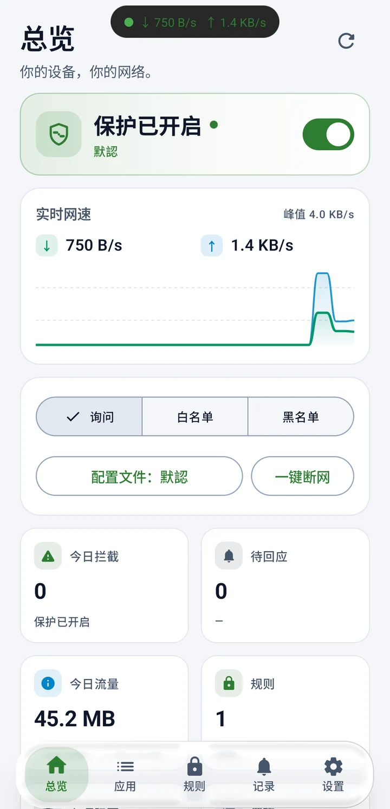
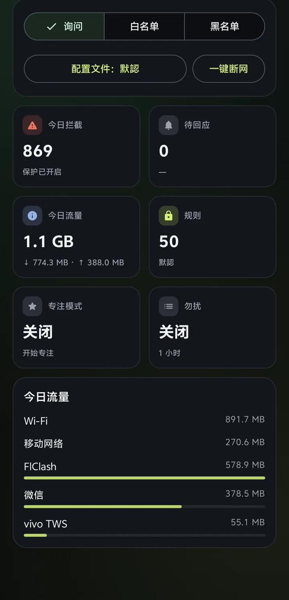
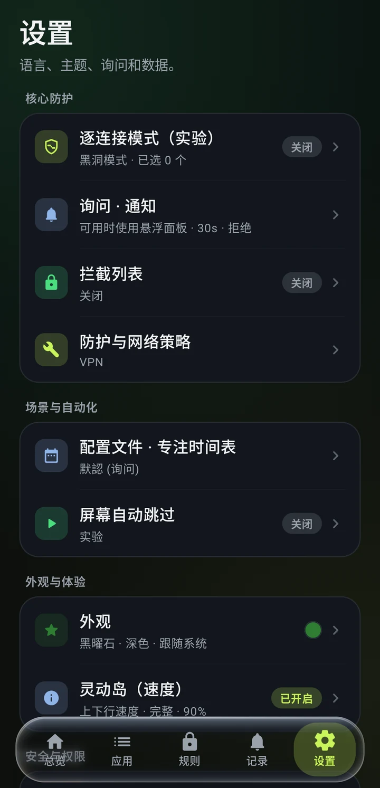
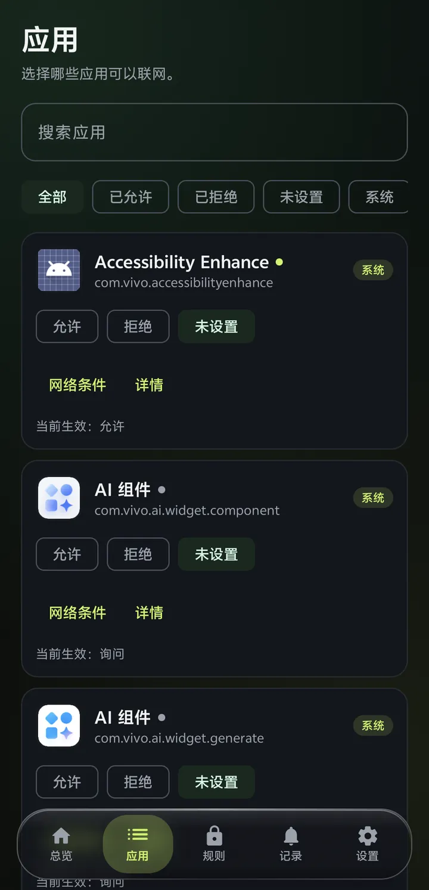
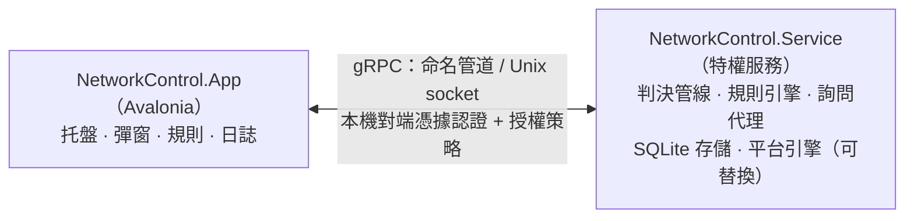

<div align="center">


# PocketGate

[简体中文](README.md) · **繁體中文** · [English](README.en.md)

**每個應用第一次聯網，都先問你。**

跨平台（Android / Windows）的按應用聯網控制工具：應用首次聯網時彈窗詢問，<br>
規則精確到網域、IP 與埠，全程在本機執行，不收集任何資料。

[](https://github.com/Barryyue/PocketGate/releases)
[](https://github.com/Barryyue/PocketGate/releases)
[](LICENSE)
[](#android-版)
[](#隱私)

[下載](https://github.com/Barryyue/PocketGate/releases) ·
[Gitee 鏡像](https://gitee.com/yuexiaobai/PocketGate) ·
[Android 版介紹](site/android.html) ·
[產品首頁](site/index.html) ·
[文檔](#文檔)

<br>

&nbsp;
&nbsp;
&nbsp;


<sub>以上為 Android 版真機截圖（vivo，Android 17）</sub>

</div>

---

## 為什麼需要它

系統防火牆只擋**入站**連線，從不過問應用要往外連到哪裡。PocketGate 補上這一層：

- **先問再放行**：新應用第一次聯網時先被攔下，由你決定允許、拒絕還是僅此一次。
- **看得見**：每一條連線來自哪個應用、連到哪裡、持續多久，都列得清清楚楚；系統自帶的資料收集也無所遁形。
- **只在本機**：沒有帳號、沒有伺服器、沒有分析 SDK；Android 版連自己的檢查更新都可以關掉。

---

## Android 版

> Kotlin + Jetpack Compose 原生開發 · Android 10+ · `arm64-v8a` · 安裝檔約 5.6 MB · 免 Root

### 聯網的那一刻，問你一次



- 正在使用的應用聯網時，詢問直接浮在它上面；在 PocketGate 裡顯示為頁內卡片；鎖屏時改發通知，通知按鈕可以直接回答。
- 允許或拒絕都能選時效：**僅一次**（離開應用後自動收回）、限時、永久；同一應用的多條連線合併成一則詢問。
- 懸浮詢問需要「懸浮窗」與「使用情況訪問」兩項權限，缺一項會改用通知詢問。

### 兩種攔截引擎

| | 黑洞模式（預設） | 逐連線模式 |
|---|---|---|
| 原理 | 被拒絕的應用進入 VPN 後直接丟棄 | 所有流量經本機 `hev-socks5-tunnel` 轉送，每條連線單獨判決 |
| 粒度 | 依應用 | 依應用 + 網域 + 位址 + 埠 + 協定 |
| 出口 | — | 內建直連出口，或標準本機 SOCKS5 連接埠（用於抓包除錯或上游串聯） |
| 特點 | 最省電，被允許的應用完全不經過 PocketGate | 即時連線檢視、一鍵雙向 RST 中斷、DNS 防繞過、QUIC 也能依網域判決 |

### 功能一覽

| 防護 | 情境 | 體驗 |
|---|---|---|
| 5 種全域模式：詢問 / 白名單 / 黑名單 / 全部封鎖 / 停用 | 專注模式與時間表：只留幾個應用連線 | 6 套視覺主題，含 Android 12+ 系統取色 |
| 7 份公開攔截清單 + 追蹤器識別，支援自訂訂閱 | 依網路類型、Wi-Fi SSID、SIM 卡自動切換設定檔 | Bento 總覽儀表板、即時網速波形、流量排行 |
| 即時活躍連線，一鍵中斷 | 鎖定時斷網，只放行白名單應用 | 靈動島與狀態列原生網速圖示 |
| 外部代理三段診斷（埠 / 交握驗證 / 外網） | 應用程式分身沿用主應用規則，或獨立管控 | 4 款桌面小工具、快速設定方塊、應用捷徑 |
| 應用程式鎖：修改規則前驗證系統螢幕鎖 | 勿擾與每日摘要 | Android 16 實時活動通知（Live Updates） |
| 純離線模式：PocketGate 自己絕不聯網 | WebDAV 端對端加密同步（PBKDF2 + AES-256-GCM） | 應用程式內自動更新，GitHub / Gitee / 鏡像自動擇優 |

### 六套主題

&nbsp;
&nbsp;
&nbsp;


黑曜石極客 · 經典 · 極簡霜白 · 極光流光 · 純黑省電 · 系統取色，跟隨系統深淺色自動切換。

### 下載與安裝

1. 到 [GitHub Releases](https://github.com/Barryyue/PocketGate/releases) 或 [Gitee Releases](https://gitee.com/yuexiaobai/PocketGate/releases) 下載 `PocketGate-<版本>.apk`。
   - 標籤 `v*` 是本頁介紹的 Kotlin 版（**推薦下載版本**）；`atomui-v*` 是實驗性的 .NET + Avalonia 版本（**實驗版本**，見下文）。
2. 允許瀏覽器或檔案管理員「安裝不明應用程式」，安裝後依首次引導授權 VPN 與通知即可開始。
3. **從 0.14 或更早版本升級**：0.15.0 起改用正式簽章，無法直接覆蓋安裝。請先在「設定」匯出規則，解除安裝舊版，裝好新版後再匯入。
4. 系統同一時間只允許一個本機虛擬網卡介面。如需串聯本機抓包或網路除錯工具，請關閉其虛擬網卡模式，並在 PocketGate 的逐連線模式裡將出口設為對應本機 SOCKS5 連接埠。

之後的版本，應用程式會自己提示更新。構建方法見 [android-kotlin/README.md](android-kotlin/README.md)。

---

## Windows 版

> .NET 10 · Avalonia 12 + AtomUI · 使用者態 WFP · Windows 10 1809+ / 11 · x64、ARM64

目前是 **0.3.0 試用版**：先阻斷再詢問，規則模型、詢問時效與日誌和 Android 版一致；提供安裝程式與可攜版，可以從托盤一鍵斷網。



---

## 隱私

- 不收集任何遙測，沒有分析或統計 SDK。
- 規則、日誌都存在本機 SQLite；WebDAV 同步時先在本機加密，伺服器只看得到密文。
- 只有 VPN 授權（Android）或服務權限（Windows）是必要的，其餘權限都可選，用途在應用內的權限檢查裡逐項說明。
- PocketGate 自己主動聯網的只有檢查更新與下載攔截清單；Android 版開啟「純離線模式」後連這兩件事也不做。

---

## 專案結構

| 目錄 | 說明 |
|---|---|
| `android-kotlin/` | **Android 版（推薦下載版本）**（Kotlin + Jetpack Compose + hev-socks5-tunnel），獨立 Gradle 專案 |
| `src/NetworkControl.Core` | 平台無關核心：領域模型、規則引擎、判決管線、詢問代理 |
| `src/NetworkControl.Storage` | SQLite 存儲（`config.db` / `activity.db`）與遷移 |
| `src/NetworkControl.Ipc` | `.proto` 契約、IPC 端點、診斷包工具 |
| `src/NetworkControl.Service` | Windows 服務宿主：本機 IPC、gRPC 服務、引擎裝配 |
| `src/NetworkControl.Engine.Windows` | Windows 使用者態 WFP 引擎 |
| `src/NetworkControl.App` | 桌面介面：Avalonia 12 + AtomUI，三語與托盤彈窗 |
| `src/NetworkControl.App.Android` 等 | Android 的 .NET + Avalonia 實作（AtomUI 版，**實驗版本**），與桌面共用核心，用於技術選型對照 |
| `site/` | 產品介紹頁：[首頁](site/index.html)、[Android 版](site/android.html)（三語、深淺主題） |

## 開發

```bash
# 桌面版（需要 .NET SDK 10.0.400+）
dotnet build NetworkControl.slnx
dotnet test --solution NetworkControl.slnx
dotnet run --project src/NetworkControl.App      # 調試構建會自動拉起使用模擬引擎的開發服務
```

```powershell
# Android 版（Kotlin）
.\scripts\android-kotlin.ps1 test      # 單元測試
.\scripts\android-kotlin.ps1 build     # Debug APK
.\scripts\android-kotlin.ps1 publish   # Release APK，輸出到 artifacts\kotlin-android\
```

## 文檔

- [開發指南](docs/development.md)：本地執行、擴展點、編碼約定
- [需求規格](docs/requirements.md) · [設計實現](docs/design.md) · [進度看板](docs/progress.md)
- [Android Kotlin 版計劃與狀態](docs/android-kotlin.md) · [功能完成記錄](docs/kotlin-feature-log.md)
- [AGENTS.md](AGENTS.md)：AI 編碼助手共用的工作指南

## 開源協議

本專案以 [GNU General Public License v3.0](LICENSE) 授權發布。
