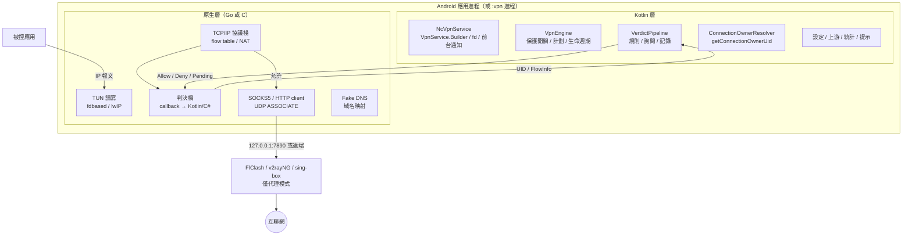

# Android 轉發模式與上游代理預研

> 狀態：研究完成，等待 Phase 0 真機 spike 驗證；本文不修改任何代碼。
> 日期：2026-11-15
> 範圍：Android（Kotlin 版為主，Avalonia/.NET 版為輔）的「所有流量進入虛擬網卡 → 用戶態 TCP/IP 協議棧 → 判決 → 轉發到本機 SOCKS5/HTTP 上游代理」。
> 相關文檔：[android.md](android.md) §3.3、§5.6；[android-kotlin.md](android-kotlin.md)；[progress-android.md](progress-android.md)「中期主線：轉發模式 + 上游代理」；[design.md](design.md) §22。
> 查證方式：GitHub 倉庫 metadata / LICENSE / README / 源碼（2026-11-15）；Android 官方 API 文檔；公開 benchmark。**凡是查不到或只在桌面環境測過的，文中明確標「待查證」或「待真機」。**

---

## 0. 結論摘要

1. **值得做，但不要直接排進下一個版本。** 轉發模式是 Android 版從「按應用黑名單」升級為「完整按連線控制」的唯一可行路徑，也是與 FlClash / v2rayNG / sing-box 等「僅代理模式」共存的關鍵。代價是要引入並長期維護一個用戶態 TCP/IP 協議棧，工作量以「月」計，不是普通功能。
2. **先做 3–5 天的 Phase 0 spike，再決定是否投入。** 用同一台真機、同一個本機 SOCKS5 上游，分別驗證 gVisor/Go 與 hev/C 兩條路線的 TCP 吞吐、UDP、DNS、環路、耗電與整合成本。spike 不進主線，結論寫回本文。
3. **首選架構：gVisor netstack（Go）+ 自寫薄轉發層。** 原因不是效能最好，而是它提供了**現成的判決插入點**：`tcp.Forwarder` 明確允許「忽略、回 RST、或完成三次握手」，`udp.Forwarder` 也是同一模式；這正好對應「每條新連線先判決、允許才轉發」。Android 上已有 Tailscale、RethinkDNS/firestack 等先例。
4. **備選：hev-socks5-tunnel（C/lwIP）fork。** 它是最快出 MVP 的路線：官方 Android JNI、TCP/UDP fullcone、`mapdns` 可把域名傳給 SOCKS5；但 JNI 只暴露 start/stop/stats，**沒有 per-flow 判決回調**，必須改 C；`mapdns` 目前 IPv4-only（見 §1.3）。
5. **不建議直接使用**：go-tun2socks（已歸檔）、badvpn（已歸檔、TCP-only）、sing-box / NetGuard（GPL，不能閉源嵌入）。smoltcp / leaf 列為觀察與長期共用核心候選，不作為第一版。
6. **黑洞模式保留為默認「省電模式」。** 轉發模式是可選的「進階模式」；兩者共用同一套規則、判決管線、詢問與存儲。轉發模式不可用或上游失效時，必須有明確的降級與提示，不能默默直連。

**Go / No-Go 門檻（Phase 0 結束時）**：真機上 TCP 單流 ≥ 100 Mbps（本機 SOCKS5、Wi-Fi 5/6）、待機耗電 ≤ 2%/h、UDP/QUIC 可用、FlClash 僅代理模式可搭配、無環路、1 小時無崩潰。任何一項明顯不達標，就暫緩轉發模式，先做黑洞模式能做的改進。

---

## 1. 候選協議棧 / 轉發庫

### 1.1 評估維度

| 維度 | 說明 |
|---|---|
| 語言與授權 | 能否閉源嵌入；GPL / MPL 的義務；是否有專利授權 |
| Android 可用性 | 是否有 JNI / AAR / NDK 構建；是否已有 Android 先例；arm64 / 16 KB page |
| TCP / UDP | 是否支援完整 TCP 狀態機、IPv4/IPv6、UDP、ICMP；UDP 是否可 fullcone |
| 判決插入 | 能否在「新連線建立、但尚未轉發」時插入回調；是否容易回 RST / ICMP |
| 域名傳遞 | 是否有 fake DNS / 域名映射；能否把域名而不是 IP 傳給 SOCKS5/HTTP |
| 效能 / 耗電 | 有無公開數據；是否適合手機單一 TUN 佇列；記憶體與 GC |
| JNI 整合 | 需要多少 C/Go/Rust 膠水；是否能在 ndk-build / CMake / gomobile 中構建 |
| 維護狀態 | 最近提交、是否歸檔、issue 活躍度、API 穩定度 |

> **重要限制**：本節的吞吐數字幾乎都來自 x86 桌面或開發板，**不能直接當成手機數字**。Android 的 `VpnService` 只有一個 TUN fd、單一佇列，且要經過 Java/Kotlin 與原生邊界；真機數字必須在 Phase 0/4 量測。

### 1.2 事實對照表（查證日 2026-11-15）

| 方案 | 語言 | 授權 | Android 整合 | TCP / UDP | 最近維護 | 備註 |
|---|---|---|---|---|---|---|
| **gVisor netstack**（`pkg/tcpip`） | Go | Apache-2.0 | 無官方 Android artifact；可用 gomobile / c-shared + NDK 自行構建 | 完整 TCP、UDP、ICMP、IPv4/IPv6；`tcp.Forwarder` / `udp.Forwarder` | 2026-11-14 仍有提交 | 原始目標是容器 runtime，但 `pkg/tcpip` 可獨立使用 |
| **xjasonlyu/tun2socks** | Go | MIT | 無 JNI；CLI/daemon；可參考其 forwarder | gVisor；HTTP/SOCKS/SS/SSH；TCP/UDP | 2026-10-29 | 不是嵌入式庫；沒有 per-flow 判決 API |
| **wireguard-go `tun/netstack`** | Go | MIT | 無 JNI；Go 套件 | gVisor；TCP/UDP；主要給 WireGuard | 2026-10-24 | 可作 gVisor 使用範例，沒有判決回調 |
| **smoltcp** | Rust | 0BSD | 無官方 JNI；`cdylib` + NDK；leaf 的 `netstack-smoltcp` 是參考 | TCP/UDP/IPv4/IPv6；SACK、timestamp、PLPMTUD **未實現** | 2026-11-13 | 記憶體足跡小、無 GC；要自己寫 tun2socks/NAT/SOCKS5 |
| **leaf** | Rust | Apache-2.0 | 有 `scripts/build_android.sh`、`leaf-ffi`（C ABI）、mobile bindings | TUN inbound（lwip / smoltcp）、TCP/UDP、fake DNS、dispatcher | 2026-11-14 | 完整代理框架；FFI 是 config-driven，沒有現成 per-UID 判決回調 |
| **hev-socks5-tunnel** | C + lwIP | MIT（含 lwIP BSD-3 等第三方） | **官方 ndk-build + JNI**（`hev-jni.c`） | TCP/UDP fullcone、UDP-in-UDP/TCP、IPv4/IPv6、可選 ICMP echo | 2026-11-13 | JNI 只有 start/stop/isRunning/getStats；`mapdns` 域名映射 |
| **go-tun2socks** | Go | MIT | 曾有行動端綁定；已歸檔 | gVisor；TCP/UDP | **2021-02-01 歸檔** | README 自己推薦 leaf；不建議 |
| **badvpn tun2socks** | C | BSD-3-Clause | 無 Android JNI；已歸檔 | **tun2socks 只代理 TCP**；UDP 需另開 `udpgw` | **2021-08-22 歸檔** | 舊、TCP-only、無域名映射 |
| **sing-box** | Go | GPL-3.0 + 附加條款 | 有 Android 版；TUN/gVisor/fakeip/sniff | 完整 | 2026-11-14 | 授權不適合閉源嵌入；可作使用者自行安裝的上游 |
| **NetGuard** | Java + C | GPL-3.0 | 完整 Android VpnService | 自有 C 棧；SOCKS5 **TCP**；UDP 不經 SOCKS5 | 2026-08-01 | 架構參考（per-address JNI 判決），不能直接挪用 |
| **RethinkDNS / firestack** | Kotlin + Go | App Apache-2.0；firestack MPL-2.0 | 完整 Android VpnService + Go JNI | Go 用戶態棧（gVisor 系）；SOCKS5/HTTP/WireGuard；防火牆 | 2026-11-09 / 2026-10-25 | 最接近本專案目標的參考；MPL 檔案級 copyleft |
| **sockstun** | Java | MIT | 完整 Android VpnService + hev JNI；`:native` 進程 | TCP/UDP、IPv4/IPv6、global/per-app | 2026-11-06 | 管線與 FGS 配置參考；**沒有判決點** |
| **lwIP** | C | BSD-3-Clause | NDK 可構建 | TCP/UDP/IPv4/IPv6；可裁剪 | 2026-11-08 | 成熟輕量；要自己寫 SOCKS5/判決 |

#### 1.2.1 工程評估（主觀評分，1=差、5=好）

| 方案 | 效能 | 耗電/記憶體 | JNI/整合 | 判決插入 | 域名 / UDP | 維護 | 總評 |
|---|---:|---:|---:|---:|---:|---:|---|
| gVisor netstack | 4 | 3 | 3 | 5 | 3 / 5 | 5 | 首選 |
| hev-socks5-tunnel | 5 | 5 | 5 | 2 | 4 / 5 | 4 | 備選/加速 |
| smoltcp | 4 | 5 | 2 | 5 | 3 / 4 | 4 | 觀察 |
| leaf | 4 | 4 | 3 | 3 | 5 / 4 | 5 | 觀察 |
| xjasonlyu/tun2socks | 4 | 3 | 2 | 1 | 3 / 4 | 5 | 參考 |
| wireguard-go netstack | 4 | 3 | 2 | 1 | 2 / 4 | 5 | 參考 |
| go-tun2socks | 2 | 3 | 3 | 2 | 2 / 3 | 1 | 不選 |
| badvpn | 2 | 4 | 1 | 2 | 1 / 2 | 1 | 不選 |
| sing-box | 4 | 3 | 1 | 4 | 5 / 5 | 5 | 不嵌入（GPL） |
| NetGuard | 3 | 4 | 1 | 3 | 2 / 3 | 3 | 參考（GPL） |
| RethinkDNS/firestack | 4 | 3 | 2 | 4 | 4 / 4 | 4 | 參考（Apache/MPL） |

> 評分是工程判斷，不是 benchmark；「判決插入」指是否能在新連線轉發前插入每條 flow 的回調；「域名/UDP」指現成能力，不代表整合後一定能用。真正的取捨以 Phase 0 真機數據為準。

### 1.3 關鍵方案分析

#### 1.3.1 gVisor netstack（推薦首選）

- **是什麼**：gVisor 的 `pkg/tcpip` 是以 Go 實作的用戶態 TCP/IP 棧，包含 `stack`、`tcp`、`udp`、`ipv4`、`ipv6`、`gonet` 等套件。它不依賴 Linux 核心網路，只要給它一個 link endpoint（例如 `pkg/tcpip/link/fdbased` 接 TUN fd，或 `channel` 接記憶體佇列）就能跑。
- **判決點**：`tcp.Forwarder` 的註釋直接寫明「client 可以決定 ignore、send a RST、或 attempt to complete the 3-way handshake」。`ForwarderRequest` 提供 `ID()`（四元組）、`Complete(sendReset)`、`CreateEndpoint(queue)`。這正好是「先判決，允許才完成握手並轉發」的 API，不需要自己在 TCP 狀態機裡找插入點。
- **UDP**：`udp.Forwarder` 對每個新 UDP 會話給 `ForwarderRequest`；`CreateEndpoint` 建立已 connect 的 UDP endpoint。注意：**UDP forwarder 的 handler 在協議棧的封包執行路徑上同步呼叫**，不能在裡面等待使用者；要丟到 worker 佇列，先回傳 `true`，判決後再建立 endpoint/轉發（見 §2.4）。
- **Android 先例**：Tailscale 的 `wgengine/netstack` 使用 gVisor netstack；RethinkDNS 的 `GoVpnAdapter` 使用 `com.celzero.firestack`（Go 用戶態棧）；xjasonlyu/tun2socks 也是 gVisor。這些證明「Go 用戶態棧在 Android 上可跑」，但**具體整合路徑與 gomobile/NDK 構建在我們的工具鏈上仍需 spike 驗證**（arm64、16 KB page、JNI 回調、崩潰行為）。
- **缺點**：Go runtime 會增加 APK 體積與記憶體；GC 與 goroutine 排程對延遲/耗電的影響待真機；`pkg/tcpip` 不是穩定 API，升級 gVisor 可能破壞整合；沒有內建 fake DNS 或 SOCKS5 client，要自己寫。
- **適合**：想要完整控制、可插入判決、支援 UDP/IPv6、能接受 Go 體積與維護成本。

#### 1.3.2 hev-socks5-tunnel（最快 MVP 的備選）

- **是什麼**：C + lwIP 的 tun2socks，官方支援 Android ndk-build，`src/hev-jni.c` 提供 `TProxyStartService(configPath, fd)`、`TProxyStopService()`、`TProxyIsRunning()`、`TProxyGetStats()`。
- **最強項**：在低功耗 ARM 開發板（RK3399，兩個大核、1 Gbps 網卡）的公開測試中，hev 是唯一能幾乎跑滿 1 Gbps 且 CPU 使用最少的方案（[hev 博客](https://hev.cc/posts/2023/benchmarking-of-tun2socks-on-rk3399/)）；桌面多佇列測試更達到 60 Gbps 級別。C/lwIP 的記憶體足跡也小（桌面單流約 2.6 MB RSS，見其 wiki benchmark）。
- **UDP**：支援 UDP fullcone、UDP-in-UDP、UDP-in-TCP，對 QUIC/遊戲/語音友善。
- **域名**：`mapdns` 可攔截發往 `mapdns.address` 的 IPv4 DNS，為域名分配映射網段中的假 IP，並在 SOCKS5 目標使用域名。`sockstun` 的設定用 `network: 240.0.0.0`、`netmask: 240.0.0.0`，避開常見的 `198.18.0.0/15` fake-ip 網段。注意它**只處理發往該地址的查詢**；硬編碼 `8.8.8.8` 的應用會繞過，需要額外攔截（或接受只能按 IP 控制）。
- **致命缺點**：**沒有 per-flow 判決回調**。JNI 只暴露全域 start/stop/stats；它會把 TUN 裡的所有 TCP/UDP 直接送到 SOCKS5。要插入「這條連線屬於哪個 UID、是否允許」的判斷，只能：
  1. fork 源碼，在 `hev_socks5_session_tcp_construct` / UDP 會話建立前加 callback（MIT 允許）；或
  2. 在它前面再包一層自寫的過濾器（等於自己處理 TCP 狀態，並不省事）。
- **其他風險**：`mapdns` 目前 **IPv4-only**；2026-05 的 issue「no AAAA synthesis / no IPv6-addressed mapdns handling」仍 open；2026-09 曾有「真實 IP 被誤映射到域名」的 issue（已 closed，但使用前要確認版本包含網段檢查修正）。另外，`mapdns` 在 multi-queue 模式下會被停用（Android 單佇列不受影響）。
- **適合**：Phase 0 對照組、想要最快看到 TCP/UDP 轉發效果、能接受 fork 與 C 維護。

#### 1.3.3 leaf / smoltcp（長期共用核心的觀察對象）

- **leaf**：Rust、Apache-2.0；TUN inbound 支援 lwip 與 smoltcp，內建 fake DNS、dispatcher、SOCKS5/HTTP/Shadowsocks 等 outbound；有 Android 構建腳本與 `leaf-ffi` C ABI。它的 `handle_inbound_stream_smoltcp` 已經在做「fake IP → domain → `SocksAddr::Domain`」的轉換，和我們要的「按域名轉發」非常接近。
- **但**：leaf 是完整代理框架，FFI 主要吃設定檔，沒有現成的「每條新連線回調 Kotlin/C# 做 UID 判決」介面；要嘛 fork，要嘛在 dispatcher 前加 hook。對本專案而言，整合 leaf 的成本不一定比 gVisor 低。
- **smoltcp**：0BSD、無 heap、Rust 記憶體安全；但 SACK、TCP timestamp、PLPMTUD 未實現，這些在行動網路（丟包、亂序、路徑 MTU 變化）上可能影響吞吐與穩定性；要自己寫 flow table、NAT、SOCKS5、fake DNS。適合「長期自研共用核心」，不適合第一版。
- **結論**：leaf 可作為 Rust 共用核心的候選；smoltcp 只作為 leaf 的底層或長期自研參考。

#### 1.3.4 不建議的方案

| 方案 | 原因 |
|---|---|
| **go-tun2socks** | 2021 年歸檔；README 自己推薦 leaf；效能較低；沒有維護。 |
| **badvpn** | 2021 年歸檔；tun2socks 只代理 TCP，UDP 要另開 udpgw；沒有 Android JNI。 |
| **sing-box** | GPL-3.0 + 附加條款，閉源嵌入會傳染；可作為使用者自行安裝的上游，不嵌入。 |
| **NetGuard** | GPL-3.0；C 層的 per-address 判決與 SOCKS5 TCP 值得參考，但不能直接複製代碼。 |
| **mihomo / Clash Meta** | 一般為 GPL-3.0（具體版本待查證）；不嵌入。 |
| **VpnService.Builder.setHttpProxy** | 只是一個 HTTP proxy 建議，應用可忽略；PAC 不支援；split tunnel 下通常不能正常工作（官方文檔）。不能用它來做本專案的分流/上游。 |

### 1.4 公開效能數據（僅供相對比較）

| 方案 | 測試環境 | 單流吞吐 | 記憶體 | 說明 |
|---|---|---|---|---|
| hev-socks5-tunnel 2.19.3 | Ryzen 9 7950X、MTU 8500、multi-queue | 60.4 Gbps 上傳 / 61.6 Gbps 下載 | 約 2.6 MB | 桌面；multi-queue 不適用 Android |
| sing-box 1.14.3 | 同上 | 23.9 / 20.8 Gbps | 約 84 MB | Go + gVisor |
| xjasonlyu/tun2socks v2.3.2 | i5-10500、MTU 9000 | 2.92 / 3.03 Gbps | 未記錄 | gVisor |
| badvpn 1.999.130 | 同上 | 674 Mbps / 2.88 Gbps | 未記錄 | TCP-only |
| go-tun2socks v1.16.11 | 同上 | 331 Mbps / 2.25 Gbps | 未記錄 | 已歸檔 |
| hev（RK3399） | 2 大核、1 Gbps 網卡 | 接近 1 Gbps | 低 | 最接近手機的公開數據 |

> 這些數字來自不同時間、不同硬件，**不能直接比較絕對值**。手機上的關鍵變數是：單一 TUN 佇列、JNI 邊界、CPU 大小核調度、散熱、螢幕/無線電喚醒。真機目標見 §5。

### 1.5 待查證清單

- [ ] gVisor `pkg/tcpip` 在 Android arm64 / 16 KB page 的 gomobile 或 c-shared 構建是否一次通過；Go 版本與 NDK 的相容性。
- [ ] gVisor `udp.Forwarder` 在「延後 `CreateEndpoint`」時，封包生命週期是否安全；若不行，需在 handler 內先建立 endpoint、暫緩轉發。
- [ ] hev fork 後，在 lwIP 協程中加入「等待使用者判決」的正確做法（`hev_task_sleep` + eventfd/pipe 喚醒），不能阻塞 lwIP timer。
- [ ] leaf 的 Android FFI 是否能接受 `VpnService` fd（源碼有 `settings.fd` / `raw_fd`，待實測）；是否能在不啟動完整 config 的情況下只跑 TUN inbound。
- [ ] 各方案在 Android 14/15/16/17、Pixel/Samsung/小米/華為上的實際耗電與吞吐。
- [ ] `mapdns` 在目前版本是否已包含 2026-09 的映射網段檢查修正；IPv6 AAAA 是否仍不支援。
- [ ] `VpnService.Builder.excludeRoute` 與 `addRoute("0.0.0.0", 0)` 同時使用時，各 OEM 的行為。
- [ ] 16 KB page 對 Go/C/Rust 原生庫的具體構建參數與 Play 要求。

---

## 2. 推薦架構

### 2.1 總體分層



### 2.2 邊界與責任

| 責任 | Kotlin 層 | 原生層 | 備註 |
|---|---|---|---|
| VpnService 授權、Builder、fd、前台通知 | ✅ | ❌ | 必須在 `VpnService` 內呼叫 `establish()` |
| 保護開關、模式、配置持久化 | ✅ | ❌ | 黑洞 / 轉發切換 |
| 規則、判決管線、詢問、記錄 | ✅ | ❌ | 復用現有 Core（Kotlin 版） |
| UID 歸屬 | ✅ | 呼叫回調 | `getConnectionOwnerUid` 是 Binder，不能在主執行緒 |
| TUN 讀寫、TCP/IP 狀態機、NAT | ❌ | ✅ | 原生層擁有 fd |
| 每條新連線的判決 | 提供回調 | 在轉發前呼叫 | 見 §2.4 |
| SOCKS5 / HTTP client、UDP ASSOCIATE | ❌ | ✅ | 原生層直接連上游 |
| Fake DNS / 域名映射 | 可復用現有 `FakeDnsPool` 邏輯 | 建議原生實作 | 見 §2.5 |
| 上游健康檢查、環路避免 | 配置與 UI | 執行 | `protect()` 需要 Kotlin 協助 |
| 流量統計 | 顯示 | 按 UID 計數 | 見 §3.7 |

**建議的進程邊界**：第一版可以與現有 Kotlin 版一樣放在同一進程；如果原生庫崩潰風險不可接受，再學 `sockstun` 把 `VpnService` 放到 `:native` 進程（`android:process=":native"`），UI 透過 AIDL/ServiceConnection 通訊。獨立進程的好處是原生庫崩潰不會帶走 UI，代價是 IPC 與生命週期複雜度。**第一版先同進程，Phase 4 再評估獨立進程。**

### 2.3 啟動、停止與 fd 所有權

1. Kotlin `VpnService.Builder`：
   - `addAddress(10.111.222.1, 32)`、`addAddress(fd00:6e63::1, 128)`；
   - `addRoute("0.0.0.0", 0)`、`addRoute("::", 0)`；
   - `addDnsServer(10.111.222.2)`（fake DNS 地址）；
   - `setMtu(1500)`（或 1400，Phase 4 測）；
   - `setBlocking(false)`（原生事件迴圈用非阻塞 fd；若原生庫要求 blocking，改用 blocking + 專用讀取執行緒；黑洞模式仍用 blocking + Kotlin `TunReader`）；
   - `addDisallowedApplication(self)`（自身流量不進 TUN）；
   - 轉發模式下**不要**把「允許的應用」加入 disallowed；所有應用都進 TUN；
   - 上游應用默認也不加入 disallowed，改用 flow-level direct（見 §2.6）；只有在用戶關閉 lockdown 且選擇「排除上游應用」時才加入；
   - `setUnderlyingNetworks(arrayOf(activeNetwork))`，並在網路切換時更新。
2. `establish()` 得到 `ParcelFileDescriptor`。
3. 把 fd 交給原生層：
   - 最安全：`val fd = pfd.detachFd()`，所有權轉移給原生，原生 `stop()` 時 `close(fd)`；Kotlin 不再 close。
   - 或：`pfd.fd` 傳給原生，原生 `dup()` 一份；Kotlin 保留 pfd，停止時先停原生、再 close pfd。**必須在代碼中明確寫所有權，避免 double-close。**
4. 原生層啟動讀取執行緒/事件迴圈，建立 stack、link endpoint、forwarder。
5. 停止順序：Kotlin 先標記 stopping → 原生停止接收新連線、關閉會話 → join 原生執行緒 → 關閉 fd → 關閉 `VpnService` / 前台通知。
6. `onRevoke()` 可能在非主執行緒呼叫；停止流程必須 thread-safe，且可重複呼叫（AGENTS.md 的 double-dispose 教訓）。

### 2.4 判決點：每條新連線先判決，允許才轉發

#### 2.4.1 TCP

以 gVisor 為例：

```go
tcpForwarder := tcp.NewForwarder(stack, rcvWnd, maxInFlight, func(r *tcp.ForwarderRequest) {
    id := r.ID()
    flow := buildFlow(id)                 // src/dst/proto；UID 由 Kotlin/C# 回調查
    switch gate.Decide(flow) {            // 允許阻塞：每條 SYN 一個 goroutine
    case Deny:
        r.Complete(true)                  // 回 RST，應用立即失敗
        return
    case Allow:
        var wq waiter.Queue
        ep, err := r.CreateEndpoint(&wq)  // 到這裡才完成三次握手
        if err != nil { return }
        conn := gonet.NewTCPConn(&wq, ep)
        go proxyTCP(conn, target)         // 先 SOCKS5 CONNECT，再雙向 copy
    }
})
stack.SetTransportProtocolHandler(tcp.ProtocolNumber, tcpForwarder.HandlePacket)
```

要點：

- **判決必須在 `CreateEndpoint` 之前**。`CreateEndpoint` 會完成三次握手並讓應用進入 ESTABLISHED；如果先握手再拒絕，應用會看到「已連上又被重置」，體驗較差。更好的順序是：判決允許 → 先連上游 SOCKS5（失敗就 `Complete(true)` 回 RST）→ 再 `CreateEndpoint` 完成握手 → 開始轉發。這樣上游不可用時應用不會先看到「已連上」。
- **等待詢問時保持 SYN 未回應**（應用看到 SYN_SENT）。這比黑洞模式「先丟棄、等應用重試」好，因為用戶允許後同一條連線可以繼續。
- 但應用本身有連接超時（瀏覽器/系統通常 20–30 秒）；詢問超時應短於它（建議 15 秒），超時就 `Complete(true)` 回 RST，並記錄 `VerdictReason.Timeout`。
- `tcp.Forwarder` 的 handler 每條 SYN 一個 goroutine，**可以阻塞**；但要限制 `maxInFlight`（例如 256），避免詢問風暴把記憶體打爆。
- 若 UID 查不到（`INVALID_UID`）或 `getConnectionOwnerUid` 拋 `SecurityException`（VPN 尚未生效 / 競爭），不要無限等待：按策略 `Block`（回 RST）或 `Direct`（系統 UID/可信 UID），並計數。

#### 2.4.2 UDP

UDP 的判決比 TCP 難，因為：

- `udp.Forwarder` 的 handler **在協議棧的封包處理路徑上同步執行**；在這裡等使用者會阻塞整個 stack 的收發。
- UDP 沒有握手，第一包就是資料；應用可能已經在等回應。
- `getConnectionOwnerUid` 對 UDP（尤其未 connect 的 socket）可能返回 `INVALID_UID`（待真機確認）。

建議做法：

1. `udp.Forwarder` handler 只做「建立/查找 flow、把 request 放入有界佇列、回傳 `true`」，**絕不等待**。
2. worker goroutine 對新 flow 查 UID、走判決管線。
3. 允許：呼叫 `CreateEndpoint`，建立 `gonet.NewUDPConn`，建立 SOCKS5 UDP ASSOCIATE，再把佇列中的第一個 packet 送出去。
4. 拒絕：回 ICMP port unreachable（或直接丟棄），並在 NAT 表標記 `DENIED`，後續同 flow 的包直接丟棄，避免重複詢問。
5. 若 `CreateEndpoint` 必須在 handler 內同步呼叫（待 spike 驗證封包生命週期），則先在 handler 內建立 endpoint 但**不要**建立 upstream socket；等判決後再開始讀寫。這樣既不阻塞 stack，也不丟包。
6. **封包引用**：gVisor 的 UDP `ForwarderRequest` 沒有 `Complete`；拒絕時若直接丟掉 request，可能泄漏封包引用。做法是先 `CreateEndpoint` 再立刻 `Close`，或按所用 gVisor 版本提供的釋放方式處理；這點必須在 spike 用 heap profile 驗證。延後判決後要回 ICMP 也比 TCP 麻煩（handler 已回傳 `true`），第一版可以選擇「拒絕即丟棄」，讓應用超時，或另行構造 ICMP。
7. **UDP 詢問超時要更短**（例如 10 秒）或按 UID/域名緩存；語音、遊戲、QUIC 對第一包延遲很敏感，掛起太久會直接失敗。

#### 2.4.3 判決橋的 API 形狀

原生層不能直接呼叫 Kotlin 的 suspend 函式，也不能直接呼叫 C# 的 `ValueTask`。建議用「請求 + 完成」的兩段式 C ABI：

```c
// 原生 → 宿主：回傳 0=Allow, 1=Deny, 2=Pending
typedef int (*nc_verdict_cb)(uint64_t flow_id, const nc_flow *flow, void *user);

// 宿主 → 原生：完成一個 Pending 的判決
void nc_complete_verdict(uint64_t flow_id, int action);

// 原生 → 宿主：查 UID（Binder 不能在原生執行緒直接呼叫 Java 時，回調到 Kotlin/C#）
typedef int (*nc_uid_cb)(uint64_t flow_id, int protocol,
                         const uint8_t *src, int src_len, int src_port,
                         const uint8_t *dst, int dst_len, int dst_port,
                         void *user);
```

- Kotlin：`nc_verdict_cb` 收到 flow 後，建立 `CompletableDeferred`，`scope.launch { pipeline.decide(flow) }`，完成後呼叫 `nc_complete_verdict`。原生執行緒在 `Pending` 時等待 condition variable / channel，帶硬超時。
- C#：`nc_verdict_cb` 用 `[UnmanagedCallersOnly]` 實作，`Task.Run(() => host.DecideAsync(flow))`，完成後 `ManualResetEventSlim.Set()`；原生執行緒等待。不要在 UI/主執行緒上阻塞。
- 原生層要有 `maxPendingVerdicts`、`verdictTimeoutMs`、`queueFull` 計數；超出上限直接 Deny + RST/ICMP，避免資源耗盡。
- 同一應用的多條連線會被 `PromptBroker` 合併；原生層的多個 pending flow 會一起被喚醒（由 Core 的詢問合併保證）。要測「20 條 Chrome 連線合併成一個詢問，允許後全部放行」。

#### 2.4.4 判決緩存

- 每條 flow 的判決在連線生命週期內有效；新 flow 重新查規則。
- 已建立的規則（允許 1 小時、永久拒絕等）由 Core 的 `RuleSet` 生效；原生層**不要**自己緩存規則，否則規則變更要通知多個緩存。
- 對 UDP，同一 5-tuple 的後續包復用判決；idle 60 秒後過期。
- 對「僅本次」的允許：只影響當前 pending 的 flow；`PromptRuleFactory` 在 `FlowOrigin.Pending` 時本來就不生成規則（見 C# `PromptRuleFactory.CreateRule`），正好符合。

### 2.5 域名傳遞：fake DNS + SOCKS5 域名請求

#### 2.5.1 為什麼要 fake DNS

如果只把 IP 傳給上游，上游的「按域名分流」規則（FlClash/mihomo、sing-box 的核心價值）會失效；而且 DNS 由誰解析、在哪裡洩漏會變得不可控。目標是：

- 應用在 TUN 內解析域名 → 我們回答一個假 IP；
- 應用連向假 IP → 我們反查出域名；
- 向上游發 SOCKS5 CONNECT 時用 **ATYP=域名**（或 HTTP CONNECT 的 `host:port`），讓上游自己解析、自己按域名分流。

這樣做的好處：

- 上游看到的是域名，按域名規則正常運作；
- DNS 不在本機洩漏（本機只回答假 IP）；
- 與上游的 fake-ip 不衝突（上游根本沒看到我們的假 IP）。

#### 2.5.2 實作要點

| 項目 | 建議 |
|---|---|
| 假 IP 網段 | 可配置；預設不要與上游的 fake-ip 衝突。hev/sockstun 用 `240.0.0.0/4`；本專案黑洞模式目前用 `198.18.0.0/15`。轉發模式建議用獨立網段（例如 `240.0.0.0/4`），Phase 0 測應用是否接受；若某些應用拒絕 class E 地址，退回 `198.18.0.0/15` 並錯開上游 fake-ip（或關閉上游 fake-ip）。 |
| A 記錄 | 為域名分配索引，回傳假 IP；TTL 建議 60 秒（黑洞模式目前 1 秒，是為了允許後儘快重解析；轉發模式不需要這麼短）。 |
| AAAA | 預設回 NODATA（強制 IPv4）；若上游與網路支援 IPv6，Phase 2 再實作 IPv6 假前綴 + 域名映射。 |
| HTTPS / SVCB | 回 NODATA，避免應用走 ECH/HTTP3 的別名；或按需轉發。 |
| DNS over TCP | 應用在 UDP 截斷時會用 TCP 53；需要處理長度前綴，或轉發到上游。 |
| DoH / DoT | 無法看到明文域名；只能按 IP 轉發，或用 TLS SNI / HTTP Host 補救。Private DNS 嚴格模式尤其要提示（見 §4.4）。 |
| 映射容量 | 至少 1–2 萬條；LRU 淘汰；域名正規化（小寫、去尾點）。 |
| 反向查詢 | 連線目標落在假網段時，查表得到域名；查不到就當真實 IP（避免 `198.18.x.x` 誤判）。 |
| 與上游 fake-ip | 我們傳域名，不傳假 IP，所以不衝突；不要把我們的假 IP 放進 SOCKS5 目標。 |

**攔截範圍**：不要只攔截 `10.111.222.2:53`。應用可能硬編碼 `8.8.8.8`/`1.1.1.1` 的明文 DNS；原生層應識別所有 UDP/TCP 53 的 DNS 查詢，對 A/AAAA/HTTPS 走 fake DNS，其他類型（MX/TXT/SRV 等）按策略轉發到上游或回 NODATA。不這樣做，DNS 會繞過 fake DNS，域名規則和「DNS 不洩漏」都失效。若用戶選擇「遠端 DNS」（不 fake），應用會拿到真實 IP 並直接連 IP，域名規則只能靠 SNI/Host 補救；不建議作為默認。

#### 2.5.3 沒有 fake DNS 時的補救

- **TLS SNI**：在 TCP 443 的第一個 payload 解析 ClientHello 的 SNI；適用於絕大多數 HTTPS。ECH 啟用時 SNI 被加密，無法取得。
- **HTTP Host**：TCP 80 的明文請求可解析 `Host:`；HTTP/2 的 HPACK 不適合即時解析。
- **QUIC**：UDP 443 的 Initial 封包可推導金鑰解析 SNI，但實作複雜；第一版不做，靠 fake DNS 或 IP 規則。
- **DNS 回應窺探**：若應用自己用 DoH，看不到；若用明文 DNS 但沒走 fake DNS，可被動記錄 IP→域名，但多域名共用 IP 時不準確。

**結論**：fake DNS 是主路徑；SNI/Host 是補充；不要承諾「所有連線都能拿到域名」。

### 2.6 環路避免

| 流量 | 路徑 | 做法 |
|---|---|---|
| 本應用自身（UI、更新、診斷） | 不進 TUN | `addDisallowedApplication(self)`；所有自建 socket 再 `protect()` 一次 |
| 上游代理應用（FlClash 等） | 不進 TUN，或進 TUN 但直連 | 兩種策略，見下 |
| 本應用連上游的 socket | `127.0.0.1:7890` | loopback 不進 TUN；仍 `protect()` |
| 遠端上游（若支援） | 保護後的 socket | `protect()` / `Network.bindSocket` |
| 直接回退 / 區域網路直連 | 保護後的 socket | `protect()` |
| DNS 解析服務（系統 UID 1051） | 由 fake DNS 回答或直連 | 系統 UID 策略，見 §2.6.3 |

#### 2.6.1 上游應用：flow-level direct 優先

- **策略 A（推薦，兼容 lockdown）**：不把上游應用加入 `addDisallowedApplication`。它的流量進 TUN，原生層查 UID，若 UID 屬於上游應用，**直接連出去**（protected socket），不送 SOCKS5。這樣：
  - 不會環路（上游的出站不會再回到自己）；
  - 若 `protect()` 的直連 socket 在 lockdown 下仍被允許，上游應用會被我們的 VPN 覆蓋，不會被系統阻斷；**這一點必須真機驗證**（Android 官方說 lockdown 不允許應用繞過 VPN，`protect()` 是否例外沒有明確保證）；
  - 代價是上游應用的流量要經過我們的 stack（開銷很小，因為它只連遠端代理伺服器）。
- **策略 B（簡單，僅在 lockdown 關閉時）**：把上游應用加入 `addDisallowedApplication`。它的流量完全不進 TUN，零開銷；但 lockdown 開啟時，disallowed 應用會被系統斷網（Android 官方文檔），導致上游不可用。**不要把策略 B 作為默認。**
- 若上游應用本身是 VPN 應用（不是僅代理模式），無法共存；設定頁要偵測並提示「請關閉它的 VPN，只開本機代理端口」。

#### 2.6.2 自己連上游

- 原生層在 `connect()` 前呼叫 Kotlin 的 `VpnService.protect(fd)`（這裡的 fd 是**上游 socket 的 fd**，不是 TUN fd；透過 JNI callback 或 `Network.bindSocket`）。
- gVisor/Go：用 `net.Dialer.Control` 在 `connect` 前取得 fd 並 protect。
- C/hev：在 session bind 的 hook 裡 protect；UDP relay 的控制 TCP 與資料 UDP socket 都要 protect。
- `protect()` 失敗就 fail closed，不要冒險直連（可能環路）。
- `setUnderlyingNetworks` 只是告訴系統上游網路，不能替代 `protect()`。

#### 2.6.3 系統 UID

- `VpnRoutingPlanner.IsSystemUid(uid)`（UID % 100000 < 10000）包括 DNS 解析服務、NTP、captive portal 等。
- 建議默認：系統 UID **直連**（protected），不詢問、不轉發到上游；只計數。這與黑洞模式「系統 UID 只計數」一致。
- 若用戶要求嚴格模式，可把系統 UID 也送上游；但 DNS 解析服務的 DoT 探測可能因此失敗，需真機測。
- 系統 UID 沒有 package，`addDisallowedApplication` 無法排除；只能在 flow 層處理。

### 2.7 UDP：SOCKS5 UDP ASSOCIATE

#### 2.7.1 協議要點（RFC 1928）

1. 建立一條 TCP 控制連線到 SOCKS5 伺服器。
2. 發送 `UDP ASSOCIATE` 請求：
   - `DST.ADDR = 0.0.0.0`、`DST.PORT = 0`（表示由客戶端決定來源）；
   - 伺服器回 `BND.ADDR` / `BND.PORT`，這是 UDP relay 位址。
3. 每個 UDP datagram 封裝：
   ```
   +----+------+------+----------+----------+----------+
   |RSV | FRAG | ATYP | DST.ADDR | DST.PORT |   DATA   |
   +----+------+------+----------+----------+----------+
   | 2  |  1   |  1   | Variable |    2     | Variable |
   +----+------+------+----------+----------+----------+
   ```
4. `FRAG != 0` 表示分片；多數代理不支援，直接丟棄（QUIC 自己有封包化與重組機制，不依賴 SOCKS5 的 FRAG）。
5. 控制 TCP 連線必須保持；斷了就重建 relay。
6. 若 `BND.ADDR` 是 `0.0.0.0`，用代理伺服器地址代替。

#### 2.7.2 建議實作

- **每個上游一個 UDP relay**（共享），而不是每個 flow 一個；用 NAT 表把本地 5-tuple 映射到遠端目標。
- 收到 relay 回來的 datagram 時，根據 header 裡的來源地址，寫回 TUN：source = 遠端目標，dest = 本地應用地址，protocol = UDP。
- 會話 idle 60 秒回收；DNS 查詢如果走 fake DNS，不進 relay。
- 上游只支援 HTTP 時：沒有 UDP；預設回 ICMP port unreachable，並提示「上游不支援 UDP，已封鎖 QUIC；部分應用會改用 TCP，沒有回退的應用可能無法上網」。
- 上游 SOCKS5 不支援 UDP ASSOCIATE 時：同上；不要默默直連。若上游只支援 hev 的「UDP-in-TCP」模式，自寫 SOCKS5 client 要另外實作；第一版以標準 RFC 1928 UDP ASSOCIATE 為準，不支援就明確提示。
- 若要做「UDP 直連」選項，必須明確標記「流量不經代理」並在 UI 持續提示。

#### 2.7.3 QUIC

- QUIC 是 UDP 443；如果上游支援 UDP，QUIC 可以工作，影片/遊戲體驗較好。
- 如果上游不支援，很多應用會回退到 TCP；但部分應用（例如某些 Google 服務）回退較慢。可以提供「封鎖 QUIC」開關，讓應用快速回退到 TCP。
- 不要對 QUIC 做 SNI 解析；第一版靠 fake DNS。

### 2.8 上游切換與不可用

| 場景 | 行為 |
|---|---|
| 啟動時上游不可用 | 不建立轉發；顯示「上游代理不可用」通知；提供「重試 / 切換到省電模式 / 直連（警告）」 |
| 執行中上游斷開 | 新連線立即 RST；現有 TCP 可能掛起或收到 RST；UDP relay 重建失敗；circuit breaker 打開 |
| circuit breaker | 連續 N 次失敗（例如 5 次/10 秒）後暫停轉發，指數退避重試（5s → 15s → 60s） |
| 上游恢復 | 自動恢復；新連線走新上游；不重建 VPN |
| 切換上游 | 只更新原生層配置；**不需要重建 VpnService**；現有連線可選擇保留或關閉（建議保留到自然結束，新連線用新上游） |
| 上游設定變更 | 校驗 host/port/type；寫入加密存儲；更新原生層；更新通知 |
| 上游憑據錯誤 | SOCKS5 認證失敗 → RST；提示「認證失敗」；不要重試風暴 |

**關鍵優勢**：轉發模式下，規則/上游/應用列表的變化大多不需要重建 VPN。黑洞模式在允許名單變化時要重建（300 ms 防抖），會造成 DNS 洩漏窗口與連線重置；轉發模式可以把重建次數降到最低（只有保護開關、fd 參數、self/上游排除策略變化才重建）。

### 2.9 與黑洞模式的關係

| 模式 | 適用 | 優點 | 缺點 |
|---|---|---|---|
| **黑洞（省電）** | 默認；只按應用控制；不與代理共存 | 允許的應用零開銷；實作成熟；耗電最低 | 不能按域名/IP/端口；沒有允許連線的日誌/統計；允許名單變化時重建 VPN；不能把流量交給上游 |
| **轉發（進階）** | 需要與 FlClash/v2rayNG/sing-box 共存；需要域名/IP/端口規則；需要完整日誌/統計 | 真正 PendingVerdict；域名轉發；UDP；規則變更不重建；上游可切換 | 所有流量經用戶態棧；耗電/吞吐成本；原生庫維護；上游依賴 |

- 兩者共用 `VpnRoutingPlanner` 的政策輸出、`VerdictPipeline`、`PromptBroker`、規則/存儲。
- 轉發模式失敗（原生庫加載失敗、ABI 不支援、上游未配置）→ 自動切回黑洞模式，並顯示原因；不要讓使用者「看似開啟保護但其實沒有」。
- 可選的「自動」模式（充電時轉發、電池時黑洞）留到 Phase 4；切換需要重建 VPN，必須提示。

---

## 3. 與現有引擎的接入方式

### 3.1 現狀盤點

| 元件 | 現狀 | 對轉發模式的意義 |
|---|---|---|
| `src/NetworkControl.Engine.Vpn`（C#） | Avalonia Android 用；`VpnBlackholeEngine` 宣告 `RulePush`；`VpnRoutingPlanner` 是純函數；`BlockedFlowReporter` 實現 `IPacketSink` | 需要新增 `VpnForwardingEngine`，不要改壞黑洞行為 |
| `android-kotlin/.../engine/vpn` | Kotlin 對照版；`VpnEngine` 直接 new `BlockedFlowReporter`；`VpnTunnelController` 用 `TunReader` | 先把 `VpnEngine` 抽成「黑洞 transport / 轉發 transport」 |
| `VpnRoutingPlanner`（C# / Kotlin） | 只允許「應用 + 出站 / 任意方向」；帶 Remote/Port/Protocol 的規則標為 `UnsupportedConditions` | 轉發模式要放行這些條件；`Inbound` 仍不支援 |
| `VpnRoutingPlan` | `BypassPackages`、`ByUid`、`SkippedRules` | 轉發模式下 `BypassPackages` 只放 self（與可選的上游應用），不再放「允許的應用」 |
| `VpnTunnelConfig` | 只有 `BypassPackages` + `Mtu` | 追加 `Mode` 等 init 屬性；不要把 upstream 放進來（避免上游變更重建 VPN） |
| `IVpnTunnel` | `ApplyAsync(config, IPacketSink)` | 新增 `IVpnForwardingTunnel` 或 `ApplyForwardingAsync`，不改既有簽名 |
| `FlowInfo` / `FlowOrigin` | 已有 `Pending` / `BlockedEvent`；`EngineHostname` | 轉發模式用 `Pending`；`EngineHostname` 填 fake DNS 結果 |
| `VerdictPipeline` | `BlockedEvent` 直接 deny；`Pending` 會 `deferred.await()` | 轉發模式天然復用，詢問會掛起連線 |
| `PromptRuleFactory` | `FlowOrigin.Pending` + `Once` 不生成規則 | 正好符合「僅本次」 |
| `EngineHostedService` | `prompts.EngineHoldsConnections = Capabilities.HasFlag(PendingVerdict)` | 轉發模式宣告 `PendingVerdict` 即可 |
| `EngineCapabilities` | 已有 `PendingVerdict`、`ProvidesHostname`、`TrafficStats` | 直接使用；若 UI 要區分 TUN 轉發，追加 `Forwarding` 旗標 |

### 3.2 引擎能力宣告

轉發引擎建議宣告：

```csharp
public EngineCapabilities Capabilities =>
    EngineCapabilities.PendingVerdict
    | EngineCapabilities.ProvidesHostname
    | EngineCapabilities.TrafficStats;
```

- **`PendingVerdict`**：每條新連線在轉發前掛起，等待 `IEngineHost.DecideAsync`；`PromptBroker.EngineHoldsConnections` 會自動設為 true。這是與黑洞模式最根本的區別。
- **`ProvidesHostname`**：`FlowInfo.EngineHostname` 由 fake DNS / SNI 提供；詢問和記錄可以顯示 `example.com:443` 而不是假 IP。
- **`TrafficStats`**：原生層按 UID 統計位元組，透過 `IEngineHost.OnTraffic` 上報；不再依賴 `NetworkStatsManager`（見 §3.7）。
- **不要宣告 `RulePush`**：轉發引擎不是靠「下發名單」生效，而是每條連線即時判決。
- **可選 `Forwarding` 旗標**：`PendingVerdict` 也被 Linux NFQUEUE 等引擎使用；如果 Android UI 需要明確顯示「TUN 轉發模式」、上游設定頁，建議在 `EngineCapabilities` 末尾追加 `Forwarding = 1 << 9`（追加不破壞二進制）。若不想改 Core，也可以用引擎名稱 `AndroidVpnForward` 判斷，但旗標更乾淨。
- `ProvidesPid` 不需要：Android 用 UID/package，不用 PID。
- `KillConnection` 可後續加：原生層可以按 5-tuple 關閉會話；第一版不做。
- `BandwidthLimit` 不做；`Inbound` 不做；`BootProtection` 可由 always-on 支援。

### 3.3 `VpnRoutingPlanner` 的改動

建議新增一個模式參數，**保留既有方法簽名**（追加可選參數或新重載）：

```csharp
public enum VpnPlanMode { Blackhole, Forward }

public static VpnRoutingPlan Plan(VpnRoutingInput input, VpnPlanMode mode = VpnPlanMode.Blackhole);
```

行為差異：

| 項目 | 黑洞模式 | 轉發模式 |
|---|---|---|
| `BypassPackages` | 允許的應用 + self | self（+ 可選的上游應用，僅在 lockdown 關閉時） |
| `ByUid` 的 `Bypass` | 表示「排除在 VPN 外」 | 表示「政策允許」；實際由轉發層 forward，不再排除 |
| `Block` / `BlockAndAsk` | 進 VPN 丟棄 / 詢問 | 進 VPN；轉發層回 RST / 掛起詢問 |
| 帶 Remote/RemotePort/LocalPort/Protocol/Zone 的規則 | `SkippedRules`（UnsupportedConditions） | **可執行**；不進 `SkippedRules` |
| Inbound 規則 | `SkippedRules`（Inbound） | 仍 `SkippedRules`（TUN 不接收入站） |
| `FilterMode.Disabled` | 所有應用 Bypass（VPN 可能仍存在但沒有流量） | 關閉 VPN（不轉發）；若要用上游代理，應保持保護開啟並選黑名單/詢問模式 |
| `FilterMode.BlockAll` | 全部丟棄 | 全部拒絕，回 RST/ICMP；不需要上游 |

實作要點：

- `GetSkipReason(rule)` 保留給黑洞模式；新增 `GetSkipReason(rule, mode)`。轉發模式只跳過 `Direction.Inbound`。
- `IsEnforceable(rule)` 同理；Kotlin 的 `AndroidRuleCompatibility` 要按當前模式計算「不生效規則」數量，否則 UI 會誤報。
- `VpnRoutingPlan` 可加 `Mode` 屬性（init，默認 Blackhole），讓引擎/UI 知道計劃語義。
- 測試：同一組規則在兩種模式下的 `BypassPackages`、`SkippedRules`、`ByUid` 都要有測試向量；Kotlin 與 C# 保持一致。

### 3.4 `VpnTunnelConfig` / `IVpnTunnel` 的改動

**原則：追加，不改既有公開簽名。**

```csharp
public enum VpnTunnelMode { Blackhole, Forward }

public sealed record VpnTunnelConfig(IReadOnlySet<string> BypassPackages)
{
    public VpnTunnelMode Mode { get; init; } = VpnTunnelMode.Blackhole;
    public bool Blocking { get; init; } = true;       // 轉發模式設 false
    // 其餘 Mtu 等不變
    public bool IsEquivalentTo(VpnTunnelConfig? other) =>
        other is not null
        && other.Mtu == Mtu
        && other.Mode == Mode
        && other.Blocking == Blocking
        && other.BypassPackages.SetEquals(BypassPackages);
}
```

新增介面（不要改 `IVpnTunnel`）：

```csharp
public interface IVpnForwardingTunnel
{
    event EventHandler? StateChanged;
    VpnTunnelState State { get; }
    string? LastError { get; }
    bool IsPrepared { get; }

    Task ApplyForwardingAsync(
        VpnTunnelConfig config,
        VpnForwardingOptions options,
        IFlowGate gate,
        CancellationToken cancellationToken);

    // 上游/規則變化：不重建 VPN
    Task UpdateForwardingAsync(VpnForwardingOptions options, CancellationToken cancellationToken);

    Task CloseAsync(CancellationToken cancellationToken);
}
```

- `VpnForwardingOptions` 放 upstream、DNS、timeouts、direct UIDs、limits；**不要**放進 `VpnTunnelConfig`，否則每次上游變更都會觸發 VPN 重建。
- `AndroidVpnTunnel` 同時實現 `IVpnTunnel` 與 `IVpnForwardingTunnel`；黑洞路徑完全不變。
- Kotlin 對照：`VpnTunnelController` 增加 `applyForwarding(config, options, gate)`；`TunReader` 只在黑洞模式啟動；轉發模式把 fd 交給 `NativeForwardingTransport`。

### 3.5 新引擎骨架

#### C#

```csharp
public sealed class VpnForwardingEngine : INetworkEngine
{
    public const string EngineName = "AndroidVpnForward";
    public string Name => EngineName;
    public EngineCapabilities Capabilities =>
        EngineCapabilities.PendingVerdict
        | EngineCapabilities.ProvidesHostname
        | EngineCapabilities.TrafficStats;

    public Task StartAsync(IEngineHost host, CancellationToken ct) { /* 訂閱規則/狀態/應用/保護/隧道 */ }
    public Task StopAsync(CancellationToken ct) { /* 停原生、關隧道、退訂、可重複呼叫 */ }
    public ValueTask DisposeAsync() => new(StopAsync(CancellationToken.None));
}
```

- `ReplanAsync`：`VpnRoutingPlanner.Plan(input, VpnPlanMode.Forward)`；保護關閉 → close；未授權 → 提示；`config` 變化 → `ApplyForwardingAsync`；只有 `options` 變化 → `UpdateForwardingAsync`。
- `IFlowGate` 由 `EngineHost` 實現（或包一層）：`DecideAsync(flow)` → `pipeline.DecideAsync`；`ResolveUid` → `IConnectionOwnerResolver`；`OnTraffic` → `host.OnTraffic`。
- 不要把 `VpnForwardingEngine` 與 `VpnBlackholeEngine` 同時註冊為 `INetworkEngine`；由 `AddAndroidVpnEngine` 按 `VpnEngineOptions.Mode` 選擇其中一個，避免兩個引擎都搶 fd。
- `DisposeAsync` 可重複呼叫（DI 可能註冊兩種類型）。

#### Kotlin

```kotlin
interface VpnTransport {
    suspend fun apply(config: VpnTunnelConfig, options: VpnForwardingOptions?)
    suspend fun update(options: VpnForwardingOptions)
    suspend fun close()
    val state: VpnTunnelState
    val lastError: String?
}

class BlackholeTransport(...) : VpnTransport { /* 現有 BlockedFlowReporter + TunReader */ }
class ForwardingTransport(...) : VpnTransport { /* JNI + native lib */ }
```

- `VpnEngine` 只依賴 `VpnTransport`；`replanNow()` 選擇 transport；`protection.enabled` 控制 apply/close。
- `ForwardingTransport` 載入 `libncforward.so`；`System.loadLibrary` 失敗 → 設 `lastError`，回退黑洞。
- `VpnTunnelController.apply` 增加 `forwarding: Boolean`：轉發模式下不啟動 `TunReader`，把 fd 交給 native；黑洞模式照舊。
- 設定新增 `vpnMode`（BLACKHOLE / FORWARD）；遷移時默認 BLACKHOLE。

### 3.6 詢問與判決整合

- `FlowInfo.Origin = FlowOrigin.Pending`；`EngineHostname` 填 fake DNS 結果；`ExecutablePath = PackageAppPath.ForPackage(package)`；`UserId = uid.ToString()`（可選，但**同一 UID 必須穩定**，否則 `PromptBroker` 的合併鍵會把 20 條 Chrome 連線拆成 20 個詢問）。
- `VerdictPipeline` 現有邏輯：`Pending` 會 `deferred.await()`；`BlockedEvent` 直接 deny。轉發模式正好走前者。
- `PromptBroker` 的合併：同一應用的多條 pending flow 合併成一個詢問；允許後所有等待者一起放行。要測「Chrome 同時開 10 條連線」。
- 詢問超時：Core 的默認動作（允許/拒絕）生效；原生層收到 Deny → RST/ICMP；記錄 `VerdictReason`。
- 「僅本次」：`PromptRuleFactory` 對 `Pending` 不生成規則；只影響當前 pending flow；新 flow 再問。
- 「允許 1 小時 / 永久」：生成規則；新 flow 直接 allow，不重建 VPN、不重新詢問；這是轉發模式相對黑洞模式最大的體驗提升。
- 篡改檢測：現有 `AppIdentity`/簽名邏輯不變；轉發模式每條 flow 都走 `RuleSet`，所以篡改規則也能生效。
- 詢問風暴保護：`maxPendingVerdicts`、每 UID 的 pending 上限、`PromptBroker` 的合併與暫停；超出上限直接 Deny 並計數。

### 3.7 流量統計與域名

- **不要依賴 `NetworkStatsManager` 做轉發模式的按應用統計**：轉發後所有 upstream socket 都屬於本應用，系統很可能把流量記到本應用 UID，而不是原始應用。黑洞模式剛好相反（允許的應用不經 VPN，系統統計準確）。
- 原生層按 flow 累計 `BytesIn` / `BytesOut`，按 UID 聚合，每秒或每 5 秒透過 `IEngineHost.OnTraffic` 上報 `TrafficSample`；`ExecutablePath` 用 package path，`Process` 為 null。
- `TrafficSample` 的 `Timestamp` 用 `TimeProvider`；`TrafficAggregator` 現有邏輯可復用。
- `ProvidesHostname`：`FlowInfo.EngineHostname` 給詢問、記錄、統計詳情；沒有域名時顯示 IP，不做 reverse DNS（避免洩漏與延遲）。
- 黑洞模式保留 `UidTrafficCollector`；轉發模式要嘛停用它，要嘛把它的來源標記為「系統統計（可能不準）」，避免重複計算。建議轉發模式停用 `NetworkStatsManager` 的按應用採集，改用原生統計。
- `SpeedMonitor`/前景通知：轉發模式用原生 `bytes/sec`；黑洞模式用現有 `NetworkStatsManager` 差值。兩者不要同時更新同一個 `SpeedSnapshot`。

### 3.8 UI 與引擎選擇

- 設定頁新增「VPN 模式」：
  - `省電（黑洞）`：默認；說明「允許的應用直接上網，不經本應用；不支援域名/IP/端口規則」。
  - `進階（轉發）`：說明「所有應用經本應用轉發；需要上游代理；耗電較高；支援域名/IP/端口規則、UDP、完整日誌」。
- 轉發模式的子設定：
  - 上游類型（SOCKS5 / HTTP）、主機、端口、帳號、密碼；
  - 上游應用（可選；用於 direct UID）；
  - UDP（自動 / 關閉 / 直連警告）；
  - 上游不可用時（阻斷 / 切換省電 / 直連警告）；
  - DNS（fake DNS / 遠端 DNS；Private DNS 提示）；
  - 進階：假 IP 網段、MTU、max sessions、timeouts。
- 總覽頁：模式 badge、上游狀態（可用/不可用/未設定）、今日流量、待決詢問、原生 counters。
- 通知：上游不可用、UDP 不支援、原生庫回退、VPN 被撤銷。
- 規則頁：轉發模式下，帶域名/IP/端口/協議的規則顯示「生效」；黑洞模式顯示「此平台不生效」並提示切換。
- 首次使用引導：黑洞模式解釋「本機 VPN、流量不離開手機」；轉發模式要說明「流量會交給本機代理應用，代理可能再把流量送到遠端」。

### 3.9 測試策略

| 層級 | 測試 | 是否需要真機 |
|---|---|---|
| 純邏輯 | `VpnRoutingPlanner` 兩種模式；`SkippedRules`；`BypassPackages`；`ByUid` | 否（JVM / .NET 單元測試） |
| 純邏輯 | fake DNS 分配/反查；SOCKS5 handshake parser；HTTP CONNECT parser；UDP header；上游健康狀態機 | 否 |
| 原生核心 | 用 `channel` link endpoint 或 loopback TUN 餵封包；TCP/UDP 轉發到本機測試 SOCKS5 | 否（桌面 Go/C 測試） |
| 場景 | 允許/拒絕/詢問/超時/合併/僅本次；用 Fake tunnel + Fake flow gate | 否（C# ScenarioHost / Kotlin 測試） |
| 整合 | VpnService 授權、fd、JNI、UID、DNS、UDP、環路 | **是** |
| 系統 | Always-on、lockdown、Private DNS、IPv6-only、OEM、16 KB page | **是** |
| 性能 | 吞吐、延遲、PSS、耗電、熱 | **是** |
| 穩定性 | 24 小時、網路切換、上游 kill/restart、VPN revoke | **是** |

- 原生核心的單元測試可以在桌面跑（gVisor 可以接 `channel` endpoint；hev 可以跑 Linux 二進位），不需要每次上真機。
- Android 整合測試用 `adb`：`dumpsys connectivity`、`dumpsys meminfo`、`dumpsys batterystats`、`logcat`、`am start -W`；不要截屏（AGENTS.md）。
- 測試上游：本機跑 `hev-socks5-server` 或 `sing-box`/FlClash 的僅代理端口；用 `iperf3`/HTTP 下載測吞吐；用 `dig`/`curl` 測 DNS/域名。
- 失敗注入：上游連接拒絕、認證失敗、UDP ASSOCIATE 失敗、上游中途關閉、網路切換、VPN revoke、原生庫 crash。

### 3.10 兼容與遷移

- **公開 API 只追加**：`VpnTunnelConfig.Mode`、`VpnRoutingPlan.Mode`、`IVpnForwardingTunnel`、`VpnForwardingOptions`；不改既有方法簽名，避免 Avalonia Android 和測試大改。
- **proto / DB 不動**：轉發模式不新增 IPC 欄位；設定存在現有 `Settings` 表/SharedPreferences；不修改已發布的遷移腳本。
- **兩個引擎不同時啟用**：由 `VpnEngineOptions.Mode` 選擇；`AddAndroidVpnEngine` 註冊兩個實現，但 `INetworkEngine` 只解析出一個；避免 fd 搶奪與 double-dispose。
- **向後兼容**：舊版沒有 `vpnMode` 設定 → 默認 BLACKHOLE；舊版規則照常；轉發模式是 opt-in。
- **Kotlin 版優先**：Kotlin 是當前 Android 主線；C# Avalonia 版如果仍要維護，再按同一設計移植。不要為了「兩邊同時」而把第一版拖成兩倍工作。

---

## 4. Android 限制與風險

### 4.1 VpnService 單一 VPN / 與其他 VPN 共存

- Android 官方：**同一時間（同一使用者 / 工作資料夾）只能有一條 VPN 連線**；建立新 VPN 會停用既有 VPN。`VpnService.prepare()` 會停用其他應用的 VPN。
- 因此轉發模式仍然不能與「以 VPN 模式運行的 FlClash/v2rayNG/sing-box」共存；上游必須是**僅代理模式**（只開本機 SOCKS5/HTTP 端口）。
- 工作資料夾 / 私人空間有獨立的 VPN 名額；本應用在個人區，無法控制工作區應用。這與黑洞模式相同，需要在說明中講清楚。
- 被其他 VPN 取代時：`onRevoke` → 停止原生、關閉 fd、保護開關關閉、通知用戶；不要自動搶回。
- 若上游應用本身是 VPN 應用，無法共存；設定頁要偵測並提示。

### 4.2 Always-on / lockdown / 上游應用

- Always-on VPN：系統可能在開機時直接拉起 `VpnService`，此時上游應用可能還沒啟動；轉發模式要：
  - 先建立 TUN，啟動原生，但上游健康檢查失敗時不轉發；
  - 顯示「等待上游代理」通知；
  - 可選「上游不可用時切換黑洞模式」；
  - 不要在開機時彈出大量詢問。
- 「Block connections without VPN」（lockdown）：
  - 官方文檔：不在 allowed/disallowed 名單中的應用會失去網路；disallowed 應用也會被阻斷。可用 `VpnService.isLockdownEnabled()`（API 29）偵測，在此模式下系統不允許應用繞過 VPN。
  - 若把上游應用加入 `addDisallowedApplication`，lockdown 開啟時上游應用會斷網 → 轉發失效。**默認用 flow-level direct（§2.6.1）**。
  - 但 `protect()` 的直連 socket 在 lockdown 下是否仍被允許，官方沒有明確保證；若也被封鎖，flow-level direct 同樣失效，只能提示用戶關閉 lockdown 或改用不需要本機上游的方案。**Phase 0 必須測。**
  - NetGuard 的 FAQ 直接建議在 Android O 上不要開 lockdown，因為 VPN 實作問題多；可作為實務參考。
  - 若用戶堅持 lockdown + 上游是 disallowed 應用，只能提示「二選一」。
- `VpnService.Builder.addAllowedApplication` / `addDisallowedApplication` 不能混用；名單變更要重建 VPN。轉發模式應盡量不用名單，改用 flow-level 判決，減少重建。
- `allowBypass()` 會讓應用可以自行綁定其他網路繞過 VPN；黑洞/轉發都不建議默認開啟（安全性）。

### 4.3 耗電、吞吐、CPU、記憶體

- **吞吐**：
  - Android `VpnService` 只有一個 TUN fd / 單一佇列；不能像 Linux TUN 那樣 multi-queue。所有封包都要經過一次用戶態複製與協議棧處理。
  - gVisor/Go 的 per-packet 成本、GC、goroutine 排程會影響高頻寬；C/lwIP 較輕，但仍有 copy。
  - 公開桌面數據：hev 60 Gbps、gVisor 3–7 Gbps、badvpn 0.7–2.9 Gbps；手機上會低很多。**Phase 0 的門檻是單流 ≥ 100 Mbps**，這對 4K 影片、雲遊戲、大檔案下載是底線。
- **耗電**：
  - 沒有可靠的公開 Android 數據；hev 在 RK3399 的測試只說「CPU 使用最少」，不是電池數據。
  - 待機時如果沒有封包，協議棧不應喚醒 CPU；但背景同步、推播、DNS 會持續產生小封包，讓 CPU 頻繁進出 idle。
  - 原生層要用 epoll/eventfd/批次讀寫，避免 busy loop、避免每秒定時器；健康檢查要有退避。
  - 前景服務 + 通知是必須的；不要持有不必要的 wake lock。
- **記憶體**：
  - gVisor/Go runtime 起步幾 MB 到數十 MB；每個 TCP 連線有緩衝區；hev/C（lwIP）較小（桌面單流約 2.6 MB）。
  - 要限制 `maxTcpSessions`、`maxUdpSessions`、`maxPendingVerdicts`、TCP buffer 大小；低記憶體設備要更保守。
- **熱**：長時間高吞吐會讓手機發熱、降頻；Phase 4 要測 10 分鐘 iperf/影片後的溫度與降頻。
- **APK 體積**：Go AAR 可能增加數 MB/ABI；C/Rust 較小；要量測 arm64 單 ABI 的增量，避免 APK 從 3 MB 變成 10 MB+。

### 4.4 DNS：fake DNS、Private DNS、DoH/DoT、洩漏

- **Fake DNS 是主路徑**：所有 TUN 內的 DNS 查詢由我們回答；A 記錄給假 IP；AAAA 預設 NODATA；TTL 60 秒（轉發模式）。應用連假 IP 時反查域名，傳給上游。
- **Private DNS**：
  - `LinkProperties.getPrivateDnsServerName()` 非 null 表示**嚴格模式**（API 28+）：系統解析器會以 DoT 把查詢送到該主機，可能不經過我們的 fake DNS（行為依 Android 版本/OEM，待真機）。應用可能解析成功並連向真實 IP，但我們拿不到域名，域名規則和 DNS 防火牆失效。
  - 嚴格模式下，DoT 流量（TCP 853）本身會進 TUN；我們可以照常轉發到上游（如果上游可達），但無法解密。
  - 建議：偵測到嚴格模式時，在總覽/設定顯示警告，說明「域名規則與 DNS 統計可能不準；如需完整控制，請將私人 DNS 設為關閉或自動」。不要強制修改系統設定。
  - 自動模式：系統可能對 VPN DNS 做 DoT 探測（黑洞模式已觀察到 UID 1051 向假 DNS 的 853 探測）；fake DNS 對 UDP 53 仍可用。實際行為待真機矩陣驗證。
- **DoH / DoT in apps**：應用自己加密 DNS 時，我們看不到域名；只能按 IP 轉發，或用 SNI/Host 補救。不要承諾「所有域名規則都生效」。
- **DNS 洩漏**：
  - Mullvad 2024 的報告指出：VPN 沒有設定 DNS、重新配置/強制停止/崩潰的短暫窗口、以及直接呼叫 `getaddrinfo` 的應用，可能把 DNS 查詢洩漏到 VPN 外。
  - 對策：**永遠設定 fake DNS 地址**（即使封鎖狀態）；盡量減少 VPN 重建；轉發模式本身比黑洞模式重建少，是優勢；在 UI 說明「私人 DNS/應用內 DoH 可能繞過本應用」。
  - 若上游不可用且選擇「直連」，DNS 也要走 protected resolver，否則可能洩漏；直連選項要明確警告。
- **DNS 防火牆 / 加密 DNS 上游**：轉發模式天然可以做（所有查詢經過我們）；這是後續功能，不在第一版。

### 4.5 IPv6、IPv6-only、NAT64

- 黑洞模式目前同時加 IPv4/IPv6 路由與假 DNS；轉發模式也要決定 IPv6 策略：
  - **完整轉發**：TCP/UDP 都支援 IPv6；SOCKS5 用 ATYP=IPv6；HTTP CONNECT 用 `[addr]:port`。上游與目標都必須支援 IPv6。
  - **預設關閉 IPv6**：不 add IPv6 route，或回 ICMPv6 unreachable；應用走 IPv4。適合上游 IPv4-only，但 IPv6-only 電信（T-Mobile 等）會斷網。
  - **AAAA NODATA**：fake DNS 只回 A，讓應用用 IPv4；但應用若直接連 IPv6 字面量，仍會進 TUN。
- IPv6-only / NAT64 / 464XLAT：如果上游只支援 IPv4，而手機只有 IPv6，必須靠 NAT64/DNS64；我們的 stack 不做 NAT64，轉發 IPv6 到上游可能失敗。Phase 2 要在 IPv6-only 環境測；必要時提供「IPv6 直連/封鎖」選項。
- IPv6 的 fake DNS：可用 ULA 前綴（例如 `fd00:6e63:...`）分配索引，回 AAAA；但上游不支援 IPv6 時沒有意義。第一版建議 AAAA NODATA，Phase 2 再評估。
- MTU：IPv6 最小 1280；TUN MTU 1500 沒問題，但路徑 MTU 與上游 MSS 要測；smoltcp 不支援 PLPMTUD，gVisor/lwIP 較好。

### 4.6 OEM ROM 與 Android 版本

| 風險 | 說明 | 對策 |
|---|---|---|
| 後台限制 / 自啟動 | 小米 HyperOS、華為、OPPO/vivo 等會殺後台；always-on 可能不生效 | 引導電池最佳化白名單、自啟動權限；真機矩陣 |
| VPN 實作怪異 | NetGuard README 提到舊三星 VPN 實作 bug、部分 LineageOS 版本 VPN 損壞、`com.android.vpndialogs` 缺失 | 偵測 `onRevoke`/`establish` 失敗；提示；不要假設所有 ROM 行為一致 |
| GrapheneOS | always-on + lockdown 默認開啟；disallowed 應用會被斷網 | flow-level direct；提示 lockdown 影響 |
| 私人空間 / 工作資料夾 | 獨立 VPN 名額；本應用無法控制 | 說明；不要誤導 |
| 前景服務類型 | Android 14+ 必須宣告；VPN 可用 `systemExempted`（官方文檔明確列出 VPN apps）或 `specialUse` | 沿用現有 `systemExempted`；若被 Play 審核質疑，再評估 `specialUse` |
| 16 KB page | Android 15 起部分設備；Google Play 要求原生庫 16 KB 對齊 | Go/C/Rust 要按各自工具鏈加 16 KB 對齊旗標（C/Rust 例如 `-Wl,-z,max-page-size=16384`；Go 的等價參數待查證）；16 KB 模擬器測 |
| targetSdk 37 / 區域網路權限 | Android 17 對 target 37+ 強制 `ACCESS_LOCAL_NETWORK`；LAN 上游需要 | 127.0.0.1 是否豁免待查證；若用戶用 LAN 代理，宣告權限並引導授權 |
| Android 版本 | 最低 API 29；`excludeRoute` 33；`setHttpProxy` 29；`getConnectionOwnerUid` 29 | 分版本分支；低版本用拆分路由代替 excludeRoute |

### 4.7 安全與隱私

- **本機代理端口**：上游應用若綁 `0.0.0.0` 或無認證，同一設備的其他應用（或同網段設備）可以使用；建議 UI 提示「上游請綁 127.0.0.1，必要時設認證」。本應用只連 loopback。
- **日誌**：會看到域名、IP、UID、上游錯誤；不要記錄 payload、SNI 以外的 TLS 內容、帳號密碼。診斷包要脫敏（現有 `Diagnostics/` 機制）。
- **原生解析攻擊面**：IP/TCP/UDP/DNS/SOCKS5/HTTP 解析都要做邊界檢查與 fuzz；Go/Rust 記憶體安全優於 C；C/lwIP 要特別小心。
- **崩潰**：原生庫崩潰 → 進程死亡 → VPN fd 關閉 → 系統恢復網路（fail-open）。這可能讓本應被阻斷的流量短暫放行。緩解：
  - 盡量用記憶體安全語言；
  - 原生庫獨立進程（`:native`）隔離；
  - always-on + 系統重啟；
  - 提供「崩潰後封鎖」策略（若可行）；
  - 診斷上報（本地）。
- **上游應用信任**：用戶選擇的上游應用可以看到所有轉發的流量（它本身就是代理），這是設計前提；UI 要說明。
- **DNS 隱私**：fake DNS 只看域名，不解析；上游解析；不要在日誌裡長期保存完整域名（可配置保留期）。

### 4.8 授權與合規

| 授權 | 方案 | 對閉源嵌入的影響 |
|---|---|---|
| Apache-2.0 | gVisor、leaf、RethinkDNS App | 可以；保留 NOTICE、專利授權條款 |
| MIT | hev、xjasonlyu/tun2socks、wireguard-go、go-tun2socks、sockstun | 可以；保留版權聲明 |
| BSD-3-Clause | badvpn、lwIP | 可以；保留版權聲明 |
| 0BSD | smoltcp | 可以；幾乎無義務 |
| MPL-2.0 | firestack | 可以動態連結；修改的 MPL 檔案要公開；注意檔案級 copyleft |
| GPL-3.0 | NetGuard、mihomo（待查證） | **不建議閉源嵌入**；可作為使用者自行安裝的上游 |
| GPL-3.0 + 附加條款 | sing-box | 同上；附加條款限制名稱/關聯 |

- 若專案最終決定開源（progress-android.md 的「需要用戶決定」），GPL 選項才需要重新評估；在那之前，優先 Apache/MIT/BSD/0BSD。
- 第三方組件要加 NOTICE/授權頁；原生庫的源碼提供方式要符合授權。

### 4.9 風險矩陣

| 風險 | 機率 | 影響 | 緩解 | 驗證 |
|---|---|---|---|---|
| 真機吞吐不達標 | 中 | 高 | Phase 0 先測；hev 備選；限制高頻寬場景 | 真機 iperf/HTTP |
| 耗電明顯增加 | 中高 | 高 | 省電模式默認；批次/退避；真機 batterystats | 真機 1h/24h |
| 上游應用環路 | 中 | 高 | flow-level direct + protect；spike 驗證 | 真機抓包/日誌 |
| DNS 洩漏 | 中 | 高 | 永遠設 fake DNS；減少重建；Private DNS 提示 | 真機 tcpdump/上游日誌 |
| IPv6 兼容 | 中 | 中 | AAAA NODATA 默認；Phase 2 完整 IPv6；IPv6-only 測 | 真機 IPv6-only |
| OEM 殺後台 | 高 | 中 | 白名單引導；always-on；通知 | 真機矩陣 |
| 原生庫崩潰 | 中 | 高 | 記憶體安全語言；獨立進程；watchdog；診斷 | 壓測/模糊測試 |
| 授權污染 | 低 | 高 | 只用 Apache/MIT/BSD/0BSD；GPL 不嵌入 | 法務/清單 |
| 上游變更破壞兼容 | 中 | 中 | SOCKS5/HTTP 標準協議；健康檢查；錯誤提示 | 多上游測試 |
| Android 17 區域網路權限 | 中 | 中 | loopback 優先；LAN 代理宣告權限 | target 37 測 |

---

## 5. 分階段實施計劃

> 工作量是「一位熟悉 Android + Go/C 的工程師」的粗略估計，不含節假日與緩衝；實際以 spike 結果為準。

### Phase 0：預研 spike（3–5 天，必須真機）

**目標**：用最小代碼驗證「VpnService fd → 用戶態棧 → 本機 SOCKS5」是否可行，比較 gVisor/Go 與 hev/C。

**內容**：
- 同一台真機、同一個 FlClash（僅代理模式，`127.0.0.1:7890`）或 `hev-socks5-server`；
- 兩個 spike 分支：
  - A：gVisor/Go，`fdbased` 接 fd，`tcp.Forwarder` 全部允許（暫不做 UID/詢問），TCP → SOCKS5；
  - B：hev/C，官方 JNI，全部允許，TCP/UDP → SOCKS5；
- 測 TCP 吞吐（LAN iperf3/HTTP 下載）、UDP/QUIC、DNS、環路、待機耗電、PSS、啟動時間、APK 增量；
- 驗證域名：fake DNS 或 hev `mapdns` 是否能讓上游看到域名（用上游日誌/規則確認）；
- 驗證上游 kill/restart、VPN revoke、網路切換；
- 不改主線；代碼放臨時分支，結論寫回本文與 progress。

**驗收**：
- TCP 單流 ≥ 100 Mbps（Wi-Fi 5/6，mid-range 真機）；
- UDP/QUIC 可用（至少 hev；gVisor 待 Phase 2）；
- 待機 ≤ 2%/h（螢幕關閉、無大量同步）；
- 無環路；FlClash 僅代理模式可搭配；
- 1 小時無崩潰；PSS 增量可接受（記錄）。
- **Go/No-Go**：任一方案達標 → 進入 Phase 1；都不達標 → 暫緩，先做黑洞模式改進。

**需要真機**：是（模擬器只能驗證編譯/基本連通，不能代表耗電/吞吐/OEM）。

### Phase 1：最小 TCP 轉發（8–10 天，必須真機）

**內容**：
- Kotlin `ForwardingTransport` + JNI + 原生核心（gVisor 或選定的方案）；
- TCP only；每條新連線查 UID → `VerdictPipeline` → allow/deny/ask；
- deny 回 RST；ask 掛起 SYN；timeout 回 RST；
- 上游 SOCKS5 TCP CONNECT（IP 目標，暫不做域名）；
- 環路避免（self/upstream UID/protect）；上游健康檢查；失敗提示；
- 模式切換 UI；原生 counters；日誌；
- 不支援 UDP（回 ICMP port unreachable）；不支援域名（顯示 IP）。

**驗收**：
- Chrome/YouTube TCP 正常；被拒應用立即 RST；詢問允許後同一連線繼續；
- 上游 kill → 新連線 RST + 通知；重啟 → 恢復；
- 無環路；VPN revoke/always-on 正常；
- 30 分鐘穩定；PSS/CPU 記錄；
- 黑洞模式完全不變（回歸測試）。

**需要真機**：是。

### Phase 2：UDP + 域名 + IPv6（8–10 天，必須真機）

**內容**：
- SOCKS5 UDP ASSOCIATE；UDP NAT 表；fullcone；QUIC；
- fake DNS（A；AAAA NODATA 默認）；域名反查；SOCKS5 ATYP=domain；HTTP CONNECT host；
- DNS over TCP；DNS 失敗策略；上游不支援 UDP 的提示/QUIC 封鎖；
- IPv6 策略（轉發/關閉）；IPv6-only/NAT64 測；
- 原生按 UID 流量統計；
- DNS 洩漏測試；Private DNS 偵測與提示。

**驗收**：
- QUIC 影片/遊戲 UDP 可用；UDP 不可用時有明確提示；
- 域名規則命中；上游日誌看到域名；
- DNS 查詢不洩漏到 VPN 外（tcpdump/上游日誌）；
- IPv6-only 環境可用（或明確提示）；
- 1 小時穩定；UDP idle 回收正常。

**需要真機**：是（UDP/QUIC/IPv6/DNS 都要）。

### Phase 3：上游切換與 UX（5–7 天，部分真機）

**內容**：
- 多上游配置（SOCKS5/HTTP、認證、端口）；自動偵測常見本機端口；
- 切換上游不重建 VPN；現有連線策略；
- 上游應用選擇 + flow-level direct；lockdown 兼容；
- 失敗策略（阻斷/切省電/直連警告）；circuit breaker；
- 通知/總覽/設定/診斷完整化；
- 規則頁按模式顯示生效狀態；導入/導出設定。

**驗收**：
- 切換上游後新連線走新上游；舊連線不崩；
- 上游應用不被詢問、不環路；lockdown 下仍可用；
- 上游不可用提示清楚；無默默直連；
- 規則變更不重建 VPN（日誌確認）；
- 真機 + 模擬器 UI 測試。

**需要真機**：是（lockdown/上游應用/網路切換）。

### Phase 4：真機性能、耗電、兼容、硬化（10–15 天，必須真機）

**內容**：
- 性能：Wi-Fi/5G、2.4/5GHz、低/中/高端機；TCP/UDP 吞吐、延遲、抖動；
- 耗電：螢幕關/開、待機/影片/下載；`batterystats`；24 小時；
- 記憶體/熱/降頻；buffer/MTU/batching 調優；
- OEM 矩陣：Pixel、Samsung、小米/HyperOS、華為/Honor、OPPO/vivo、GrapheneOS、LineageOS；
- Android 版本：10/12/14/16/17；16 KB page；targetSdk 37；
- 穩定性：24h、網路切換、上游 kill/restart、VPN revoke、原生 crash/重啟；
- 模糊測試：DNS/SOCKS5/HTTP/IP/TCP/UDP parser；
- 安全/隱私檢查；診斷包脫敏；授權頁；
- 可選：`:native` 獨立進程；watchdog。

**驗收**：
- 吞吐 ≥ 直接連線的 70–80%（mid-range；具體門檻待 Phase 0 定）；
- 待機耗電 ≤ 1–2%/h；24h 無異常；
- 無 P0/P1 記憶體洩漏/崩潰；OEM 已知問題有說明；
- 16 KB page、targetSdk 37 通過；
- 文檔/診斷/回退完整。

**需要真機**：是（全部）。

### Phase 5（可選）：共用核心與桌面

- 把原生核心抽成穩定 C ABI，供 Kotlin 與 .NET（Avalonia Android / 未來 macOS/Linux）使用；
- 評估 Rust 核心（leaf/smoltcp）或 C（hev fork）長期方案；
- 內置 WireGuard、按連線 kill、頻寬限制等。
- 不是第一版必要條件。

### 工作量總表

| 階段 | 日曆日（1 人） | 真機 | 主要產出 |
|---|---:|---|---|
| Phase 0 | 3–5 | 是 | spike 分支、選型結論、門檻數據 |
| Phase 1 | 8–10 | 是 | TCP 轉發 + 判決 + 上游 + UI 開關 |
| Phase 2 | 8–10 | 是 | UDP + fake DNS + 域名 + IPv6 |
| Phase 3 | 5–7 | 是 | 上游切換/失敗策略/UX |
| Phase 4 | 10–15 | 是 | 性能/耗電/OEM/硬化 |
| **合計** | **34–47 工作日（約 7–9.5 週）** | | 不含緩衝與節假日 |

> 若同時做 Avalonia/.NET 版，增加 30–50%；若只做 Kotlin 版，按上表。若原生核心選 Rust 自研，Phase 1 之前再加 1–2 週。

---

## 6. 建議：是否值得做、何時做、與 .NET 共用

### 6.1 是否值得做

**值得，但不是「下一個版本就上」的功能。**

支援的理由：

1. **產品差異化**：黑洞模式只能按應用控制，這是 Android 防火牆的基本盤；轉發模式才能按域名/IP/端口/協議控制、記錄允許的連線、做 DNS 防火牆、與代理工具共存。這些是進第一梯隊的必要能力。
2. **與代理共存是硬需求**：很多目標用戶同時使用 FlClash/v2rayNG/sing-box；黑洞模式在他們開啟代理時完全失效（VPN 被撤銷）。轉發模式是唯一能同時保留防火牆與代理的路徑。
3. **體驗提升明顯**：允許後同一條連線繼續，不需要重建 VPN、不需要應用重試；規則變更不重置連線；這些是黑洞模式做不到的。
4. **技術可行**：gVisor 的 `tcp.Forwarder`/`udp.Forwarder` 提供了現成判決點；hev 提供了現成 Android JNI + UDP + 域名映射；Android 上已有 Tailscale/Rethink/sockstun 等先例。

反對/風險：

1. **工程量大**：34–47 工作日只是第一版，之後還要長期維護原生庫、Android 兼容、OEM 問題。
2. **耗電/吞吐不可預測**：必須真機驗證；如果 mid-range 手機只能跑 50 Mbps 或待機 5%/h，產品會被投訴。
3. **上游依賴**：上游應用沒開、端口變了、UDP 不支援，都會讓使用者覺得「網路壞了」；需要大量 UX 與錯誤處理。
4. **Android 限制不變**：仍然只能有一個 VPN；仍然不能控制工作資料夾/私人空間；仍然會被其他 VPN 撤銷。
5. **維護成本**：Go/C/Rust 原生庫 + JNI + 多 ABI + 16 KB page + Android 17，都是長期負擔。

**結論**：值得做，但要用 Phase 0 的門檻來決定；不要因為「看起來很酷」就直接排期。

### 6.2 何時做

建議順序：

1. **現在**：做 Phase 0 spike（3–5 天）。這不會阻塞其他功能，但會給出關鍵決策數據。
2. **P0 完成後**：先做首次使用引導、系統應用默認允許、詢問批量處理、TCP RST 快速失敗、私人 DNS 兼容性提示。這些是每個使用者第一天就會遇到的問題。
3. **Phase 0 達標後**：排 Phase 1–3（約 4–5 週），放在「專注模式 / 時間表」之前。理由：轉發模式解鎖的域名規則、日誌、統計、DNS 防火牆，比專注模式更有價值；而且專注模式可以基於轉發模式的即時判決做得更好。
4. **Phase 4 必須在公開版本前**：效能/耗電/OEM 硬化不能省；否則負評會集中在「耗電」「斷網」。
5. **如果 Phase 0 不達標**：暫緩轉發模式，先做黑洞模式能做的：
   - 與其他 VPN 友好共處（被取代通知、恢復入口）；
   - 工作資料夾/私人空間說明；
   - 允許區域網路（excludeRoute）；
   - 快速失敗 RST；
   - 域名顯示（fake DNS 已有）；
   - 把「轉發模式」留到有成熟庫/更高效能硬件時。

**時間估計**：Phase 0 現在；Phase 1–3 下一個開發周期（約 1–1.5 個月）；Phase 4 再 2–3 週。單人全職約 2–2.5 個月；團隊 2 人可壓到 1–1.5 個月（不含真機矩陣排隊）。

### 6.3 技術選型建議

| 優先級 | 方案 | 理由 |
|---|---|---|
| **首選** | gVisor/Go + 自寫薄轉發層 | 判決點現成、UDP/IPv6 完整、Android 先例多；可接受 Go 體積/記憶體 |
| **備選/加速** | hev/C fork | 最快 MVP、Android JNI 現成、UDP/域名映射現成；需改 C 加判決、mapdns IPv4-only |
| **觀察** | leaf/Rust + smoltcp/lwip | 長期共用核心、記憶體安全；目前整合成本高、smoltcp 功能缺口 |
| **不選** | go-tun2socks、badvpn | 已歸檔、維護風險 |
| **不嵌入** | sing-box、NetGuard、mihomo | GPL；可作為使用者自行安裝的上游/參考 |

**建議的 Phase 0 對照**：A = gVisor/Go；B = hev/C。不要一次測三個；Rust 留到 Phase 0 之後如果兩者都不滿意再評估。

### 6.4 與 Avalonia/.NET 版共用的可能性

**結論：可以共用「原生轉發核心」，但不要共用引擎編排與 UI；短期不要為了共用而選型。**

| 方案 | Android Kotlin | Avalonia/.NET Android | 桌面 Windows | 評價 |
|---|---|---|---|---|
| **C ABI（hev/C fork）** | JNI 呼叫 | P/Invoke | 可用（hev 支援 Windows Wintun） | 最容易共用；C 維護/安全成本 |
| **C ABI（Rust/leaf）** | JNI 呼叫 | P/Invoke | 可用（leaf 支援多平台） | 記憶體安全、長期最佳；前期工作多 |
| **Go/gVisor c-shared** | JNI 呼叫 | P/Invoke | 技術上可（Go 跨平台），但需自行接 Windows TUN/Wintun，沒有現成整合 | Go runtime + .NET 同進程，體積/啟動成本；不推薦 |
| **各平台自寫** | Kotlin/Go | C#/Go | WFP 不變 | 重複工作，但 UI/引擎貼合平台 |

- **近期（Kotlin 為主）**：選 gVisor/Go 或 hev/C，先把 Kotlin 版做好；原生核心用穩定 C ABI 包裝，方便日後 .NET P/Invoke。不要現在就為了 .NET 版改選 Rust。
- **中期（Avalonia Android 仍要維護）**：如果 C# 版也要轉發，優先復用同一 C ABI；C# 只寫 `VpnForwardingEngine` + `IFlowGate` + UI。兩邊的規則/判決語義用測試向量對齊，不共用代碼。
- **長期（桌面 macOS/Linux 也要 TUN）**：Rust 核心（leaf/smoltcp 或自研）最合適；Windows 仍用 WFP，不需要 TUN。屆時再把 C ABI 換成 Rust `cdylib`，Android/ .NET 都受益。
- **不建議**：把 Go runtime 塞進 .NET AOT 進程；體積、啟動、GC、除錯都會變複雜。Go 核心更適合 Android-only 或獨立進程。

### 6.5 需要用戶決定的問題

1. **優先級**：轉發模式是否為「第一梯隊必要條件」？如果是，Phase 0 現在做，Phase 1–3 排在專注模式/時間表之前；如果不是，先做 P0/P1，轉發模式延後。
2. **目標用戶**：主要用戶是否同時使用 FlClash/v2rayNG/sing-box？如果是，轉發模式的價值最高；如果大多數用戶不用代理，優先級降低。
3. **耗電/吞吐底線**：能不能接受「mid-range 真機 100–300 Mbps、待機 1–2%/h、高負載發熱」？如果不能，轉發模式可能不適合。
4. **開源策略**：如果最終不開源，GPL 方案（sing-box/NetGuard/mihomo）不能用；如果開源，選項變多。這一項會影響選型。
5. **維護人力**：是否有工程師能長期維護原生庫、JNI、OEM 兼容？沒有的話，hev fork 的 C 維護成本可能比 gVisor/Go 更難。
6. **Avalonia 版是否繼續**：如果 Avalonia Android 版只是對照、不再發布，轉發模式只做 Kotlin，工作量減 30–50%；如果要雙線，先定共用 C ABI。

### 6.6 建議的下一步（立即可做）

- [ ] 建立 Phase 0 spike 分支（不進 main），選一台 mid-range 真機 + FlClash 僅代理模式。
- [ ] 用 `iperf3`/HTTP 測 direct baseline，再測 gVisor/Go 與 hev/C 的 TCP 吞吐。
- [ ] 用 `dumpsys batterystats` 測 30 分鐘待機與 30 分鐘影片的耗電。
- [ ] 用上游日誌確認 `mapdns`/fake DNS 是否把域名傳給 SOCKS5。
- [ ] 測上游 kill/restart、VPN revoke、Wi-Fi/5G 切換、Private DNS 嚴格模式。
- [ ] 把數據寫回本文 §1.4/§5，召開一次 Go/No-Go 評審。
- [ ] 若 Go：認領 Phase 1 任務，先做 `VpnRoutingPlanner` 模式參數與 `VpnForwardingEngine` 骨架（不碰原生庫），再接 native。

---

## 附錄 A：建議的 C ABI（草案，非現成 API）

```c
// 版本與生命週期
int  nc_forward_init(const char *config_json, nc_host_callbacks *cb, void *user);
int  nc_forward_start(int tun_fd);
int  nc_forward_update(const char *config_json);   // 上游/DNS/limits，不重建 TUN
int  nc_forward_stop(void);
void nc_forward_destroy(void);

// 判決
int  nc_complete_verdict(uint64_t flow_id, int action); // 0=Allow 1=Deny
int  nc_complete_uid(uint64_t flow_id, int uid);        // 非同步 UID 查詢

// 統計
int  nc_forward_get_stats(nc_stats *out);

typedef struct {
    int (*resolve_uid)(uint64_t flow_id, int protocol,
                       const uint8_t *src, int src_len, int src_port,
                       const uint8_t *dst, int dst_len, int dst_port,
                       void *user);                  // 回傳 0=同步填 uid；1=非同步
    int (*decide)(uint64_t flow_id, const nc_flow *flow, void *user); // 0=Allow 1=Deny 2=Pending
    void (*on_traffic)(const nc_traffic *samples, int count, void *user);
    int  (*protect_fd)(int fd, void *user);          // VpnService.protect
    void (*on_log)(int level, const char *message, void *user);
} nc_host_callbacks;
```

- `config_json` 建議包含：`version`、`mtu`、`upstream{type,host,port,username,password,udp}`、`dns{mode,fakeIpv4,ttl,aaaa}`、`directPackages/directUids`、`timeouts`、`limits`、`logLevel`。
- 這是本專案設計的介面，**不是任何現成庫的 API**；實作時按選定方案調整。
- `protect_fd` 必須在 `connect()` 前呼叫；回傳失敗要 fail closed。

## 附錄 B：真機驗證矩陣

| 類別 | 設備/版本 | 必測 |
|---|---|---|
| AOSP | Pixel / Android 14、16、17 | 基本 TCP/UDP、always-on、lockdown、Private DNS、16 KB |
| 三星 | One UI / Android 14–16 | VPN 實作、背景限制、always-on |
| 小米 | HyperOS / Android 14–16 | 自啟動、電池最佳化、VPN 通知 |
| 華為/榮耀 | HarmonyOS/Android 12–14 | 後台殺進程、VPN 對話框 |
| OPPO/vivo | ColorOS/OriginOS | 電池限制、背景 |
| GrapheneOS | Android 16/17 | lockdown 默認、always-on、disallowed |
| LineageOS | 最新 | VPN 實作差異 |
| 網路 | Wi-Fi 5/6、5G、IPv6-only、NAT64、弱網 | 吞吐、切換、DNS、UDP |

## 附錄 C：參考資料（查證日 2026-11-15）

- gVisor：<https://github.com/google/gvisor>；TCP forwarder <https://github.com/google/gvisor/blob/master/pkg/tcpip/transport/tcp/forwarder.go>；UDP forwarder <https://github.com/google/gvisor/blob/master/pkg/tcpip/transport/udp/forwarder.go>；gonet <https://github.com/google/gvisor/blob/master/pkg/tcpip/adapters/gonet/gonet.go>
- smoltcp：<https://github.com/smoltcp-rs/smoltcp>
- hev-socks5-tunnel：<https://github.com/heiher/hev-socks5-tunnel>；JNI <https://github.com/heiher/hev-socks5-tunnel/blob/main/src/hev-jni.c>
- xjasonlyu/tun2socks：<https://github.com/xjasonlyu/tun2socks>；benchmark <https://github.com/xjasonlyu/tun2socks/wiki/Benchmarks>
- leaf：<https://github.com/eycorsican/leaf>
- go-tun2socks：<https://github.com/eycorsican/go-tun2socks>
- badvpn：<https://github.com/ambrop72/badvpn>
- sing-box：<https://github.com/SagerNet/sing-box>
- wireguard-go：<https://github.com/WireGuard/wireguard-go>
- NetGuard：<https://github.com/M66B/NetGuard>；FAQ <https://github.com/M66B/NetGuard/blob/master/FAQ.md>
- RethinkDNS：<https://github.com/celzero/rethink-app>；firestack <https://github.com/celzero/firestack>
- sockstun：<https://github.com/heiher/sockstun>
- Android VpnService：<https://developer.android.com/reference/android/net/VpnService>；Builder <https://developer.android.com/reference/android/net/VpnService.Builder>；指南 <https://developer.android.com/develop/connectivity/vpn>；`isLockdownEnabled()` <https://developer.android.com/reference/android/net/VpnService#isLockdownEnabled()>
- ConnectivityManager#getConnectionOwnerUid：<https://developer.android.com/reference/android/net/ConnectivityManager#getConnectionOwnerUid(int,%20java.net.InetSocketAddress,%20java.net.InetSocketAddress)>
- LinkProperties#getPrivateDnsServerName：<https://developer.android.com/reference/android/net/LinkProperties#getPrivateDnsServerName()>
- Android 區域網路權限：<https://developer.android.com/privacy-and-security/local-network-permission>
- Android 前景服務類型：<https://developer.android.com/develop/background-work/services/fgs/service-types>
- Android 17 行為變更：<https://developer.android.com/about/versions/17/behavior-changes-17>
- Mullvad DNS 洩漏報告：<https://mullvad.net/en/blog/dns-traffic-can-leak-outside-the-vpn-tunnel-on-android>
- RFC 1928（SOCKS5）：<https://www.rfc-editor.org/rfc/rfc1928>；RFC 1929（使用者名稱/密碼認證）：<https://www.rfc-editor.org/rfc/rfc1929>
- hev RK3399 benchmark：<https://hev.cc/posts/2023/benchmarking-of-tun2socks-on-rk3399/>
- hev 官方 benchmarks：<https://github.com/heiher/hev-socks5-tunnel/wiki/Benchmarks>

## 附錄 D：名詞

| 名詞 | 說明 |
|---|---|
| 黑洞模式 | 允許的應用排除在 VPN 外直接上網，其餘進入 TUN 丟棄並詢問 |
| 轉發模式 | 所有應用進入 TUN，用戶態協議棧還原 TCP/UDP，判決後轉發到上游 |
| 上游代理 | 本機 SOCKS5/HTTP 代理（FlClash/v2rayNG/sing-box 的僅代理模式） |
| Fake DNS | 用保留網段中的假 IP 回答 DNS，連線時反查域名 |
| `PendingVerdict` | 引擎掛起連線等待核心判決的能力 |
| `ProvidesHostname` | 引擎能提供遠端域名 |
| `TrafficStats` | 引擎能按應用/UID 提供流量統計 |
| UDP ASSOCIATE | SOCKS5 的 UDP relay 方法（RFC 1928） |
| 環路 | 上游代理的出站流量又回到本應用 VPN，形成迴圈 |

---

> **本文的立場**：轉發模式是正確的長期方向，但必須用真機數據決定，而不是用庫的 README 決定。先做 Phase 0，讓數據說話；黑洞模式在過渡期仍然是默認、可靠、省電的選擇。
