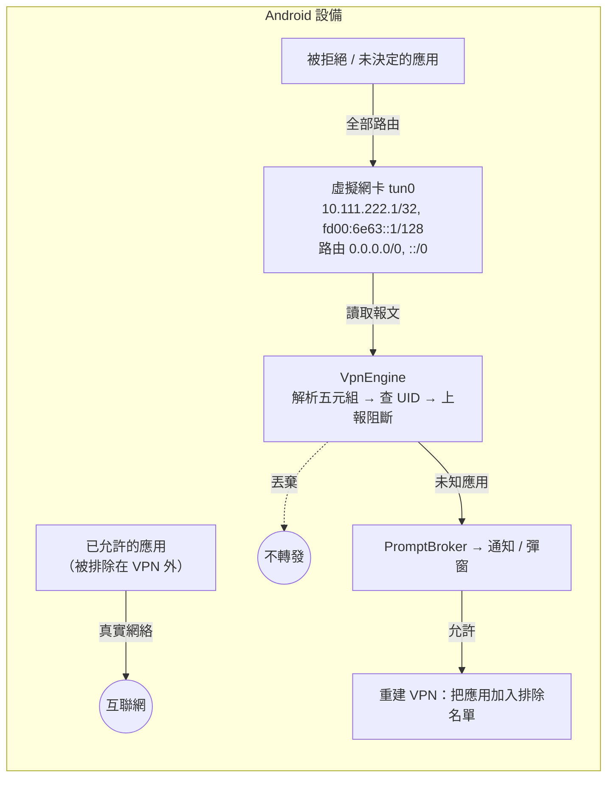
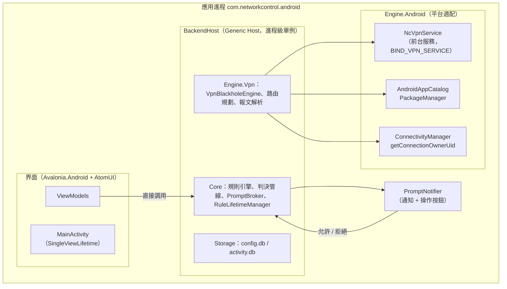

# NetworkControl Android 版設計

> 狀態：M-A（Android MVP）設計稿，2026-11-13。實現進度見 [progress.md](progress.md) 的「Android MVP」一節。
> 本文只描述 Android 特有的部分；領域模型、規則引擎、判決管線、詢問代理沿用 [design.md](design.md)。

---

## 1. 目標與範圍

### 1.1 MVP 目標

在**不需要 root** 的 Android 手機上實現「按應用控制聯網」，交互模型和桌面版一致：

1. 應用首次聯網時詢問（通知 + 應用內彈窗），允許 / 拒絕，永久 / 限時 / 直到重啟。
2. 應用列表中直接切換每個應用的「允許 / 拒絕 / 未設定（按模式處理）」。
3. 全局模式：詢問、白名單、黑名單、全部阻斷（一鍵斷網）、停用。
4. 被阻斷的聯網嘗試記錄（時間、應用、目標 IP、端口、協議）。
5. 開機和「始終開啟的 VPN」自動恢復保護。
6. 界面使用 Avalonia 12 + AtomUI，三種語言（zh-TW、zh-CN、en-US），淺色 / 深色。

### 1.2 MVP 不做（後續版本）

| 功能 | 原因 / 計劃 |
|---|---|
| 按域名、IP、端口的規則 | 黑洞式 VPN 只能按應用分流（見 §3）。規則模型照常支持，Android 引擎把這類規則標記為「此平台無法執行」。後續的「轉發模式」（用戶態 TCP/IP 協議棧）可以支持 |
| 允許的連接的日誌、流量統計 | 允許的應用不經過 VPN，看不到它們的流量。轉發模式可以支持 |
| 按網絡類型（Wi-Fi / 行動網路）分別控制 | 需要監聽網絡變化並重建 VPN，P1 |
| 快速設定磁貼、桌面小工具 | P1 |
| 規則導入導出、和桌面版同步 | 依賴 A2 的導出格式，P1 |
| 多用戶（工作資料夾） | VPN 只作用於當前用戶，P2 |

### 1.3 與需求文檔「非目標」的關係

需求文檔 §1.3 把「內置 VPN、代理或流量轉發」列為非目標。Android 沒有 root 時，`VpnService` 是第三方應用控制其他應用網絡的**唯一**途徑。本設計只在本機建立一個不連接任何遠端服務器的虛擬網卡，被阻斷應用的報文進入虛擬網卡後直接丟棄，**不轉發、不解密、不離開設備**——它是攔截機制，不是 VPN 服務。NetGuard、RethinkDNS、AFWall+（無 root 模式）都採用同類做法。

---

## 2. Android 平台約束

| 約束 | 影響 |
|---|---|
| 沒有 root 時無法使用 iptables / eBPF | 只能用 `VpnService` |
| 系統同時只允許一個 VPN | 用戶啟用其他 VPN 時我們的 VPN 被撤銷（`onRevoke`），需要提示 |
| `VpnService.Builder` 可以按包名排除應用（`addDisallowedApplication`）或只包含應用（`addAllowedApplication`），**兩者不能混用** | 黑洞方案的基礎；分流以 UID 為單位 |
| 修改分流名單需要重新 `establish()` | 規則變化時重建虛擬網卡；新網卡建立後再關閉舊的，切換期間不斷網 |
| `ConnectivityManager.getConnectionOwnerUid()`（API 29+）只有當前生效的 VPN 應用可以調用 | 由 VPN 自身查詢報文所屬的 UID；**最低支持 Android 10（API 29）** |
| Android 11+ 的軟件包可見性 | 需要 `QUERY_ALL_PACKAGES`（防火牆類應用屬於 Google Play 允許的用途） |
| Android 13+ 通知需要運行時權限 | 首次啟用保護時請求 `POST_NOTIFICATIONS`；拒絕時只能在應用內看到詢問 |
| Android 14+ 前台服務類型 | VPN 服務聲明 `foregroundServiceType="systemExempted"` |
| 後台限制、Doze | VPN 服務由系統綁定，進程不會被輕易回收；判決不依賴定時器（限時規則到期由 `RuleLifetimeManager` 在進程存活時處理，進程重啟後在加載時處理） |
| 沒有 ASP.NET Core（Kestrel） | Android 上不運行 gRPC 服務器，界面在同一進程內直接調用核心（§4） |

---

## 3. 攔截方案

### 3.1 候選方案

| 方案 | 原理 | 優點 | 缺點 |
|---|---|---|---|
| **A. 黑洞式分流 VPN（MVP 採用）** | 允許的應用通過 `addDisallowedApplication` 排除在 VPN 之外，直接使用真實網絡；其餘應用的流量進入虛擬網卡後被丟棄 | 不需要實現 TCP/IP 協議棧；允許的應用**零性能損耗**、不影響耗電；實現簡單可靠 | 只能按應用控制；看不到允許應用的流量；改規則要重建 VPN |
| B. 轉發式 VPN | 所有流量進入虛擬網卡，用戶態協議棧（類似 tun2socks / gVisor netstack）解析後由受保護的 socket 轉發 | 可以按域名 / IP / 端口控制，可以統計流量、記錄所有連接、真正掛起連接等待判決（PendingVerdict） | 要實現或引入協議棧，複雜度和耗電明顯增加；兼容性問題多 |
| C. root + iptables | 與 Linux 引擎類似 | 能力最完整 | 絕大多數用戶沒有 root |

MVP 採用 A；B 作為後續的可選「進階模式」，通過同一個引擎抽象接入（§5.6）。

### 3.2 黑洞方案的工作方式



- 這與 Windows 用戶態 WFP 引擎的「先阻斷後詢問」完全相同：引擎能力為 `RulePush`，連接以 `FlowOrigin.BlockedEvent` 上報，用戶允許後生成規則、引擎重建分流名單，應用重試即可連上（FR-INT-07 的提示文案沿用）。
- 被阻斷應用的 DNS 查詢也會進入虛擬網卡（Android 10+ 的 DnsResolver 按發起應用的 UID 選擇網絡），因此域名解析同樣被阻斷。虛擬網卡不設置 DNS 服務器。
- MVP 對被丟棄的 TCP SYN 不回覆 RST，應用會等到超時才報錯；後續可回寫 RST / ICMP 不可達讓應用快速失敗（P1）。

---

## 4. 進程與組件架構

Android 版是**單進程**應用：界面、VPN 服務和核心在同一個進程中。



### 4.1 為什麼不沿用 gRPC 服務

- Android 工作負載不包含 ASP.NET Core，Kestrel 不能運行；同一進程內也不需要跨進程通信和對端鑒權。
- 桌面界面的視圖模型與 proto 類型綁定，而手機界面的信息架構（底部導航、應用列表為主、通知交互）與桌面不同，複用的收益有限。
- **共享的是核心邏輯**：規則模型、優先級、篡改檢測、詢問合併 / 超時、規則時效、存儲遷移全部來自 Core 和 Storage，Android 只新增引擎和界面。

界面層通過一個薄的應用服務門面 `IBackend`（§7.1）訪問核心，不直接依賴具體的倉儲；以後如果需要把後端移到獨立進程（例如 `:vpn` 進程），只需替換門面的實現。

### 4.2 BackendHost 生命週期

- 進程級單例，在 `Application.OnCreate` 中**惰性**構建（第一次被界面或 VPN 服務使用時啟動），保證「開機啟動 VPN」「始終開啟的 VPN」這類沒有界面的啟動路徑也能拿到核心。
- 使用 `HostApplicationBuilder(new HostApplicationBuilderSettings { DisableDefaults = true })`：不加載 appsettings 文件、不監聽文件變化、不註冊控制台生命週期；`IHostLifetime` 替換為空實現。內容根目錄為 `Context.FilesDir`。
- 啟動順序與服務端相同：啟動任務（遷移 → 設置 → 運行時狀態 → 規則）→ 規則生命週期管理 → 引擎。
- 引擎啟動**不等於** VPN 啟動：VPN 需要用戶授權（`VpnService.prepare`）。引擎在 `StartAsync` 中只註冊回調；「保護」開關打開時才建立虛擬網卡（§5.4）。
- 進程被系統殺死時沒有清理機會；VPN 隨進程消失，網絡恢復正常（fail-open）。

---

## 5. VPN 引擎

### 5.1 項目劃分

| 項目 | 目標框架 | 內容 | 能否在桌面測試 |
|---|---|---|---|
| `NetworkControl.Engine.Vpn` | `net10.0` | 平台無關的引擎邏輯：報文解析、路由規劃、阻斷上報（去重、限流）、`VpnBlackholeEngine`；平台抽象接口 | ✅ `tests/NetworkControl.Engine.Vpn.Tests` |
| `NetworkControl.Engine.Android` | `net10.0-android` | 平台實現：`NcVpnService`、虛擬網卡讀取、`PackageManager` 應用目錄、UID 查詢、`IAppInspector`、開機 / 軟件包廣播 | ❌（真機 / 模擬器） |
| `NetworkControl.App.Android` | `net10.0-android` | Avalonia 界面、`BackendHost`、通知、Activity | ❌ |

`Engine.Vpn` 在主解決方案中，任何機器都能構建和測試；兩個 Android 項目在獨立的 `NetworkControl.Android.slnx` 中，避免沒有 Android 工作負載的機器（包括 CI 的 Linux / macOS 任務）構建失敗。

### 5.2 平台抽象（Engine.Vpn）

```csharp
/// 已安裝應用（只列出申請了 INTERNET 權限的應用）。
public sealed record InstalledApp(
    string PackageName, int Uid, string Label, bool IsSystem,
    long VersionCode, DateTimeOffset LastUpdated, string? SignerSha256);

public interface IInstalledAppCatalog
{
    IReadOnlyList<InstalledApp> GetApps();          // 快照
    IReadOnlyList<string> GetPackagesForUid(int uid);
    event EventHandler? Changed;                    // 安裝 / 卸載 / 更新
}

/// 虛擬網卡控制：由 Android 的 VpnService 實現。
public interface IVpnTunnel
{
    bool IsPrepared { get; }                        // 用戶是否已授權
    Task ApplyAsync(VpnRoutingPlan plan, CancellationToken ct);  // 建立或重建
    Task CloseAsync(CancellationToken ct);
    event EventHandler<PacketReceivedEventArgs>? PacketReceived; // 從虛擬網卡讀到的報文
    event EventHandler<TunnelStateChangedEventArgs>? StateChanged; // 建立、撤銷（onRevoke）、出錯
}

/// 報文所屬 UID：ConnectivityManager.getConnectionOwnerUid。
public interface IConnectionOwnerResolver
{
    int? GetOwnerUid(L4Protocol protocol, IPEndPoint local, IPEndPoint remote);
}
```

### 5.3 應用身份映射

Core 以「可執行文件路徑」為應用的主鍵。Android 上用合成路徑表示一個軟件包：

| Core 概念 | Android 對應 |
|---|---|
| `AppIdentity.Path` / `AppKey.Path` | `android-app://<包名>`，例如 `android-app://com.android.chrome`（`AndroidAppPath` 負責構造和解析） |
| `DisplayName` | 應用標籤（`loadLabel`）；取不到時用包名 |
| `CodeSignature.SignerId` | 簽名證書 SHA-256（小寫十六進制，多個簽名者時排序後以 `,` 連接） |
| `CodeSignature.IsPlatformBinary` | 系統應用（`FLAG_SYSTEM`） |
| `FileStamp(Size, LastWriteTicks)` | `(versionCode, lastUpdateTime)`：應用升級後重新檢查 |
| `Sha256` | 不計算（Android 應用都必須簽名） |
| `ProcessRef` / PID | 不提供（`FlowInfo.Process = null`）；`UserId` 為 null |

- **篡改檢測照常工作**：彈窗生成的規則帶 `RequiredSignerId`；同包名但簽名不同的應用（重新打包的惡意版本）會觸發篡改告警。
- 共享 UID（`sharedUserId`）的多個包：取 `getPackagesForUid` 排序後的第一個包作為身份；分流以 UID 為單位，對共享 UID 的任一包生效即對全部生效。
- **系統核心 UID（< 10000，即 `Process.FIRST_APPLICATION_UID`）始終放行**（系統服務器、DNS、NTP、網絡連通性檢查），相當於桌面版的「內置必要流量」（FR-INT-04）。
- 規則路徑匹配：`PathPattern.DefaultIgnoreCase` 在 Android 上改為區分大小寫（包名區分大小寫；原實現只判斷了 `IsLinux`，Android 上 `IsLinux()` 為 false）。

### 5.4 路由規劃（VpnRoutingPlanner，純函數）

輸入：生效規則集（已按優先級排序）、全局模式、已安裝應用、自身包名。輸出：

```csharp
public sealed record VpnRoutingPlan(
    bool TunnelRequired,                       // false：沒有需要阻斷的應用，可以不建立虛擬網卡
    IReadOnlySet<string> BypassPackages,       // 傳給 addDisallowedApplication（允許的應用 + 自身）
    IReadOnlyDictionary<int, AppRouting> ByUid,// 每個 UID 的決策和依據，供日誌 / 界面 / 診斷
    IReadOnlyList<SkippedRule> SkippedRules);  // 此平台無法執行的規則及原因

public enum AppRoutingDecision { Bypass, Block, BlockAndAsk }
```

**始終使用 `addDisallowedApplication`（排除名單）**：默認進入 VPN（被阻斷），只有明確允許的應用被排除。新安裝的應用在重建之前默認被阻斷，屬於安全側的失敗方式。

每個應用的決策：

1. 自身、系統核心 UID → `Bypass`。
2. 按優先級順序找第一條**作用於該應用且條件可執行**的規則（`RuleSet.FindAppLevelRule`，見下）：
   - 可執行條件：`Conditions` 為空，或只有 `Direction = Outbound`；規則的應用匹配器為 null（全局規則）或匹配該應用。
   - 篡改（簽名不一致）的規則跳過，記為 `Tampered`。
3. 命中規則 → `Allow` → `Bypass`；`Deny` → `Block`。
4. 沒有命中 → 按模式：

| 模式 | 未命中規則的應用 | 已有規則的應用 |
|---|---|---|
| 詢問 | `BlockAndAsk`（報文觸發詢問） | 按規則 |
| 白名單 | `Block` | 按規則 |
| 黑名單 | `Bypass` | 按規則 |
| 全部阻斷 | 全部 `Block`（只有自身和系統核心 UID 放行） | 忽略規則 |
| 停用 | 全部 `Bypass`；`TunnelRequired = false`，關閉虛擬網卡 | 忽略規則 |

`TunnelRequired = false` 時（例如停用模式、黑名單模式下沒有拒絕規則）關閉虛擬網卡，避免狀態欄常駐 VPN 圖標和不必要的開銷；保護開關仍顯示「開啟」。

需要給 Core 增加一個公開 API（只讀、不影響現有求值）：

```csharp
// RuleSet：按優先級返回第一條匹配該應用、且通過 includeRule 篩選的規則，同時報告因篡改跳過的規則。
public RuleMatch FindAppRule(AppIdentity app, Func<Rule, bool> includeRule);
```

不能被執行的規則（帶域名、IP、端口、協議、網絡區域條件，或入站規則）列入 `SkippedRules`，界面在規則旁顯示「Android 上不生效」；它們不影響分流決策（相當於不存在）。

### 5.5 報文處理與阻斷上報

1. Android 實現用阻塞模式（`Builder.setBlocking(true)`）讀取虛擬網卡，每個報文觸發 `PacketReceived`；讀線程是專用線程，關閉文件描述符時退出。
2. `IpPacketParser`（純函數、零分配）解析 IPv4 / IPv6 頭（跳過 IPv6 擴展頭）和 TCP / UDP 端口、TCP 標誌；分片的非首片、無法解析的報文直接丟棄。
3. 只為「新連接」上報：TCP 只看 SYN（無 ACK）；UDP 每個五元組每 10 秒最多一次；ICMP 不上報。
4. `IConnectionOwnerResolver` 查 UID → `IInstalledAppCatalog` 查包名 → 構造 `FlowInfo`：`Origin = BlockedEvent`、`ExecutablePath = android-app://<包名>`、`Process = null`。查不到 UID 的報文只計數，不上報。
5. 去重：同一 UID 在 5 秒內只上報一次（應用重試時會連續發 SYN），避免把判決管線和日誌淹沒。
6. `BlockReason`：路由決策為 `BlockAndAsk` → `DefaultBlock`（觸發詢問）；`Block` → `UserRule`（只記錄日誌）。核心的判決管線決定是否詢問、記錄什麼，引擎不做判斷。
7. 被丟棄的報文不寫回，不分配緩衝區以外的內存；讀循環的緩衝區大小等於 MTU（1500）。

### 5.6 VpnBlackholeEngine（INetworkEngine）

- `Name = "AndroidVpn"`，`Capabilities = RulePush`（以後的轉發模式聲明 `PendingVerdict | ProvidesHostname | TrafficStats`）。
- 訂閱：`RuleEngine.RuleSetChanged`、`RuntimeStateService.Changed`（模式）、`IInstalledAppCatalog.Changed`、`IVpnTunnel.StateChanged`。所有變化寫入容量為 1 的信號通道，由單一後台循環**合併**（300 ms 防抖）後重新規劃，計劃與上次相同時不重建。
- 「保護」開關（用戶意圖）保存在 Android 側的偏好中，而不是 Core 的模式：關閉保護 = 關閉虛擬網卡；模式只決定開啟保護時如何分流。
- 虛擬網卡被撤銷（用戶啟用其他 VPN、在系統設定中斷開）→ `OnEngineFault("vpn.revoked", 非致命)`，界面顯示「保護已被系統停止」，通知提示用戶重新開啟。
- `StopAsync` / `DisposeAsync` 可重複調用（沿用 AGENTS.md 第 6 節的坑）。

### 5.7 失效策略

| 情況 | 行為 |
|---|---|
| 應用崩潰 / 被殺 | VPN 隨進程消失，所有應用恢復聯網（fail-open） |
| 用戶需要 fail-closed | 設定頁提供「始終開啟的 VPN」和「無 VPN 時封鎖連線」的系統設定入口（`Settings.ACTION_VPN_SETTINGS`）；這兩項只能由用戶在系統設定中打開 |
| 開機 | `BOOT_COMPLETED` 廣播：上次保護為開啟且仍有 VPN 授權時啟動 VPN 服務；「始終開啟的 VPN」由系統直接啟動服務 |

`UserSettings.FailPolicy` 在 Android 上不生效，設定頁不顯示該項，改為上述入口。

---

## 6. 詢問交互

### 6.1 通知（主要通道）

- 後端啟動時 `PromptNotifier` 以 `PromptSubscriber(UserId: null, IsAdmin: true)` 訂閱 `PromptBroker`，因此即使界面沒有打開，判決管線也認為有用戶會話（否則 FR-PRM-12 會讓詢問直接按默認動作處理）。
- 每個待決詢問一條通知（通知渠道「聯網詢問」，重要性 HIGH，懸浮顯示）：標題「<應用名> 想要連線網路」，內容為目標 IP:端口和合併的連線數；操作按鈕「允許」「拒絕」（永久、此應用的任意連線），點擊通知正文打開應用內的完整詢問頁。
- 操作按鈕經 `BroadcastReceiver`（`PendingIntent.FLAG_IMMUTABLE`）回調 `PromptBroker.AnswerAsync`；詢問被回應、超時或撤銷（`Removed` 事件）時取消對應通知。
- 防誤觸（FR-PRM-07）：通知按鈕天然需要明確點擊；應用內彈窗沿用 1 秒禁用。

### 6.2 應用內詢問頁

- 界面在前台時以 AtomUI 的覆蓋層對話框顯示當前詢問（隊列中的下一個依次顯示）。
- 選項：**允許 / 拒絕** × **永久 / 1 小時 / 直到重啟**。不提供「僅本次」和「直到應用退出」：
  - 「僅本次」在 RulePush 引擎上會轉換為「限定 IP + 端口的 60 秒規則」（`PromptRuleFactory`），而黑洞方案無法按 IP 分流；
  - Android 上拿不到進程，「直到應用退出」會退化為「直到重啟」。
- 範圍固定為「此應用的任意連線」（同上原因）。
- 默認超時沿用設置（30 秒）。超時後報文仍被丟棄，應用下一次嘗試（去重窗口之後）會重新觸發詢問。

### 6.3 文案（FR-INT-07）

彈窗和通知固定提示：「此連線已被暫時阻止，允許後應用重新連線即可上網。」

---

## 7. 界面

### 7.1 應用服務門面

```csharp
public interface IBackend
{
    ProtectionState Protection { get; }            // 關閉 / 啟動中 / 運行中 / 需要授權 / 被撤銷 / 故障
    FilterMode Mode { get; }
    IReadOnlyList<AppRow> GetApps(AppFilter filter);           // 應用 + 當前生效的決策 + 依據
    Task SetAppDecisionAsync(string package, AppDecision decision, CancellationToken ct); // 允許 / 拒絕 / 清除
    Task SetModeAsync(FilterMode mode, CancellationToken ct);
    Task<IReadOnlyList<ActivityRow>> QueryBlockedAsync(ActivityQuery query, CancellationToken ct);
    IAsyncEnumerable<PromptEvent> SubscribePrompts(CancellationToken ct);
    Task AnswerPromptAsync(Guid id, PromptDecision decision, CancellationToken ct);
    event EventHandler? Changed;                   // 任何狀態變化（界面據此刷新）
}
```

「應用列表中設定允許 / 拒絕」= 創建或替換該應用的一條用戶規則（`Source = User`、`Lifetime = Permanent`、條件 `Direction = Outbound`、匹配器帶簽名者）；「清除」= 刪除該應用所有可在 Android 上執行的用戶 / 彈窗規則。界面不暴露規則細節，但規則數據與桌面版完全相同，以後可以直接導入導出。

### 7.2 頁面（底部導航，單 Activity）

| 頁面 | 內容 |
|---|---|
| **總覽** | 大號保護開關和狀態（含「需要授權」「已被系統停止」的說明和操作）；模式分段選擇（詢問 / 白名單 / 黑名單）；「一鍵斷網」按鈕（全部阻斷 ↔ 恢復）；今天阻斷次數；待決詢問數 |
| **應用** | 搜索框；篩選（全部 / 已允許 / 已拒絕 / 未設定；顯示系統應用）；每行：圖標、名稱、包名、三態切換（允許 / 拒絕 / 未設定），未設定時顯示「按模式：詢問」等；有臨時規則時顯示剩餘時間；有 Android 上不生效的規則時顯示提示 |
| **記錄** | 被阻斷的聯網嘗試：時間、應用、目標、協議、原因（規則 / 模式 / 等待詢問）；下拉刷新、按應用篩選；點擊一條記錄可以直接允許該應用 |
| **設定** | 語言、主題（跟隨系統 / 淺色 / 深色）、詢問超時和默認動作、通知權限狀態、始終開啟的 VPN 入口、電池最佳化說明、關於（版本號帶提交哈希） |

### 7.3 AtomUI 在 Android 上的使用

- AtomUI 官方定位是桌面組件庫（包名 `AtomUI.Desktop.Controls`），依賴 `Avalonia.Desktop`。這些依賴是託管程序集，在 Android 上不會被調用（平台後端由 `Avalonia.Android` 提供）。
- **預研項 R-A1（第一個任務）**：最小 Avalonia.Android 應用引用 AtomUI，驗證主題初始化、按鈕 / 開關 / 分段選擇器 / 列表 / 輸入框 / 對話框（覆蓋層）/ 消息提示、語言 Catalog、明暗切換在 Android 上能否工作，以及 APK 大小。
- 已知需要規避：AtomUI 依賴原生窗口的組件（`Window` 派生的對話框、托盤、窗口標題欄）不使用；彈出層使用 Avalonia 的覆蓋層彈出（`OverlayPopups`，Android 默認）。
- 回退方案：若 AtomUI 的某個組件不可用，該組件改用 Avalonia 基礎控件 + AtomUI 的設計令牌（顏色、圓角、字號）自繪；若 AtomUI 整體無法在 Android 上初始化，改用 `Avalonia.Themes.Fluent` 並按 Ant Design 令牌定製樣式，界面結構不變。預研結論寫入本文 §11。
- 觸控適配：最小點擊區域 48dp；列表使用虛擬化（`ListBox` + `VirtualizingStackPanel`）；應用圖標按需加載並緩存（`PackageManager.getApplicationIcon` → 位圖 → `Avalonia.Media.Imaging.Bitmap`，48dp）。
- 系統欄：沉浸式邊到邊佈局，安全區域內邊距（`TopLevel.InsetsManager`）。

### 7.4 本地化

- 沿用 AtomUI XLIFF Catalog 機制（與桌面版相同的坑：新增鍵在枚舉末尾追加，三種語言同時添加）。Android 項目有自己的 Catalog（手機界面文案不同）。
- 通知文案需要在沒有界面時也能取得：`PromptNotifier` 通過同一個 Catalog 讀取當前語言的文本。
- 默認跟隨系統語言；Android 13+ 的「應用語言」設定（`LocaleManager`）作為後續項。

---

## 8. 存儲、日誌、診斷

| 項 | Android 實現 |
|---|---|
| 數據目錄 | `Context.FilesDir/data`（`config.db`、`activity.db`，與桌面版同一套遷移腳本） |
| SQLite | `Microsoft.Data.Sqlite`（`SQLitePCLRaw.bundle_e_sqlite3` 自帶 Android 原生庫） |
| 日誌 | `Microsoft.Extensions.Logging`：logcat 提供程序（標籤 `NetworkControl`）+ 文件提供程序（`FilesDir/logs/app-yyyyMMdd.log`，保留 7 天）；不引入 Serilog |
| 界面偏好 | `SharedPreferences`（語言、主題、保護開關意圖） |
| 備份 | 關閉 Android 自動備份（`allowBackup=false`）：規則中包含簽名者等信息，跨設備恢復意義不大，且數據庫在寫入時備份可能不一致 |
| 診斷 | MVP：設定頁「分享診斷資訊」導出日誌 + 路由計劃（含 SkippedRules）+ 數據庫副本（P1） |

---

## 9. 清單（AndroidManifest）

```xml
<uses-permission android:name="android.permission.INTERNET" />
<uses-permission android:name="android.permission.FOREGROUND_SERVICE" />
<uses-permission android:name="android.permission.FOREGROUND_SERVICE_SYSTEM_EXEMPTED" />
<uses-permission android:name="android.permission.POST_NOTIFICATIONS" />
<uses-permission android:name="android.permission.RECEIVE_BOOT_COMPLETED" />
<uses-permission android:name="android.permission.QUERY_ALL_PACKAGES" />
<uses-permission android:name="android.permission.ACCESS_NETWORK_STATE" />

<application android:allowBackup="false" ...>
  <service android:name=".NcVpnService"
           android:permission="android.permission.BIND_VPN_SERVICE"
           android:foregroundServiceType="systemExempted" android:exported="false">
    <intent-filter><action android:name="android.net.VpnService" /></intent-filter>
    <meta-data android:name="android.net.VpnService.SUPPORTS_ALWAYS_ON" android:value="true" />
  </service>
  <receiver android:name=".BootReceiver" android:exported="true"> BOOT_COMPLETED </receiver>
  <receiver android:name=".PromptActionReceiver" android:exported="false" />
</application>
```

- 應用 ID：`com.networkcontrol.android`（正式名稱確定前的暫定值，見 progress.md 待決問題）。
- `minSdk 29`（Android 10），`targetSdk 36`（.NET 10 Android 默認）。
- C# 中的 Android 組件用 `[Service]`、`[BroadcastReceiver]`、`[IntentFilter]`、`[MetaData]` 特性聲明，由構建合併到清單；需要手寫的部分放在 `Properties/AndroidManifest.xml`。

---

## 10. 構建、工具鏈與發布

### 10.1 工具鏈（不需要管理員權限）

系統的 .NET SDK 安裝在 `Program Files`，安裝工作負載需要管理員權限。Android 構建使用**用戶級的獨立工具鏈**：

| 組件 | 位置（開發機） | 說明 |
|---|---|---|
| .NET SDK 10.0.402 | `D:\tools\android-dev\dotnet` | `dotnet-install.ps1 -InstallDir`，與系統 SDK 版本相同 |
| Android 工作負載 | 同上 | `dotnet workload install android` |
| JDK 17、Android SDK（platform 36、build-tools） | `D:\tools\android-dev\jdk`、`D:\tools\android-dev\android-sdk` | `dotnet build -t:InstallAndroidDependencies` 自動下載 |

`scripts/android-env.ps1` 設置 `DOTNET_ROOT`、`PATH`、`AndroidSdkDirectory`、`JavaSdkDirectory` 後調用構建；工具鏈位置可以用環境變量 `NC_ANDROID_TOOLCHAIN` 覆蓋。

### 10.2 解決方案

- 主解決方案 `NetworkControl.slnx` 只新增 `Engine.Vpn` 和它的測試（純 `net10.0`），現有的構建、測試、格式檢查命令不變。
- `NetworkControl.Android.slnx`：Core、Storage、Engine.Vpn、Engine.Android、App.Android。
- 命令：

```powershell
.\scripts\android-env.ps1 build          # Debug APK
.\scripts\android-env.ps1 install        # 安裝到已連接的設備 / 模擬器（adb）
.\scripts\android-env.ps1 publish        # Release APK（裁剪 + 簽名）
```

### 10.3 發布

- Release：Mono 運行時 + 裁剪（`TrimMode=partial` 起步，AtomUI 的反射用法需要評估），ABI `arm64-v8a` + `x86_64`（模擬器），格式 APK（側載分發）；以後上架再加 AAB。
- 簽名：Debug 使用 SDK 默認調試密鑰；Release 密鑰庫由用戶生成並保存在倉庫之外（`NC_ANDROID_KEYSTORE` 等環境變量），**不提交任何密鑰**。
- 版本號：`ApplicationDisplayVersion` 取 `Directory.Build.props` 的 `VersionPrefix`；`ApplicationVersion`（整數版本碼）由版本號換算（`major*10000 + minor*100 + patch`）。

---

## 11. 預研結論（R-A1 完成後填寫）

| 項目 | 結論 |
|---|---|
| AtomUI 主題初始化 | 待驗證 |
| 常用組件（按鈕、開關、分段選擇器、輸入框、列表、標籤、卡片） | 待驗證 |
| 覆蓋層對話框、消息提示 | 待驗證 |
| 語言 Catalog 運行時切換 | 待驗證 |
| APK 大小（Debug / Release） | 待驗證 |
| 冷啟動時間 | 待驗證 |

---

## 12. 測試策略

| 層 | 方法 |
|---|---|
| 報文解析 | 單元測試：構造 IPv4 / IPv6（含擴展頭）TCP SYN、UDP、分片、截斷、非法長度的字節數組 |
| 路由規劃 | 單元測試：五種模式 × 規則組合（全局規則、應用規則、優先級、篡改、不可執行條件、系統 UID、自身） |
| 阻斷上報 | 單元測試：假的虛擬網卡和 UID 解析器，驗證去重窗口、SYN 過濾、UID 查不到時不上報、BlockReason |
| 引擎集成 | 單元測試：Core 的 `ScenarioHost` 風格，真實的 RuleService / PromptBroker + 假平台；驗證「阻斷 → 詢問 → 允許 → 計劃中該應用被排除」完整鏈路 |
| 設備驗證 | 模擬器（無窗口模式）或真機：`adb shell appops set <包名> ACTIVATE_VPN allow` 跳過授權對話框；用瀏覽器訪問網頁觸發詢問；通過 `logcat`、`dumpsys notification`、`dumpsys connectivity` 檢查；界面效果用 `adb exec-out screencap` 截取**設備屏幕**（不是電腦桌面） |

---

## 13. 任務分解（M-A）

| 編號 | 任務 | 驗收 |
|---|---|---|
| A-0 | 設計文檔（本文）、工具鏈、`android-env.ps1`、`NetworkControl.Android.slnx` | 工具鏈可以構建空 Android 應用 |
| A-1 | 預研 R-A1：Avalonia.Android + AtomUI 最小應用 | §11 填寫結論；在模擬器上運行 |
| A-2 | Core 小改動：`RuleSet.FindAppRule`、Android 路徑大小寫 | Core 測試通過 |
| A-3 | `Engine.Vpn`：報文解析、路由規劃、阻斷上報、引擎 | 單元測試覆蓋 §12 前四項 |
| A-4 | `Engine.Android`：VpnService、應用目錄、UID 查詢、IAppInspector、廣播 | 模擬器上 VPN 建立、被阻斷應用無法聯網、允許後可以聯網 |
| A-5 | `App.Android`：BackendHost、IBackend、日誌 | 冷啟動後核心啟動成功，數據庫建立 |
| A-6 | 界面：總覽、應用、記錄、設定 | 模擬器上各頁面可用 |
| A-7 | 詢問：通知 + 操作按鈕 + 應用內詢問頁 | 瀏覽器聯網 → 通知 → 允許 → 瀏覽器可以上網 |
| A-8 | 開機 / 始終開啟的 VPN / 撤銷處理 | 模擬器重啟後保護自動恢復 |
| A-9 | Release APK、文檔（development.md、progress.md、AGENTS.md 坑） | 生成可以側載安裝的簽名 APK |

---

## 14. 風險

| 風險 | 應對 |
|---|---|
| AtomUI 在 Android 上不可用或部分不可用 | R-A1 首先驗證；回退方案見 §7.3 |
| 某些廠商 ROM（MIUI / HyperOS 等）限制後台、修改 VPN 行為 | 設定頁提供電池最佳化白名單入口；真機驗證由用戶執行 |
| `getConnectionOwnerUid` 對 UDP / IPv6 偶爾返回 -1 | 只影響詢問的觸發（報文照樣被丟棄）；計數寫入診斷 |
| 重建 VPN 時已建立的連接被重置 | 只有被移入 / 移出 VPN 的應用受影響；防抖合併頻繁的規則變化 |
| Mono + AtomUI 冷啟動慢、APK 大 | 預研時測量；Release 啟用裁剪和 `AndroidEnableProfiledAot` |
