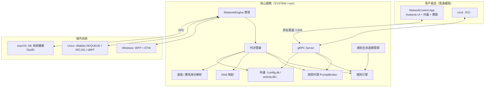
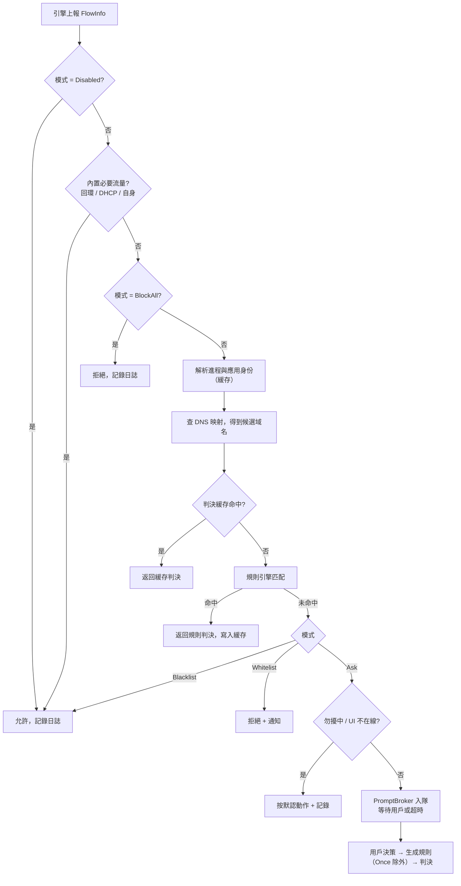
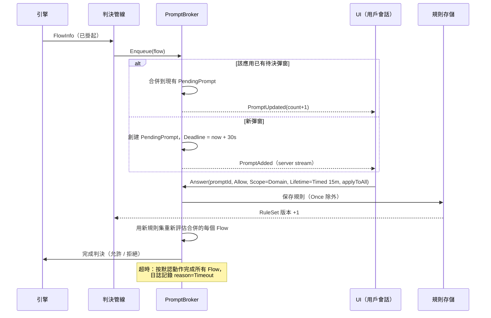

# NetworkControl 設計實現文檔

| 項目 | 內容 |
|---|---|
| 文檔版本 | v0.1 草案 |
| 日期 | 2026-11-12 |
| 狀態 | 待評審 |
| 相關文檔 | [需求規格說明書](requirements.md) |

> 文中 `FR-xxx` / `NFR-xxx` 編號對應需求文檔中的條目。

---

## 1. 設計原則

1. **核心與平台分離**：規則引擎、判決管線、存儲、IPC 全部寫成與平台無關的 .NET 代碼；平台相關的部分只做「攔截」和「採集」，越薄越好。
2. **服務是唯一的事實來源**：所有規則和判決都由核心服務決定，UI 只負責展示和輸入。UI 不在時，系統照常工作。
3. **熱路徑最短**：判決路徑上不做 I/O，不做阻塞調用；簽名校驗、哈希計算、日誌寫入全部異步，結果緩存。
4. **不能把用戶鎖在網外**：任何異常都要有明確、可配置的兜底行為（fail-open / fail-closed），默認 fail-open。
5. **能力驅動**：各平台引擎通過「能力聲明」告訴核心自己能做什麼，核心和 UI 據此調整行為，不寫 `if (OperatingSystem.IsWindows())` 這類散落的判斷。

---

## 2. 技術選型

| 層 | 選型 | 理由 |
|---|---|---|
| 運行時 | .NET 10（LTS） | 長期支持；NativeAOT、命名管道和 UDS 的 Kestrel 支持都已成熟 |
| UI | Avalonia 11.x（若 12.x 穩定則評估升級） | 跨平台；XAML/MVVM；支持托盤和 NativeAOT |
| MVVM | CommunityToolkit.Mvvm | 源生成器，零反射，AOT 友好 |
| UI 主題 | FluentAvalonia 或 Semi.Avalonia（M0 階段確定） | 成熟的控件主題 |
| 圖表 | LiveChartsCore.SkiaSharpView.Avalonia | Avalonia 原生支持，性能足夠 |
| 服務宿主 | Microsoft.Extensions.Hosting（Windows Service / systemd / launchd 集成） | 統一生命週期、DI、配置、日誌 |
| IPC | gRPC：Windows 走命名管道，Linux/macOS 走 Unix Domain Socket | 強類型契約、雙向流、版本化 |
| 存儲 | SQLite（Microsoft.Data.Sqlite，WAL 模式） | 零部署、事務、單文件，便於備份 |
| 日誌 | Serilog → 滾動文件 + EventLog / journald / os_log | 結構化日誌 |
| Windows 引擎 | WFP（P/Invoke `fwpuclnt.dll`）+ ETW（Microsoft.Diagnostics.Tracing.TraceEvent） | 用戶態即可實現，不需要驅動簽名 |
| Linux 引擎 | nftables + NFQUEUE（libnetfilter_queue）+ NFLOG + eBPF（libbpf, CO-RE, C 語言） | 支持掛起判決；eBPF 精確歸屬進程 |
| macOS 引擎 | Network Extension 系統擴展（Swift）+ Swift 橋接動態庫（`@_cdecl` 導出 C 接口） | 蘋果唯一受支持的方案 |
| 打包 | WiX v5（MSI）、nfpm（deb/rpm）、`codesign` + `notarytool`（dmg） | — |
| 測試 | xUnit、FsCheck（屬性測試）、BenchmarkDotNet、SharpFuzz | — |

---

## 3. 總體架構

### 3.1 進程模型



### 3.2 解決方案結構

```
network-control/
├─ docs/
├─ src/
│  ├─ NetworkControl.Core/              # 領域模型、規則引擎、判決管線、引擎抽象（無平台依賴）
│  ├─ NetworkControl.Storage/           # SQLite 倉儲、遷移、備份
│  ├─ NetworkControl.Ipc/               # .proto 文件 + 生成代碼 + 客戶端連接工廠
│  ├─ NetworkControl.Service/           # 服務宿主：Generic Host、gRPC 服務實現、引擎裝配
│  ├─ NetworkControl.Engine.Fake/       # 模擬引擎（開發和測試用）
│  ├─ NetworkControl.Engine.Windows/    # WFP、ETW、Windows 進程/簽名/圖標
│  ├─ NetworkControl.Engine.Linux/      # NFQUEUE、NFLOG、eBPF 加載、/proc、sock_diag
│  ├─ NetworkControl.Engine.MacOS/      # XPC 橋接封裝、libproc、Security.framework
│  ├─ NetworkControl.App/               # Avalonia UI
│  └─ NetworkControl.Cli/               # ncctl（P2）
├─ native/
│  ├─ linux-ebpf/                       # nc_connect.bpf.c 等（CO-RE）
│  ├─ macos/
│  │  ├─ NCFilterExtension/             # NEFilterDataProvider 系統擴展（Swift）
│  │  └─ NCMacBridge/                   # Swift 動態庫：擴展激活、XPC 客戶端、窗口層級
│  └─ windows-driver/                   # WFP Callout 驅動（M5+，可選）
├─ tests/
│  ├─ NetworkControl.Core.Tests/
│  ├─ NetworkControl.Storage.Tests/
│  ├─ NetworkControl.Engine.Linux.IntegrationTests/
│  ├─ NetworkControl.Engine.Windows.IntegrationTests/
│  └─ NetworkControl.Benchmarks/
└─ packaging/
   ├─ windows/ (WiX)   ├─ linux/ (nfpm, systemd unit)   └─ macos/ (entitlements, plist, 腳本)
```

依賴方向：`App → Ipc`；`Service → Core, Storage, Ipc, Engine.*`；`Engine.* → Core`。**Core 不依賴任何其他項目。** 平台引擎由 Service 在啟動時按當前平台加載。

---

## 4. 領域模型

### 4.1 連接與進程

```csharp
public enum Direction : byte { Outbound, Inbound }
public enum L4Protocol : byte { Tcp = 6, Udp = 17, Icmp = 1, IcmpV6 = 58, Other = 255 }
public enum VerdictAction : byte { Allow, Deny }

/// 進程引用：PID 會被複用，因此必須帶上啟動時間才能唯一標識
public readonly record struct ProcessRef(int Pid, long StartTimeTicks);

public sealed record FlowInfo
{
    public required ulong FlowId { get; init; }          // 引擎內唯一
    public required Direction Direction { get; init; }
    public required L4Protocol Protocol { get; init; }
    public required IPEndPoint Local { get; init; }
    public required IPEndPoint Remote { get; init; }
    public ProcessRef? Process { get; init; }            // 部分引擎可能拿不到
    public string? ExecutablePath { get; init; }         // 引擎直接提供的路徑（Windows AppId、macOS audit token 解析）
    public string? UserId { get; init; }                 // Windows SID / Unix UID
    public string? EngineHostname { get; init; }         // macOS remoteHostname
    public required DateTimeOffset Timestamp { get; init; }
    public FlowOrigin Origin { get; init; }              // Pending（可掛起）/ BlockedEvent（已被阻斷的事件）
}
```

### 4.2 應用身份

```csharp
public sealed record AppIdentity
{
    public required long AppId { get; init; }            // apps 表主鍵
    public required string Path { get; init; }           // 規範化後的完整路徑
    public string? DisplayName { get; init; }
    public CodeSignature? Signature { get; init; }       // 為 null 表示未簽名或無法校驗
    public string? Sha256 { get; init; }                 // 僅對未簽名程序計算
    public string? PackageId { get; init; }              // MSIX 包族名 / Flatpak / Snap
    public string? ServiceName { get; init; }            // svchost 托管的服務名
    public string? CommandLine { get; init; }            // 僅解釋器類進程才採集
}

public sealed record CodeSignature(
    string SignerId,      // Win: 證書 Subject CN + 頒發者；mac: Team ID；Linux: 軟件包名
    string? SigningId,    // mac: Signing Identifier（例如 com.google.Chrome）
    bool IsPlatformBinary // 系統自帶（Windows 目錄 / Apple 平台二進制 / 發行版官方包）
);
```

### 4.3 應用匹配器（規則用）

規則**不**直接引用 `AppId`，而是引用一個匹配器，這樣應用更新或路徑帶版本號（如 `Discord\app-1.0.9\Discord.exe`）時規則仍然有效（FR-APP-04）。

```csharp
public sealed record AppMatcher
{
    public required string PathPattern { get; init; }    // 支持環境變量和 * 通配：%LOCALAPPDATA%\Discord\app-*\Discord.exe
    public string? RequiredSignerId { get; init; }       // 有值時必須簽名者一致，否則視為篡改
    public string? RequiredSha256 { get; init; }         // 未簽名應用：哈希不一致視為篡改
    public string? ServiceName { get; init; }
    public string? PackageId { get; init; }
    public string? CommandLinePattern { get; init; }     // P2
}
```

彈窗生成規則時的默認策略：

| 情況 | 生成的匹配器 |
|---|---|
| 已簽名 | `PathPattern` = 路徑中的版本號目錄替換為 `*`（啟發式規則：匹配 `app-\d+(\.\d+)*`、`\d+\.\d+\.\d+\.\d+` 等），`RequiredSignerId` = 簽名者 |
| 未簽名 | `PathPattern` = 完整路徑，`RequiredSha256` = 當前哈希 |
| svchost | `PathPattern` = svchost 路徑，`ServiceName` = 服務名 |

### 4.4 規則

```csharp
public enum RuleLifetime : byte { Once, UntilProcessExit, Timed, UntilRestart, Permanent }
public enum RuleSource : byte { User, Prompt, Builtin, Subscription, Import }

public sealed record Rule
{
    public required Guid Id { get; init; }
    public Guid? ProfileId { get; init; }                // null = 共享規則，對所有配置文件生效
    public AppMatcher? App { get; init; }                // null = 任意應用（全局規則）
    public RuleConditions Conditions { get; init; } = RuleConditions.Any;
    public required VerdictAction Action { get; init; }
    public required RuleLifetime Lifetime { get; init; }
    public DateTimeOffset? ExpiresAt { get; init; }      // Timed
    public ProcessRef? BoundProcess { get; init; }       // UntilProcessExit
    public required RuleSource Source { get; init; }
    public bool Enabled { get; init; } = true;
    public int ManualPriority { get; init; }             // >0 表示用戶手動置頂，數字越大越優先
    public string? Note { get; init; }
    public DateTimeOffset CreatedAt { get; init; }
    public DateTimeOffset UpdatedAt { get; init; }
}

public sealed record RuleConditions
{
    public static readonly RuleConditions Any = new();
    public Direction? Direction { get; init; }
    public L4Protocol? Protocol { get; init; }
    public RemoteTarget? Remote { get; init; }
    public PortRange? RemotePort { get; init; }
    public PortRange? LocalPort { get; init; }           // 入站規則常用
    public Schedule? Schedule { get; init; }             // P2
}

/// 遠端目標：多選一
public abstract record RemoteTarget;
public sealed record DomainTarget(string Pattern) : RemoteTarget;             // "api.github.com" 或 "*.github.com"
public sealed record AddressTarget(IReadOnlyList<IPNetwork> Networks) : RemoteTarget; // 單 IP 即 /32、/128
public sealed record ZoneTarget(NetworkZone Zone) : RemoteTarget;            // Loopback / LocalNetwork / Internet
public sealed record ListTarget(Guid SubscriptionId) : RemoteTarget;          // 黑名單訂閱（P2）

public readonly record struct PortRange(ushort From, ushort To);
```

「本次」（`Once`）在支持掛起的引擎上**不產生規則**，只作用於彈窗涵蓋的那些連接；在 Windows 用戶態引擎上，它轉換成 `Timed` 規則，限定遠端 IP 加端口，有效期 60 秒（可配置）。

### 4.5 模式與配置文件

```csharp
public enum FilterMode : byte { Ask, Whitelist, Blacklist, BlockAll, Disabled }

public sealed record Profile
{
    public required Guid Id { get; init; }
    public required string Name { get; init; }
    public FilterMode Mode { get; init; } = FilterMode.Ask;
    public NetworkMatch? AutoActivate { get; init; }     // SSID / 網關 MAC / 網卡類型
}
```

運行時狀態 `RuntimeState`：當前配置文件、`BlockAll` 之前的模式（用於恢復）、勿擾模式的截止時間。

---

## 5. 判決管線

### 5.1 總流程



### 5.2 線程模型

- 引擎回調線程只做一件事：把 `FlowInfo` 寫入有界 `Channel<FlowWork>`（容量 65536，滿時按失效策略直接判決，並計入丟棄計數）。
- N 個工作線程（默認等於 CPU 核數，上限 8）消費這個 Channel，執行 §5.1 的流程。緩存命中時全程同步完成，不分配堆內存。
- 需要等待用戶的連接交給 `PromptBroker`，工作線程**不阻塞**，立即處理下一條；用戶答覆後由 Broker 回調引擎完成判決。
- 日誌、統計通過另一個 `Channel<ActivityEvent>`，由單個寫入線程每 1 秒或每 1000 條批量提交一次事務。

### 5.3 進程與應用身份解析

```csharp
public interface IProcessInfoProvider          // 各平台實現
{
    bool TryGetProcess(int pid, out ProcessSnapshot snapshot);   // 路徑、啟動時間、父 PID、用戶、命令行（按需）
}

public interface ICodeSignatureVerifier        // 各平台實現，可能很慢
{
    ValueTask<CodeSignature?> VerifyAsync(string path, CancellationToken ct);
}
```

緩存層次：

| 緩存 | 鍵 | 失效條件 |
|---|---|---|
| 進程快照 | `ProcessRef` | 進程退出 |
| 應用身份 | `(Path, 文件大小, 修改時間)` | 文件變化 |
| 簽名和哈希結果 | 同上，並持久化到 `apps` 表 | 文件變化 |

新應用第一次出現時，簽名校驗可能需要 10–200 ms。處理方式如下：

- 在支持掛起的引擎上，這次連接等待校驗完成；校驗超時 2 秒則按「未簽名」處理，並標記為「待重新校驗」。
- 在 Windows 用戶態引擎上，規則已經以 WFP 過濾器的形式生效，不存在等待問題。

篡改檢測（FR-APP-05）：規則的 `AppMatcher.RequiredSignerId` 或 `RequiredSha256` 與觀測值不一致時，該規則**不參與匹配**，並生成一個帶「程序已變更」標記的詢問。

### 5.4 DNS 映射

```csharp
public sealed class DnsMapper
{
    // IP → 最近解析出這個 IP 的域名（可能有多個）
    // 容量上限 10 萬條，LRU 淘汰；TTL 下限 60 秒、上限 24 小時
    public void Observe(DnsObservation obs);   // 來自引擎：域名、IP 列表、TTL、可選 PID
    public DomainCandidates Lookup(IPAddress remote, ProcessRef? process);
}
```

查找時優先返回「同一進程最近解析的」域名，其次是全局最近的。如果引擎直接提供了 `EngineHostname`（macOS），以它為準。

各平台的 DNS 數據來源：

| 平台 | 來源 |
|---|---|
| Windows | ETW `Microsoft-Windows-DNS-Client` 提供程序（事件 3008：查詢完成，包含 PID 和結果） |
| Linux | nftables 對 `udp sport 53` / `tcp sport 53` 的響應做 NFLOG 鏡像，由服務解析 DNS 報文。應用發往 `127.0.0.53` 的查詢走 lo 接口，同樣能捕獲 |
| macOS | `remoteHostname` 為主；另外在擴展中對發往 53 端口的 UDP 流做 peek 解析作為補充 |

DoH/DoT 無法解析，這是已知限制，在 UI 中標註「域名來源：未知」。

### 5.5 判決緩存

- 鍵：`(AppId, Direction, Protocol, RemoteIP, RemotePort, 候選域名集合的哈希)`。
- 值：`(Action, RuleId, RuleSetVersion)`。
- 規則集任何變更都會遞增 `RuleSetVersion`，版本不一致的緩存條目視為失效（惰性淘汰）。
- 容量 64K，LRU 淘汰。

---

## 6. 規則引擎

### 6.1 不可變快照

```csharp
public sealed class RuleSet                     // 不可變，整體替換
{
    public long Version { get; }
    // 按 PathPattern 的「無通配前綴」建立索引；通配規則單獨放在一個列表裡
    private readonly FrozenDictionary<string, CompiledRule[]> _byExactPath;
    private readonly CompiledRule[] _wildcardAppRules;
    private readonly CompiledRule[] _globalRules;    // App == null 的規則
    public MatchResult Evaluate(in EvaluationContext ctx);
}

public sealed class RuleEngine
{
    private RuleSet _current;                   // Volatile 讀，Interlocked.Exchange 寫
    public void Publish(IEnumerable<Rule> activeRules);   // 規則變更時重新編譯（萬條規則耗時 < 50 ms）
}
```

「生效的規則」只包括：當前配置文件的規則、共享規則、內置規則；而且必須同時滿足已啟用、未過期、`BoundProcess` 仍然存活。

### 6.2 優先級

候選規則按下面的鍵**降序**排序，第一條匹配成功的規則就是結果（FR-RUL-04）：

1. `ManualPriority`（用戶手動置頂）。
2. 具體度分數 `Specificity`。
3. 同分時 `Deny` 優先於 `Allow`。
4. 仍然相同時，更新時間較新的優先。

具體度分數：

| 維度 | 取值 | 分數 |
|---|---|---|
| 應用 | 指定應用（含服務名或命令行）/ 指定應用 / 任意 | 2000 / 1000 / 0 |
| 遠端 | 精確 IP 或精確域名 / CIDR 或通配域名 / 區域 / 訂閱列表 / 任意 | 400 / 300 / 200 / 100 / 0 |
| 遠端端口 | 單個端口 / 範圍 / 任意 | 40 / 30 / 0 |
| 協議 | 指定 / 任意 | 10 / 0 |
| 方向 | 指定 / 任意 | 5 / 0 |
| 時間段 | 有 / 無 | 1 / 0 |

例子：應用 A 有「拒絕任意連接」（1000），又有「允許 `*.github.com`」（1300），訪問 `api.github.com` 時允許，訪問其他地址時拒絕。這正是 US-04 要的效果。

規則引擎用表驅動的單元測試覆蓋優先級語義，並用屬性測試驗證兩個不變量：「增加一條更具體的規則，不會改變與它無關的連接的判決」；「規則的插入順序不影響結果」。

### 6.3 匹配細節

- **域名**：連接的候選域名中**任意一個**匹配即算命中。通配規則 `*.example.com` 匹配 `example.com` 本身及其所有子域名（與 Little Snitch 的語義一致）。匹配不區分大小寫，使用 IDN 規範化後的形式。
- **區域**：`LocalNetwork` 包括 10/8、172.16/12、192.168/16、169.254/16、100.64/10、fc00::/7、fe80::/10 和組播地址；`Internet` 指以上以外的地址。
- **時間段**：按本地時區計算。跨午夜的時段拆成兩段處理。時段邊界由 `LifetimeManager` 觸發重新發布規則集。

---

## 7. 規則生命週期管理

```csharp
public sealed class LifetimeManager : BackgroundService
{
    // 1. 最小堆按 ExpiresAt 排序；PeriodicTimer 每秒檢查堆頂，到期即停用規則並重新發布規則集
    // 2. UntilProcessExit：註冊 IProcessExitWatcher，進程退出時刪除綁定的規則
    // 3. UntilRestart：只存在內存中（不寫入 config.db），服務重啟後自然消失
    // 4. 時間段規則：計算下一個邊界時間，到點重新發布規則集
}

public interface IProcessExitWatcher           // 各平台實現
{
    IDisposable Watch(ProcessRef process, Action onExit);
}
```

| 平台 | 進程退出監聽方式 |
|---|---|
| Windows | `OpenProcess(SYNCHRONIZE)` + `RegisterWaitForSingleObject` |
| Linux | `pidfd_open` + epoll；內核不支持時用 netlink proc connector |
| macOS | kqueue `EVFILT_PROC` + `NOTE_EXIT` |

過期或刪除的臨時規則移到 `rule_history` 表（保留 30 天），方便審計。

---

## 8. 詢問代理（PromptBroker）

### 8.1 數據結構

```csharp
public sealed class PendingPrompt
{
    public Guid PromptId { get; }
    public string TargetUserId { get; }         // 彈窗應該送到哪個用戶的 UI
    public AppIdentity App { get; }
    public bool IsTamperAlert { get; }
    public List<PendingFlow> Flows { get; }     // 同一應用合併在一起（FR-PRM-08）
    public DateTimeOffset Deadline { get; set; }
}

public sealed class PendingFlow
{
    public FlowInfo Flow { get; }
    public DomainCandidates Domains { get; }
    public TaskCompletionSource<VerdictAction>? Completion { get; }   // 支持掛起的引擎才有
}
```

### 8.2 流程



要點：

- **重新評估**：用戶選擇「僅此域名」時，合併在同一彈窗裡、但屬於其他域名的連接不會被這次決策放行。如果剩下的連接仍然沒有規則命中，就繼續留在彈窗中（彈窗內容隨之更新）。
- **路由**（FR-PRM-13）：UI 連接時上報用戶 ID。`TargetUserId` = 發起連接的用戶；如果是系統帳戶，則送給任一管理員用戶的 UI。找不到在線的 UI 時直接按默認動作處理。
- **超時**：由服務計時，不依賴 UI。UI 端顯示的倒計時只是展示用。UI 可以發送 `PausePromptTimer`，服務端最多延長到 5 分鐘。
- **上限**：待決連接總數超過 1000 時，新來的直接按默認動作處理，防止內存被惡意耗盡。

### 8.3 決策到規則的映射

| 範圍（Scope） | 生成的條件 |
|---|---|
| 此應用的任意連接 | `Direction` = 當前方向 |
| 此域名 | `Remote = DomainTarget(域名)`；有多個候選域名時取 UI 中選中的那個 |
| 此 IP | `Remote = AddressTarget(ip/32)` |
| 此 IP + 端口 | 上一行 + `RemotePort`、`Protocol` |
| 此端口 | `RemotePort`、`Protocol` |

---

## 9. 平台引擎抽象

```csharp
[Flags]
public enum EngineCapabilities
{
    None            = 0,
    PendingVerdict  = 1 << 0,   // 能掛起連接等待判決
    RulePush        = 1 << 1,   // 判決以「下發規則」的方式生效（Windows 用戶態）
    ProvidesPid     = 1 << 2,
    ProvidesHostname= 1 << 3,
    Inbound         = 1 << 4,
    TrafficStats    = 1 << 5,
    KillConnection  = 1 << 6,
    BandwidthLimit  = 1 << 7,
    BootProtection  = 1 << 8,
}

public interface INetworkEngine : IAsyncDisposable
{
    string Name { get; }
    EngineCapabilities Capabilities { get; }
    Task StartAsync(IEngineHost host, EngineOptions options, CancellationToken ct);
    Task StopAsync(CancellationToken ct);
    ValueTask<bool> KillConnectionAsync(ConnectionKey key, CancellationToken ct);     // 可選能力
}

/// 由核心實現，供引擎回調
public interface IEngineHost
{
    // PendingVerdict 類引擎：每條新連接調用；返回值可能在很久以後（等用戶）才完成
    ValueTask<VerdictAction> DecideAsync(FlowInfo flow);

    // RulePush 類引擎：連接已被默認阻斷規則攔下後上報，用於觸發詢問
    void OnFlowBlocked(FlowInfo flow, BlockReason reason);

    void OnDnsObserved(DnsObservation observation);
    void OnTraffic(ReadOnlySpan<TrafficSample> samples);
    void OnEngineFault(EngineFault fault);

    // RulePush 類引擎訂閱規則集變化，自行編譯成底層規則
    IObservable<RuleSetChange> RuleSetChanges { get; }
    FilterMode CurrentMode { get; }
}
```

`Engine.Fake` 實現 `PendingVerdict` 能力，通過腳本或 UI 中的「模擬連接」按鈕生成 `FlowInfo`。M0 階段完全依賴它來開發 UI 和核心。

---

## 10. Windows 引擎（M1：用戶態 WFP）

### 10.1 WFP 對象

| 對象 | 說明 |
|---|---|
| Provider | `NetworkControl Provider`（固定 GUID）。所有過濾器掛在它下面，卸載時按 Provider 一次清理乾淨 |
| SubLayer | `NetworkControl SubLayer`，權重 0x8000。我們的阻斷在任何子層中都生效（WFP 仲裁規則：任一子層判為 Block 即阻斷，除非存在 hard permit） |
| 監聽層 | 出站：`FWPM_LAYER_ALE_AUTH_CONNECT_V4/V6`；入站：`FWPM_LAYER_ALE_AUTH_RECV_ACCEPT_V4/V6`（P1） |

### 10.2 過濾器權重布局（子層內，`FWP_UINT8` 0–15）

| 權重 | 內容 |
|---|---|
| 15 | 內置必要放行：自身服務、回環（`FWP_CONDITION_FLAG_IS_LOOPBACK`）、DHCP |
| 14 | `BlockAll` 模式：全量阻斷（僅在該模式下存在） |
| 4–13 | 用戶規則：權重 = 4 + 規則在全局排序中的分檔（按 §6.2 的優先級分成 10 檔）；同一檔內 Deny 的權重比 Allow 高 1 |
| 1 | 默認阻斷過濾器：只在 Ask / Whitelist 模式下存在，記錄它的 FilterId |

> WFP 的權重是有限的整數，無法完整表達 §6.2 的排序。**RuleCompiler** 要先在內存中對規則集做一次「求值等價」分析：對衝突的規則對，保證高優先級規則的權重更高；權重檔位不夠時，把低優先級規則拆分成排除了衝突範圍的子規則。這是 M1 的主要技術難點，需要大量單元測試覆蓋。

### 10.3 規則編譯

```
RuleSet ──RuleCompiler──▶ DesiredFilterSet ──Diff(當前已下發)──▶ FwpmTransaction { Add / Delete }
```

| 規則條件 | WFP 條件 |
|---|---|
| AppMatcher.PathPattern | `FWPM_CONDITION_ALE_APP_ID`（用 `FwpmGetAppIdFromFileName0` 轉換）。通配路徑展開為磁盤上實際存在的路徑；用 `FileSystemWatcher` 監聽新版本目錄出現後追加 |
| PackageId | `FWPM_CONDITION_ALE_PACKAGE_ID` |
| AddressTarget | `FWPM_CONDITION_IP_REMOTE_ADDRESS`（`FWP_V4_ADDR_MASK` / `FWP_V6_ADDR_MASK`） |
| RemotePort / Protocol | `FWPM_CONDITION_IP_REMOTE_PORT`（範圍用 `FWP_RANGE_TYPE`）、`FWPM_CONDITION_IP_PROTOCOL` |
| ZoneTarget | 展開成多個地址掩碼條件 |
| **DomainTarget** | **無法直接表達**，見 §10.4 |
| Schedule | 由 LifetimeManager 在時段邊界觸發重新編譯 |
| CommandLinePattern | **無法表達**（用戶態 WFP 的已知限制，UI 中禁用這個選項） |

所有變更都放在 WFP 事務裡提交，保證原子性。

### 10.4 域名規則：動態 IP 過濾器

1. ETW 收到 DNS-Client 事件：PID P 把 `api.github.com` 解析為 `[IP1, IP2]`，TTL 為 T。
2. 找出所有可能作用於 P 所屬應用、且包含 `DomainTarget` 的規則（含通配規則），為每個 IP 生成一個「應用 + IP」過濾器，記錄過期時間 `max(T, 300 秒)`。
3. 過期過濾器由後台定時清理；同一個 IP 被重複解析時延長過期時間。

**競態**：應用拿到 DNS 結果後立刻連接，ETW 事件可能晚到幾毫秒，導致這次連接被默認阻斷過濾器攔下。

**應對**：收到阻斷事件後，等 200 ms 再查一次 DNS 映射。如果此時有域名規則命中，就補發過濾器，**不彈窗**，日誌記錄 `reason=DnsRace`。應用重試後即可連上。

### 10.5 阻斷事件 → 詢問

- 調用 `FwpmEngineSetOption0(FWPM_ENGINE_COLLECT_NET_EVENTS, 1)`，並設置 `FWPM_ENGINE_NET_EVENT_MATCH_ANY_KEYWORDS`。
- 用 `FwpmNetEventSubscribe`（按系統版本選最高可用版本）訂閱 `FWPM_NET_EVENT_TYPE_CLASSIFY_DROP`。
- 只處理 `filterId == 默認阻斷過濾器的 ID` 的事件。被用戶拒絕規則攔下的事件只記日誌，不彈窗。
- 事件頭帶有 AppId（設備路徑，例如 `\device\harddiskvolume3\...`）和用戶 SID，**沒有 PID**。設備路徑通過 `QueryDosDevice` 映射換算成 DOS 路徑。PID 盡量用 `GetExtendedTcpTable`/`GetExtendedUdpTable`（`*_OWNER_PID`）按本地端口補全，拿不到也不影響規則生成。
- 去重：同一應用加同一遠端，2 秒內只上報一次。

### 10.6 其他功能

| 功能 | 實現 |
|---|---|
| 流量統計 | ETW `Microsoft-Windows-Kernel-Network` 的 TCP/UDP 收發事件（包含 PID 和字節數），每秒在內存中聚合 |
| 實時連接 | `GetExtendedTcpTable` / `GetExtendedUdpTable` 每秒輪詢，與 ETW 數據合併 |
| 斷開連接 | TCP 用 `SetTcpEntry(MIB_TCP_STATE_DELETE_TCB)`；UDP 不支持，改為添加 30 秒的臨時阻斷 |
| svchost 服務名 | 有 PID 時用 `EnumServicesStatusEx(SC_ENUM_PROCESS_INFO)` 查詢。阻斷事件沒有 PID 時只能顯示為 svchost，**這是已知限制**；後續研究用服務 SID 條件細分 |
| 簽名校驗 | `WinVerifyTrust`（同時支持嵌入式簽名和 catalog 簽名）+ `CryptQueryObject` 讀取證書 Subject |
| 圖標和名稱 | `SHGetFileInfo` / `FileVersionInfo` |

### 10.7 會話與失效策略

| 策略 | 實現 |
|---|---|
| Fail-open（默認） | 所有過濾器建在**動態會話**（`FWPM_SESSION_FLAG_DYNAMIC`）中。服務進程退出時 BFE 自動刪除這些過濾器，網絡恢復暢通 |
| Fail-closed | 默認阻斷過濾器和內置放行過濾器設為**持久化**（`FWPM_FILTER_FLAG_PERSISTENT`），並添加一份 `FWPM_FILTER_FLAG_BOOTTIME` 副本（FR-SYS-05）；用戶規則仍放在動態會話中。服務掛掉時只有內置放行的流量能通過 |
| 卸載 | MSI 自定義動作執行 `NetworkControl.Service --cleanup`：按 Provider 刪除所有過濾器、子層和 Provider 本身 |

### 10.8 後期：WFP Callout 驅動（M5+，可選）

- 在 `ALE_AUTH_CONNECT` 層註冊 callout。在 classifyFn 中調用 `FwpsPendClassify0` 掛起連接，通過反向調用（inverted call）IOCTL 把連接信息交給服務；服務判決後通過 IOCTL 返回，驅動調用 `FwpsCompleteClassify0` 完成。
- 帶來的好處：真正的掛起詢問、PID、命令行規則、限速（配合 stream/datagram 層）。
- 前提：EV 證書和微軟 attestation 簽名。驅動加載後引擎從 `RulePush` 切換到 `PendingVerdict`，核心不需要任何修改。

---

## 11. Linux 引擎（M2）

### 11.1 nftables 規則集

服務啟動時以原子方式加載（`nft -f`，或者通過 libnftables / netlink），停止時刪除 `table inet netcontrol`：

```nft
table inet netcontrol {
    chain output {
        type filter hook output priority filter - 5; policy accept;
        oifname "lo" accept
        ct state established,related accept
        meta skuid 0 meta l4proto udp udp dport { 67, 547 } accept        # DHCP
        meta l4proto { tcp, udp } ct state new queue flags bypass,fanout to 0-3
        # 需要控制 ICMP 時（FR-INT-05）追加 icmp 規則
    }
    chain input {                                                         # 入站（P1）
        type filter hook input priority filter - 5; policy accept;
        iifname "lo" udp sport 53 log group 10                            # 本地 stub resolver 返回給應用的 DNS 響應
        udp sport 53 log group 10                                         # 直接查詢上游 DNS 的響應
        tcp sport 53 log group 10
        ct state established,related accept
        iifname "lo" accept
        meta l4proto { tcp, udp } ct state new queue flags bypass,fanout to 4-5
    }
}
```

- `bypass`：沒有程序監聽隊列時直接放行，實現 fail-open。用戶選擇 fail-closed 時去掉這個標誌，並把 `table` 寫入 `/etc/nftables.d/` 讓它開機就加載，實現啟動保護。
- `fanout`：把連接按流哈希分散到多個隊列，由多個線程並行處理。
- 只有 `ct state new` 的報文進入隊列，已允許連接的後續報文不再經過用戶態（滿足 FR-INT-02）。UDP 同樣由 conntrack 跟蹤。

### 11.2 NFQUEUE 處理

- 通過 P/Invoke 調用 `libnetfilter_queue`。M2 之後評估是否改為直接使用 netlink（`NETLINK_NETFILTER`），去掉這個原生依賴。
- 配置：`NFQNL_COPY_PACKET`，拷貝範圍 128 字節（只需要 IP 和 L4 頭）；打開 `NFQA_CFG_F_UID_GID` 拿到 UID；打開 `NFQA_CFG_F_FAIL_OPEN`，隊列滿時內核直接放行；隊列最大長度 4096。
- **掛起**：拿到報文 ID 後不立即判決，`DecideAsync` 完成後再調用 `nfq_set_verdict`。TCP 的 SYN 重傳報文也會進入隊列（仍然是 `new` 狀態），按五元組歸到同一個 PendingFlow，判決時一起處理。
- 判決超時兜底：PromptBroker 的超時（默認 30 秒）小於大多數 TCP 連接超時，應用會感知為「連接很慢」，而不是失敗。

### 11.3 進程歸屬

主方案是 **eBPF**（`native/linux-ebpf/nc_connect.bpf.c`，CO-RE 編譯，嵌入為資源，運行時通過 libbpf 加載）：

| 掛載點 | 作用 |
|---|---|
| `kprobe/kretprobe tcp_v4_connect`、`tcp_v6_connect` | 記錄 TCP 五元組 → `{tgid, uid, comm, 時間}`；在 kretprobe 中讀取 sport |
| `kprobe udp_sendmsg`、`udpv6_sendmsg`、`ip4_datagram_connect` | UDP 同理 |
| `kretprobe inet_csk_accept` | 入站連接 |
| `tracepoint sched/sched_process_exec`、`sched_process_exit` | 進程啟停事件，經 ring buffer 送給服務 |

五元組到進程信息的映射存在 `BPF_MAP_TYPE_LRU_HASH`（容量 65536）中。服務收到 NFQUEUE 報文後按五元組查表，查到的 tgid 經 `/proc/<pid>/exe` 和 `/proc/<pid>/stat`（取啟動時間）解析成 `ProcessRef`。

**降級方案**（內核不支持 BTF，或沒有 `CAP_BPF`）：用 netlink `sock_diag`（`inet_diag`）按五元組查 socket inode，再掃描 `/proc/*/fd` 找到所屬進程。這種方式較慢，所以結果按 inode 緩存。

> 容器內的進程：路徑通過 `/proc/<pid>/root` 拼接；UI 上把容器 ID 一併顯示（P2）。

### 11.4 其他功能

| 功能 | 實現 |
|---|---|
| DNS | NFLOG group 10 → 服務內的 DNS 報文解析器（自研，需要 Fuzz 測試）→ DnsMapper |
| 流量統計 | conntrack 計賬（`nf_conntrack_acct=1`），通過 netlink 事件在連接銷毀時拿到字節數；長連接每 5 秒 dump 一次 |
| 斷開連接 | `ss -K` 的等價做法：`sock_diag` 的 `SOCK_DESTROY`（需要 `CONFIG_INET_DIAG_DESTROY`）；不支持時改為 conntrack 刪除條目 + 臨時 drop 規則 |
| 簽名 / 來源 | 查詢 `dpkg -S` 或 `rpm -qf` 得到所屬軟件包作為 `SignerId`（緩存）；未被任何包管理的程序計算 SHA-256 |
| 圖標和名稱 | 在 `/usr/share/applications`、`~/.local/share/applications`、Flatpak/Snap 目錄下按 `Exec=` 匹配 .desktop 文件 |
| 限速（P2） | 用 nft `limit rate` 或 tc + cgroup v2 分類 |

### 11.5 服務運行

`/usr/lib/systemd/system/netcontrol.service`：

```ini
[Unit]
Description=NetworkControl core service
After=network-pre.target
Before=network.target
Wants=network-pre.target

[Service]
Type=notify
ExecStart=/opt/netcontrol/NetworkControl.Service
ExecStopPost=/usr/sbin/nft delete table inet netcontrol
Restart=always
RestartSec=1
CapabilityBoundingSet=CAP_NET_ADMIN CAP_BPF CAP_PERFMON CAP_SYS_PTRACE CAP_DAC_READ_SEARCH CAP_SYS_RESOURCE
ProtectSystem=strict
ReadWritePaths=/var/lib/netcontrol /run/netcontrol
ProtectHome=read-only

[Install]
WantedBy=multi-user.target
```

---

## 12. macOS 引擎（M4）

### 12.1 組件

```
NetworkControl.app/
└─ Contents/
   ├─ MacOS/NetworkControl                      # Avalonia UI
   ├─ MacOS/NetworkControl.Service              # .NET 核心服務（以 LaunchDaemon 方式運行，root）
   ├─ Frameworks/libNCMacBridge.dylib           # Swift 橋接庫（UI 和服務都會加載）
   ├─ Library/LaunchDaemons/com.example.netcontrol.service.plist
   └─ Library/SystemExtensions/com.example.netcontrol.filter.systemextension   # Swift，NEFilterDataProvider
```

| 組件 | 語言 | 職責 |
|---|---|---|
| 系統擴展 | Swift | 攔截流、本地判決緩存、掛起和恢復、上報 DNS 與流量 |
| 橋接庫 NCMacBridge | Swift（`@_cdecl` 導出 C 函數） | UI 側：激活系統擴展、配置 `NEFilterManager`、設置窗口層級。服務側：作為 XPC 客戶端與擴展通信，把回調轉成 C 函數指針交給 .NET |
| 核心服務 | .NET | 與其他平台相同；macOS 引擎通過 P/Invoke 調用 NCMacBridge |

### 12.2 安裝與激活

1. 首次啟動 UI 時調用 `SMAppService.daemon(plistName:)` 註冊核心服務（macOS 13+），用戶需要在「系統設置 → 通用 → 登錄項」中允許。
2. 調用 `OSSystemExtensionRequest.activationRequest(forExtensionWithIdentifier:queue:)` 激活系統擴展，用戶需要在「隱私與安全性」中允許。
3. 通過 `NEFilterManager.shared()` 配置 `NEFilterProviderConfiguration`（`filterSockets = true`，`filterPackets = false`），設置 `isEnabled = true` 並保存。系統會彈出「允許網絡內容過濾」的確認框。
4. UI 中用引導頁面串起以上三步，每一步都檢測狀態，失敗時給出指引。

需要的權限（entitlements）：

- 擴展：`com.apple.developer.networking.networkextension` = `content-filter-provider-systemextension`，加 App Group。
- App：`com.apple.developer.system-extension.install`，加相同的 networkextension 權限。
- 簽名方式：Developer ID，並且需要公證。

### 12.3 擴展邏輯

```swift
final class FilterDataProvider: NEFilterDataProvider {
    override func startFilter(completionHandler: @escaping (Error?) -> Void) {
        let outbound = NENetworkRule(remoteNetwork: nil, remotePrefix: 0,
                                     localNetwork: nil, localPrefix: 0,
                                     protocol: .any, direction: .outbound)
        let inbound  = NENetworkRule(remoteNetwork: nil, remotePrefix: 0,
                                     localNetwork: nil, localPrefix: 0,
                                     protocol: .any, direction: .inbound)
        let settings = NEFilterSettings(rules: [NEFilterRule(networkRule: outbound, action: .filterData),
                                                NEFilterRule(networkRule: inbound,  action: .filterData)],
                                        defaultAction: .allow)
        apply(settings) { completionHandler($0) }
    }

    override func handleNewFlow(_ flow: NEFilterFlow) -> NEFilterNewFlowVerdict {
        guard let socketFlow = flow as? NEFilterSocketFlow else { return .allow() }
        let request = FlowRequest(socketFlow)        // 五元組、remoteHostname、audit token → PID / 簽名信息
        if let cached = verdictCache.lookup(request) { return cached.newFlowVerdict }
        guard daemon.isConnected else { return failPolicy.newFlowVerdict }   // 服務不在線時按失效策略處理
        daemon.decide(request) { [weak self] verdict in
            self?.resumeFlow(socketFlow, with: verdict.filterVerdict)
        }
        return .pause()
    }
}
```

- **應用身份**：用 `flow.sourceAppAuditToken` 取得 PID；用 `SecCodeCopyGuestWithAttributes`（傳入 audit token）拿到代碼對象，再讀取 Team ID 和 Signing ID。在擴展內完成後隨請求一起發給服務，服務不需要再校驗一次。
- **通信**：擴展在 Info.plist 中聲明 `NEMachServiceName`，服務通過 `NSXPCConnection(machServiceName:options: .privileged)` 連接。協議很簡單：`decide(FlowRequest) -> Verdict`、`pushCacheInvalidation(version)`、`reportDns`、`reportStats`。
- **待實測項**：
  - `pause()` 的流是否有系統強制的最長掛起時間，據此調整 PromptBroker 在 macOS 上的超時上限。
  - `remoteEndpoint` 在 macOS 15 上已被棄用，改用 `remoteFlowEndpoint`，需要按系統版本分支處理。
  - 流量統計：用 `NEFilterNewFlowVerdict.statisticsReportFrequency` 配合 `handle(_ report: NEFilterReport)` 獲取字節數，需要驗證準確度和性能開銷。

---

## 13. 存儲

### 13.1 文件布局

| 平台 | 目錄 | ACL |
|---|---|---|
| Windows | `%ProgramData%\NetworkControl\` | SYSTEM、Administrators 完全控制；Users 無權限 |
| Linux | `/var/lib/netcontrol/`（數據）、`/run/netcontrol/`（socket） | `root:root 0700`；socket 為 `root:netcontrol 0660` |
| macOS | `/Library/Application Support/NetworkControl/` | `root:wheel 0700` |

數據分成兩個數據庫：

- **`config.db`**：規則、應用、配置文件、設置。體積小、很關鍵，每天備份，保留 7 份（FR-SET-04）。
- **`activity.db`**：日誌和統計。體積大、可以重建，損壞時直接重建。

### 13.2 config.db 表結構

```sql
CREATE TABLE schema_version (version INTEGER NOT NULL);

CREATE TABLE apps (
    id            INTEGER PRIMARY KEY,
    path          TEXT NOT NULL,
    file_size     INTEGER, file_mtime INTEGER,
    display_name  TEXT,
    signer_id     TEXT, signing_id TEXT, is_platform INTEGER NOT NULL DEFAULT 0,
    sha256        TEXT,
    package_id    TEXT, service_name TEXT,
    first_seen    INTEGER NOT NULL, last_seen INTEGER NOT NULL,
    UNIQUE (path, service_name, package_id)
);

CREATE TABLE profiles (
    id            TEXT PRIMARY KEY,           -- GUID
    name          TEXT NOT NULL,
    mode          INTEGER NOT NULL,
    auto_activate TEXT,                       -- JSON: NetworkMatch
    sort_order    INTEGER NOT NULL
);

CREATE TABLE rules (
    id              TEXT PRIMARY KEY,
    profile_id      TEXT REFERENCES profiles(id) ON DELETE CASCADE,   -- NULL = 共享
    app_matcher     TEXT,                     -- JSON: AppMatcher；NULL = 任意應用
    conditions      TEXT NOT NULL,            -- JSON: RuleConditions
    action          INTEGER NOT NULL,
    lifetime        INTEGER NOT NULL,         -- 只持久化 Timed / UntilProcessExit / Permanent
    expires_at      INTEGER,
    bound_pid       INTEGER, bound_start INTEGER,
    source          INTEGER NOT NULL,
    enabled         INTEGER NOT NULL DEFAULT 1,
    manual_priority INTEGER NOT NULL DEFAULT 0,
    note            TEXT,
    created_at      INTEGER NOT NULL, updated_at INTEGER NOT NULL,
    last_hit_at     INTEGER, hit_count INTEGER NOT NULL DEFAULT 0
);
CREATE INDEX ix_rules_profile ON rules(profile_id);

CREATE TABLE rule_history (                  -- 已過期或刪除的臨時規則，保留 30 天
    id TEXT PRIMARY KEY, snapshot TEXT NOT NULL, ended_at INTEGER NOT NULL, end_reason INTEGER NOT NULL
);

CREATE TABLE settings (key TEXT PRIMARY KEY, value TEXT NOT NULL);   -- JSON 值

CREATE TABLE subscriptions (                 -- P2
    id TEXT PRIMARY KEY, url TEXT NOT NULL, format INTEGER NOT NULL,
    last_updated INTEGER, entry_count INTEGER, enabled INTEGER NOT NULL
);
```

- `UntilProcessExit` 規則持久化時帶上 `bound_pid` 和 `bound_start`。服務重啟後檢查進程是否仍然存活且啟動時間一致，不一致就清除。
- `hit_count` 和 `last_hit_at` 先在內存中累加，每 60 秒批量寫回一次，避免熱路徑上的寫入。

### 13.3 activity.db 表結構

```sql
CREATE TABLE connection_log (                -- 按分鐘聚合
    id           INTEGER PRIMARY KEY,
    minute_ts    INTEGER NOT NULL,
    app_id       INTEGER,
    direction    INTEGER NOT NULL, protocol INTEGER NOT NULL,
    remote_ip    BLOB NOT NULL, remote_port INTEGER NOT NULL,
    hostname     TEXT,
    verdict      INTEGER NOT NULL,
    reason       INTEGER NOT NULL,           -- Rule / Mode / Prompt / Timeout / Builtin / DnsRace / Fail
    rule_id      TEXT,
    count        INTEGER NOT NULL DEFAULT 1,
    first_ts     INTEGER NOT NULL, last_ts INTEGER NOT NULL
);
CREATE UNIQUE INDEX ux_log_agg ON connection_log(minute_ts, app_id, direction, protocol, remote_ip, remote_port, verdict, reason);
CREATE INDEX ix_log_ts ON connection_log(last_ts);

CREATE TABLE traffic_minute (app_id INTEGER, ts INTEGER, bytes_in INTEGER, bytes_out INTEGER, PRIMARY KEY (app_id, ts)) WITHOUT ROWID;
CREATE TABLE traffic_hour   (app_id INTEGER, ts INTEGER, bytes_in INTEGER, bytes_out INTEGER, PRIMARY KEY (app_id, ts)) WITHOUT ROWID;
CREATE TABLE traffic_day    (app_id INTEGER, ts INTEGER, bytes_in INTEGER, bytes_out INTEGER, PRIMARY KEY (app_id, ts)) WITHOUT ROWID;
```

- 日誌寫入用 `INSERT ... ON CONFLICT DO UPDATE SET count = count + 1, last_ts = ...`，在同一分鐘內聚合（FR-MON-03）。
- 統計數據逐級匯總：分鐘數據保留 48 小時，小時數據保留 90 天，天數據保留 2 年。
- 清理任務每小時執行一次，按保留天數和文件大小上限刪除舊數據，每天在低峰期執行一次增量 `VACUUM`。

### 13.4 遷移與導入導出

- 遷移腳本放在 `Storage/Migrations/NNNN_xxx.sql`，啟動時按 `schema_version` 依次執行，每個腳本在一個事務中完成；遷移前自動備份。
- 導出格式為 JSON（`{ "format": "netcontrol-rules", "version": 1, "profiles": [...], "rules": [...] }`）。路徑中的用戶目錄替換為 `%USERPROFILE%`、`~` 之類的佔位符，導入時再展開，這樣規則可以跨機器使用（FR-SET-03）。

---

## 14. IPC

### 14.1 傳輸與鑒權

| 平台 | 端點 | 客戶端身份 |
|---|---|---|
| Windows | 命名管道 `\\.\pipe\NetworkControl.v1`（Kestrel `ListenNamedPipe`）；`PipeSecurity`：SYSTEM 和 Administrators 完全控制，INTERACTIVE 讀寫 | `GetNamedPipeClientProcessId` 拿到 PID，再驗證進程路徑和簽名；通過模擬客戶端取得 SID 和組 |
| Linux | `/run/netcontrol/ui.sock`（Kestrel `ListenUnixSocket`） | `SO_PEERCRED` 拿到 PID、UID、GID；檢查是否屬於 `netcontrol` 組 |
| macOS | `/var/run/netcontrol/ui.sock` | `LOCAL_PEERPID` + 代碼簽名校驗（Team ID 必須一致） |

客戶端通過 `GrpcChannel` 配合 `SocketsHttpHandler.ConnectCallback` 連接到管道或 socket。

權限分級：

| 角色 | 條件 | 允許的操作 |
|---|---|---|
| Viewer | 任何通過身份校驗的本地交互用戶 | 查看狀態、日誌、規則；回應**發給自己的**彈窗 |
| Admin | Windows Administrators 組成員（包括受 UAC 過濾的令牌）/ `netcontrol` 組成員 / macOS admin 組成員 | 修改規則、模式、設置 |

還有一個可選設置：「所有用戶都視為 Admin」，適合單用戶的個人電腦。設置了密碼保護（P2）後，Admin 的操作還需要附帶短時效的令牌。

### 14.2 服務定義（節選）

```proto
syntax = "proto3";
package netcontrol.v1;

service Control {
  rpc GetStatus (Empty) returns (Status);
  rpc WatchStatus (Empty) returns (stream Status);           // 模式、配置文件、引擎狀態、計數器
  rpc SetMode (SetModeRequest) returns (Status);
  rpc SetActiveProfile (SetProfileRequest) returns (Status);
  rpc SetDoNotDisturb (DndRequest) returns (Status);
}

service Prompts {
  rpc Subscribe (SubscribeRequest) returns (stream PromptEvent);   // Added / Updated / Removed
  rpc Answer (AnswerRequest) returns (AnswerResult);
  rpc PauseTimer (PromptRef) returns (Empty);
}

message AnswerRequest {
  string prompt_id = 1;
  Action action = 2;                 // ALLOW / DENY
  Scope scope = 3;                   // ANY / DOMAIN / IP / IP_PORT / PORT
  string selected_domain = 4;
  Lifetime lifetime = 5;             // ONCE / UNTIL_EXIT / TIMED / UNTIL_RESTART / PERMANENT
  uint32 timed_minutes = 6;
  bool apply_to_all_flows = 7;
}

service Rules {
  rpc List (RuleQuery) returns (RuleList);
  rpc Create (Rule) returns (Rule);
  rpc Update (Rule) returns (Rule);
  rpc Delete (RuleIds) returns (Empty);
  rpc Watch (Empty) returns (stream RuleChange);
  rpc Export (ExportRequest) returns (ExportedFile);
  rpc ImportPreview (ImportRequest) returns (ImportDiff);
  rpc ImportApply (ImportRequest) returns (Empty);
}

service Activity {
  rpc QueryLog (LogQuery) returns (LogPage);
  rpc WatchConnections (Empty) returns (stream ConnectionSnapshot);  // 每秒一次的增量
  rpc QueryTraffic (TrafficQuery) returns (TrafficSeries);
  rpc KillConnection (ConnectionKey) returns (Empty);
}

service Apps {
  rpc List (AppQuery) returns (AppList);
  rpc GetIcon (AppRef) returns (Icon);             // PNG，UI 端按 AppId 緩存
}
```

版本策略：包名帶主版本號（`v1`）。UI 連接後先調用 `GetStatus` 比對 `protocol_version`，不兼容時提示「請升級 UI 或服務」。

---

## 15. UI 設計（Avalonia）

### 15.1 結構

```
NetworkControl.App
├─ App.axaml(.cs)            # 啟動：單實例鎖、DI 容器、托盤、IPC 連接、主題和語言
├─ Services/
│  ├─ ServiceConnection      # gRPC 通道、自動重連（指數退避）、在線狀態 Observable
│  ├─ PromptCoordinator      # 訂閱彈窗事件流，管理彈窗窗口的隊列
│  ├─ NotificationService    # 自繪的輕量 toast 窗口（不依賴系統通知，三個平台一致）
│  ├─ AutoStartService       # Win: HKCU\...\Run；Linux: ~/.config/autostart；mac: SMAppService.mainApp
│  └─ IconCache
├─ ViewModels/  Views/
│  ├─ Shell（左側導航）
│  ├─ Dashboard   # 狀態卡片、今日流量、Top 應用、最近阻斷
│  ├─ Apps        # 應用列表 → 應用詳情（該應用的規則、連接、流量）
│  ├─ Rules       # 規則表格：分組、搜索、篩選、批量操作
│  ├─ Connections # 實時連接（TreeDataGrid，按應用分組）
│  ├─ Log         # 日誌查詢、篩選、導出、右鍵創建規則
│  ├─ Traffic     # 圖表
│  ├─ Profiles
│  └─ Settings
├─ Prompt/
│  ├─ PromptWindow.axaml     # 見需求文檔 §6.3.1
│  └─ PromptViewModel
└─ Localization/ Strings.zh-Hant.resx / Strings.zh-Hans.resx / Strings.en.resx
```

### 15.2 彈窗窗口實現要點

| 需求 | 實現 |
|---|---|
| 置頂、不搶焦點（FR-PRM-07） | `Topmost = true`、`ShowActivated = false`、`ShowInTaskbar = false`、`SystemDecorations = BorderOnly` |
| 防誤觸 | 窗口顯示後 1 秒內，根容器 `IsHitTestVisible = false` 並忽略鍵盤輸入；淡入動畫期間按鈕保持禁用 |
| 位置 | 默認放在主屏工作區右下角（靠近托盤），可配置為居中；記住用戶拖動後的位置 |
| macOS 所有桌面空間可見 | 用 `TryGetPlatformHandle()` 取得 NSWindow，經 NCMacBridge 設置 `collectionBehavior = canJoinAllSpaces | fullScreenAuxiliary`，`level = .floating` |
| Linux Wayland | Avalonia 走 XWayland 時置頂行為取決於合成器；M2 在 GNOME、KDE 上實測，必要時改為居中並請求焦點 |
| 倒計時 | 由服務的 `Deadline` 驅動 UI 顯示；鼠標懸停或展開詳情時調用 `PauseTimer` |
| 合併計數 | 收到 `PromptUpdated` 事件時刷新計數；「詳情」中列出合併的所有連接 |

### 15.3 托盤

用 Avalonia `TrayIcon` + `NativeMenu`。圖標分 5 種狀態（FR-TRY-01），每種狀態準備淺色和深色兩個版本。Linux 依賴 StatusNotifierItem；GNOME 沒有安裝 AppIndicator 擴展時，降級為「首次啟動提示安裝擴展」，並在關閉主窗口時改為最小化，而不是隱藏到托盤。

### 15.4 性能

- 規則、日誌列表使用虛擬化控件（`TreeDataGrid` 或 `DataGrid` 的虛擬化），分頁從服務端加載。
- 實時連接視圖由服務每秒推送增量，UI 端做差異更新，避免重建整個集合。
- 最小化到托盤時銷毀主窗口及其視圖模型，只保留托盤、彈窗協調器和 IPC，以滿足 NFR-PERF-05 的內存目標。
- 評估對 UI 啟用 NativeAOT 或 ReadyToRun（Avalonia 支持 AOT，需要把綁定改為編譯綁定 `x:CompileBindings="True"`）。

---

## 16. 失效與自我保護

| 場景 | 行為 |
|---|---|
| UI 不在線 | 服務照常判決；需要詢問的連接按默認動作處理並記錄（FR-PRM-12） |
| 服務崩潰 | 系統服務管理器 1 秒後重啟。Windows：動態會話的過濾器自動消失（fail-open），持久化過濾器保留（fail-closed）。Linux：`bypass` 標誌決定行為。macOS：擴展內按失效策略處理，並使用本地判決緩存 |
| 服務 5 分鐘內崩潰 3 次以上 | 進入「安全模式」：只加載內置規則，模式強制為 Blacklist（全部放行）。托盤顯示告警，等待用戶處理（NFR-REL-04）。用戶明確選擇了 fail-closed 時不降級 |
| 引擎初始化失敗 | 服務保持運行並上報 `EngineFault`，UI 顯示原因和修復建議（例如 BFE 服務未啟動、缺少內核功能、系統擴展未批准） |
| 判決隊列滿 | 按失效策略直接判決，並計入丟棄計數；計數大於 0 時在 UI 狀態中提示 |
| config.db 損壞 | 從最近一份備份恢復並告警；沒有備份時只加載內置規則，進入 Ask 模式 |
| 防止誤殺自身 | 內置規則永遠放行服務、UI 進程以及 DNS、DHCP；規則引擎拒絕保存匹配到自身進程的 Deny 規則 |

---

## 17. 打包與部署

| 平台 | 產物 | 要點 |
|---|---|---|
| Windows | `NetworkControl-x64.msi`、`-arm64.msi` | WiX `ServiceInstall`（LocalSystem，自動啟動，失敗後重啟）；UI 開機自啟寫 HKCU；卸載自定義動作執行 `--cleanup`；所有 exe/dll 都簽名 |
| Linux | `.deb`、`.rpm`（nfpm），另提供 AUR 腳本（社區維護） | 依賴 `nftables`、`libnetfilter-queue1`、`libbpf1`；postinst 創建 `netcontrol` 組並啟用服務；prerm 停止服務並刪除 table |
| macOS | 簽名並公證的 `NetworkControl.dmg` | App 必須放在 `/Applications` 才能激活系統擴展；卸載時在 UI 中提供「完全卸載」：先發起擴展停用請求，再調用 `SMAppService.unregister`，最後刪除數據 |

.NET 發布方式：服務和 UI 都用 self-contained + trimmed 發布。服務優先評估 NativeAOT（Kestrel、gRPC、Microsoft.Data.Sqlite 都需要驗證 AOT 兼容性），如果不兼容就用 ReadyToRun。

---

## 18. 測試策略

| 層級 | 內容 | 環境 |
|---|---|---|
| 單元測試 | 規則匹配與優先級（表驅動 + FsCheck 屬性測試）、生命週期、決策到規則的映射、DNS 解析器、AppMatcher 啟發式 | 任意平台 CI |
| Fuzz | DNS 報文解析器、導入文件解析器、訂閱列表解析器（SharpFuzz） | Linux CI（夜間任務） |
| 場景測試 | 用 Fake 引擎跑腳本：連接序列 → 預期的判決、彈窗、日誌 | 任意平台 CI |
| WFP 編譯器 | RuleCompiler 的「求值等價」測試：隨機規則集 + 隨機連接，比較核心引擎的判決和模擬 WFP 仲裁的判決是否一致 | 任意平台 CI |
| 集成測試（Windows） | 真實 WFP：添加過濾器 → `TcpClient` 連接驗證 → 清理 | GitHub Actions windows 運行器（管理員權限） |
| 集成測試（Linux） | 在 network namespace 中加載 nft 規則和 eBPF，用本地服務器加 curl 驗證掛起詢問 | GitHub Actions ubuntu 運行器（sudo） |
| 集成測試（macOS） | 手動加半自動：關閉 SIP 的虛擬機，`systemextensionsctl developer on` | 本地 |
| 性能 | BenchmarkDotNet 測規則引擎（1 萬條規則）；壓測工具每秒發起 5000 個新連接，驗證 NFR-PERF | 物理機 |
| 混沌 | 流量進行中 `kill -9` 服務、斷開 IPC、填滿磁盤，驗證失效策略 | 各平台 |
| 穩定性 | 72 小時日常使用，監控內存和句柄數 | 各平台 |

---

## 19. 可觀測性

- **服務日誌**：Serilog 寫入結構化日誌，存放在數據目錄的 `logs/` 下（滾動保存 7 天，每份 10 MB），同時寫入 Windows EventLog（僅 Warning 以上）、journald 或 os_log。日誌級別可以在 UI 中臨時調高。
- **指標**：使用 `System.Diagnostics.Metrics`。指標包括每秒新連接數、判決延遲直方圖、緩存命中率、待決彈窗數、隊列丟棄計數、引擎錯誤計數。通過 `WatchStatus` 推送給 UI，也可以用 `dotnet-counters` 查看。
- **診斷包**：UI 中選「導出診斷包」，打包內容包括版本、系統信息、引擎狀態、最近日誌、脫敏後的規則統計（不含具體路徑和域名，除非用戶勾選）。

---

## 20. 里程碑與任務分解

時間按一名全職開發者粗略估算，僅供排期參考。

### M0：原型（3–4 週）

- [ ] 解決方案骨架、CI（構建 + 單元測試，三個平台的矩陣）
- [ ] Core：領域模型、RuleEngine（含優先級）、DnsMapper、LifetimeManager、PromptBroker
- [ ] Storage：config.db 和 activity.db、遷移框架
- [ ] Ipc：proto 定義、服務端和客戶端連接工廠（管道 / UDS）
- [ ] Engine.Fake + 模擬連接工具
- [ ] App：托盤、彈窗窗口、規則列表、日誌頁面、模式切換
- [ ] 驗收：在 Fake 引擎上跑通 US-01、02、03、07

### M1：Windows MVP（5–6 週）

- [ ] WFP P/Invoke 封裝（引擎、事務、Provider、子層、過濾器、事件訂閱）
- [ ] RuleCompiler（權重分檔、衝突拆分）及其等價性測試
- [ ] 阻斷事件 → 詢問流程；Once → 臨時 Timed 規則
- [ ] ETW：DNS-Client（域名規則的動態 IP 過濾器，處理 DnsRace）、Kernel-Network（流量）
- [ ] 進程、簽名、圖標；svchost 服務名（盡力而為）
- [ ] 動態會話 / 持久化過濾器的失效策略；`--cleanup`
- [ ] WiX 安裝包
- [ ] 驗收：Windows 上全部 P0 功能

### M2：Linux（5–6 週）

- [ ] nft 規則集管理；NFQUEUE（P/Invoke，fanout，多線程）；掛起判決
- [ ] eBPF 程序及其加載器；`sock_diag` 降級方案
- [ ] NFLOG DNS 解析；conntrack 流量統計
- [ ] systemd 單元、nfpm 打包
- [ ] 在 GNOME、KDE 上做 UI 適配（托盤、彈窗置頂）
- [ ] 驗收：Linux 上全部 P0 功能

### M3：v1.0（6–8 週）

- [ ] P1 功能：細粒度規則、入站控制、實時連接視圖、流量統計、配置文件及自動切換、勿擾模式、篡改檢測、導入導出、備份、權限分級
- [ ] 性能調優，使 NFR-PERF 全部達標；72 小時穩定性測試
- [ ] 三種語言、主題、首次運行引導

### M4：macOS（6–8 週，可與 M3 並行）

- [ ] 申請開發者帳號和 NE 權限（**提前到 M0 期間啟動**）
- [ ] NCFilterExtension（Swift）、NCMacBridge、XPC 協議
- [ ] 激活引導流程、SMAppService 註冊
- [ ] 簽名、公證、dmg
- [ ] 驗收：macOS 上 P0 和 P1 功能

### M5+

- [ ] P2 功能：限速、黑名單訂閱、時間段規則、地圖和 ASN、密碼保護、ncctl
- [ ] Windows WFP Callout 驅動（取決於能否獲得 EV 證書）

---

## 21. 技術風險與預研項

| 編號 | 預研項 | 目的 | 計劃時間 |
|---|---|---|---|
| R1 | WFP 權重分檔與衝突拆分 | 驗證 RuleCompiler 能否在 16 個權重檔內忠實表達 §6.2 的語義；不行的話評估使用 `FWP_UINT64` 權重或多個子層 | M0 期間 |
| R2 | ETW DNS 事件延遲分佈 | 確定 DnsRace 的等待時間（暫定 200 ms） | M1 第 1 週 |
| R3 | 應用在連接被拒後的重試行為 | 統計常見應用（瀏覽器、IM、Electron 應用、包管理器）在 Windows 用戶態模式下的體驗，決定是否需要提前推進驅動方案或評估 WinDivert | M1 期間 |
| R4 | eBPF kprobe 在不同內核版本間的兼容性 | 在 5.8、5.15、6.1 和最新內核上驗證 CO-RE 程序 | M2 第 1 週 |
| R5 | macOS `pause()` 的掛起時長限制和 `remoteHostname` 的覆蓋率 | 確定 macOS 上的彈窗超時上限 | M4 第 1 週 |
| R6 | Avalonia 在 Wayland 下的彈窗和托盤行為 | 確定 Linux 上的彈窗策略 | M2 期間 |
| R7 | 服務 NativeAOT 可行性 | gRPC、Kestrel、SQLite、TraceEvent 的 AOT 兼容性 | M0 期間 |

---

## 22. M0 實現說明（與上文設計的差異）

M0 骨架已按本文檔實現。以下是實現過程中對原設計的調整，以代碼為準：

| 主題 | 原設計 | 實際實現 | 原因 |
|---|---|---|---|
| 判決流程 | §5.1 的固定流程圖 | 拆成按 `Order` 排序的**判決階段鏈**（`IVerdictStage`）：停用模式 → 內置放行 → 全部阻斷 → 規則 → 兜底 | 新功能（訂閱、配額、時間段）以新增階段的方式接入，不改動管線 |
| 應用信息解析 | 在管線開頭統一解析 | `FlowContext` 按需惰性解析並緩存 | 內置放行等前置階段無需解析應用身份，熱路徑更短 |
| 判決緩存鍵 | §5.5 中用 `AppId` | 用**完整的 `AppIdentity`**（包含簽名者、哈希、命令行） | 用 AppId 時，程序被替換後 ID 不變，舊的允許判決會從緩存命中，從而繞過篡改檢測 |
| 初始化順序 | 未明確 | `IStartupTask`（遷移 → 設置 → 運行時狀態 → 規則）在引擎啟動前依次執行 | 保證引擎收到第一條連接時規則已經就緒 |
| 數據庫版本 | §13.2 中的 `schema_version` 表 | `PRAGMA user_version` | SQLite 原生機制，與遷移在同一事務中更新 |
| 日誌中的遠端 IP | BLOB | TEXT | 便於直接查詢和調試，體積差異可以忽略 |
| IPC 類型命名 | `Action`、`Endpoint`、`Activity` | `VerdictAction`、`IpEndpoint`、`ActivityLog` | 避免與 `System.Action`、ASP.NET `Endpoint`、`System.Diagnostics.Activity` 衝突 |
| IPC 鑒權 | §14.1 的自定義校驗 | 標準的 ASP.NET Core 認證處理器（`LocalPeer`，基於對端進程憑據）+ `[Authorize]` 策略 | 沿用框架的授權模型，新增接口只需加標註 |
| IPC 客戶端 | 未提及代理 | `SocketsHttpHandler.UseProxy = false` | 系統代理（如調試代理工具）會導致 HTTP/2 明文連接協商失敗，已在開發機上復現 |
| DataProtection | 未提及 | 密鑰倉庫改為內存實現 | 認證組件會順帶啟用 DataProtection，默認會把密鑰寫入運行用戶的個人目錄 |
| 詢問彈窗中的「僅本次」 | §4.4 | 同設計；此外**無法識別應用時**，任何決策都只作用於當前彈窗，不生成規則 | 避免生成 `App = null` 的規則，那會變成影響所有應用的全局規則 |
| UI 圖標 | 設計師資源 | 運行時繪製盾牌圖標，按狀態著色 | M0 不引入二進制資源；正式發布前替換 |
| UI 組件庫 | §2 FluentAvalonia 或 Semi.Avalonia | **AtomUI 6.2**（Ant Design 6），以 NuGet 二進制引用 | 組件完整；自帶強類型、構建期校驗、可運行時切換的 XLIFF 多語言體系 |
| 界面文本 | resx | AtomUI Language Catalog（按功能域劃分的枚舉 + `en-US`/`zh-CN`/`zh-TW` XLIFF） | resx 的 `x:Static` 無法運行時切換語言；Catalog 缺翻譯會在構建時報錯 |
| 跟隨系統主題 | 未明確 | 由應用的 `AppearanceService` 監聽平台外觀，不使用 AtomUI 的 FollowSystem | AtomUI 的 FollowSystem 開啟後會覆蓋用戶手動選擇的明暗 |
| WFP 權重 | §10.2 `FWP_UINT8` 16 檔 + 衝突拆分 | `FWP_UINT64` 精確權重，規則排名一一映射 | SDK 中 UINT64 權重以指針傳入，可以表達任意優先級；預研項 R1 不再需要 |
| WFP 啟動順序 | 未明確 | 先開啟並訂閱網絡事件，再下發過濾器；任何一步失敗都完整清理後再報告故障 | 避免「默認阻斷已生效但詢問機制未就緒」導致未知連接被靜默阻斷 |
| 互操作佈局 | — | 所有 WFP / WinTrust 結構體的大小和字段偏移由單元測試對照 SDK 頭文件斷言 | 測試已發現並修正 `FWPM_NET_EVENT_HEADER1` 保留聯合的對齊錯誤（136 → 144 字節） |
| 開發啟動 | 先手動啟動服務 | 調試構建的界面在服務不可用時自動拉起旁邊構建好的開發服務；服務不可用時顯示具體原因和操作 | 只啟動界面項目時不再出現「核心服務未運行」 |
| 托盤菜單 | §15.3 | 每次狀態或語言變化時整體重建菜單；增加規則、連線記錄、設定、一鍵斷網、勿擾 | Windows 原生托盤菜單在創建後不一定響應單個菜單項的修改 |
