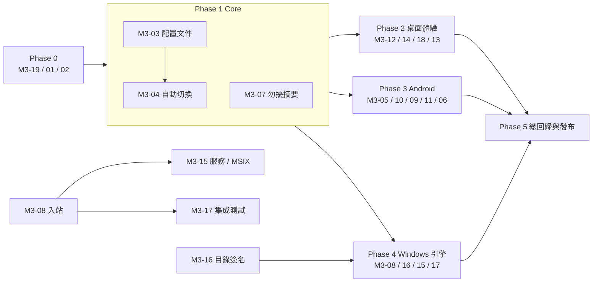

# M3 長期執行計劃

> 目標：按可驗證的節奏完成 M3 全部 19 個任務（M3-01 … M3-19），並把「代碼完成」和「驗收完成」分開記錄。
> 任務的詳細設計見 [m3-tasks.md](m3-tasks.md)，當前狀態見 [progress.md](progress.md)，設計差異見 [design.md §22](design.md#22-m0-實現說明與上文設計的差異)。
> 本文件是執行順序、檢查點和交接方式的補充，**不替代** progress.md 的狀態看板。

**建立日期：2026-11-14**
**當前基線：M3-19 / 01 / 02 / 03 / 04 / 07 / 12 / 14 / 13 / 18 代碼已提交；Windows 構建 0 警告 0 錯誤，420 個測試 419 通過、1 跳過；Android Debug 構建通過（3 個既有 XA0033 警告），未在設備上回歸。**

---

## 1. 完成定義

M3 全部完成需要同時滿足：

1. **代碼完成**：M3-01 … M3-19 的實現已合入 `main`，每項都有對應測試或明確說明為什麼無法自動化測試。
2. **自動化驗證通過**：
   - `dotnet build NetworkControl.slnx` 零警告零錯誤；
   - `dotnet test --solution NetworkControl.slnx` 全部通過；
   - `dotnet format NetworkControl.slnx --verify-no-changes --exclude src/NetworkControl.App.Android src/NetworkControl.Engine.Android`；
   - 涉及 Core / Storage / Engine.Vpn 時，`.\scripts\android.ps1 build` 通過，`NetworkControl.Android.slnx` 格式檢查通過。
3. **運行時驗證**：不需要管理員和真機的部分，用隔離管道（`NETWORKCONTROL_IPC=pipe:<其他名字>`）+ Fake 引擎的 gRPC 探針驗證，並把結果寫入進度文件。
4. **用戶驗證**：需要管理員權限、真機或人眼看界面的項目，集中在第 7 節的「用戶驗證隊列」，由用戶確認。**未確認的項目不能標為驗收完成。**
5. **文檔同步**：progress.md 的任務狀態、design.md §22（設計有變化時）、AGENTS.md 第 6 節（發現新坑時）都已更新。

> 「代碼完成」可以讓任務從 `[~]` 進入「待用戶驗證」；只有用戶驗證隊列完成後才標 `[x]`。如果某項需要推遲到後續版本，必須在 progress.md 明確寫出原因和後續任務編號。

---

## 2. 當前基線與在途工作

### 2.1 倉庫狀態（2026-11-14）

- `main` 已包含 M3-19 / 01 / 02 / 03 / 04 / 07 / 12 / 14（最新 `e82f6e4`）。
- 分支 `agent/claude/m3-13-updates` 完成 M3-13（提交 `f3bddc0`、`be8dce2`）與 M3-18（提交 `2acb28d`），並修正 M3-04 場景測試的時序依賴（`91102ac`），待合入 `main`。
- 所有代碼改動均已提交；工作區只保留文檔更新。
- Windows：`dotnet build`、`dotnet test`（416 / 415 / 1 skip）、`dotnet format` 通過；更新檢查用本機 HTTP 伺服器 + Release 構建端到端驗證。
- Android：`scripts/android.ps1 build` 通過（3 個既有 XA0033 JDK 版本解析警告）、`NetworkControl.Android.slnx` 格式檢查通過；**未在設備上運行**。
- 運行時：隔離管道 + Fake 引擎驗證了 `Connections.List`、`Profiles.*`、`Rules.Create` 的專屬規則切換和刪除級聯。

### 2.2 Phase 0 已修復的審查問題（保留記錄）

| 問題 | 影響 | 處理 |
|---|---|---|
| `WindowsConnectionTable.TcpRow6` 字段順序錯誤 | IPv6 TCP 連線的本地 / 遠端端口、狀態、PID 全部讀錯 | 按 SDK `tcpmib.h` 改正，並為四種行結構加**字段偏移**測試 |
| 即時連線頁每 2 秒清空重建集合 | 選中和滾動位置丟失，表格閃爍 | 按行鍵 `協議|本地|遠端|PID` 增量更新 |
| 遠端域名未實現 | `hostname` 永遠為空 | 注入 `DnsMapper`，在 `ConnectionResolver` 中反查 |
| 斷開連線缺少確認、能力判斷和「斷開並拒絕」 | 誤點或提示不明確 | 按 `KillConnection` 能力判斷、`PopupConfirm`、斷開並拒絕 |
| 導航順序與設計不一致 | 「即時連線」排在「連線記錄」之後 | 已調整 |
| 缺少連線解析測試 | 過濾 / 分組 / 域名可能回歸 | 抽出 `ConnectionResolver` 並加 Core 測試 |

---

## 3. 執行原則

1. **一個任務一個分支**：`agent/claude/m3-xx-<簡稱>`；大任務可以在同一分支上分多個檢查點提交，但不要和其他任務混在一起。
2. **每批開始先同步 `main`**：至少每個 Phase 開始時合併一次，避免長期分支漂移；合併後先跑構建和測試。
3. **先後端後界面**：Core / Storage / IPC 先完成並有測試，再做桌面界面和 Android 界面。
4. **Core / Storage 改動默認追加式**：不改已有公開簽名；改完必須構建 Android，並在進度文件寫明是否驗證過。
5. **高風險先預研**：M3-15 的 svchost 部分先寫結論到 design.md §22，經用戶確認後再實現；M3-08 / M3-17 的 WFP 行為先核對 SDK 頭文件，再由用戶以管理員驗證。
6. **不阻塞在用戶驗證上**：管理員 / 真機項目完成代碼和自動化測試後，進入第 7 節隊列，繼續下一個任務；但 M3 整體關閉前必須清空隊列。
7. **每個任務完成後**：更新 progress.md、本計劃第 6 節狀態表；提交信息用 Conventional Commits（正文可用中文）。
8. **不截屏、不動正式安裝的服務、不執行需要管理員權限的操作**（AGENTS.md 第 2 節）。

### 每批的工作節奏

- 小任務（M3-12 / 14 / 18 / 05 / 09 / 10 / 11 / 19）：一個會話完成 2–3 個。
- 中等任務（M3-01 / 02 / 04 / 06 / 07 / 08 / 13 / 16 / 17）：一個會話完成 1 個，複雜的跨 2 個會話。
- 大任務（M3-03 / 15）：拆成檢查點提交，預計跨 2–4 個會話。
- 每個會話結束時 `main` 必須是綠的；未完成的工作留在任務分支並在 progress.md 寫明下一步。

---

## 4. 階段計劃

### Phase 0 — 基線整合與在途工作（M3-19 / 01 / 02）— 已完成

- 合併 `main` 的最新文檔，修正 `progress.md` 衝突。
- 修補 M3-01 / M3-02：TCP6 佈局、DnsMapper 域名、增量更新、導航順序、服務層測試、斷開確認和能力判斷。
- 拆分提交 M3-19 / M3-01 / M3-02，合併 `main`。
- **退出條件已滿足**：`main` 構建 / 測試 / 格式全綠；三項代碼完成並進入用戶驗證隊列。

### Phase 1 — Core 能力：配置文件、自動切換、勿擾摘要（M3-03 → M3-04 → M3-07）

#### M3-03 配置文件管理（大）— 代碼完成

檢查點：

1. **Core / Storage**：`ProfileService`、`SqliteProfileRepository`、啟動任務、`RuntimeStateService.ActivateProfileAsync`、複製規則、刪除約束；ScenarioHost 場景測試。
2. **IPC / Service**：`profiles.proto`、`ProfilesGrpcService`、`ServiceStatus.active_profile_name`、導入時未知配置文件降級為共享規則。
3. **桌面**：設定頁配置文件卡片、總覽下拉、托盤子選單、狀態欄、規則編輯器「適用於」、規則頁配置檔案列和篩選、三語文本。
4. **Android**：`IBackend` 配置文件 API、總覽下拉、設定頁增刪改、文本生成。
5. **驗證**：356 測試、Fake 引擎探針。**待用戶驗證界面和 Android 真機。**

#### M3-04 按網絡自動切換（依賴 M3-03）— 下一個

1. Core：`NetworkContext`、`INetworkMonitor`、`AutoActivateCondition`、`ProfileAutoSwitcher`（去抖、優先級、手動覆蓋、無匹配保持）。
2. Fake：模擬網絡 + `simulator.proto` 的 `SimulateNetwork`。
3. Windows：`WindowsNetworkMonitor`（NetworkChange + NLM + WlanAPI）；AOT 下用 `ComWrappers` 源生成 COM。
4. Android：`AndroidNetworkMonitor`（`registerDefaultNetworkCallback`，排除 VPN 自身；SSID 需定位權限，拒絕時只按類型）。
5. 界面：配置文件編輯對話框的「自動切換」區、「使用目前的網絡」按鈕。
6. 驗證：條件匹配、去抖、手動覆蓋的單元測試；模擬器探針；Windows Wi-Fi / Android 真機列入用戶驗證。

#### M3-07 勿擾期間阻斷彙總（中）

1. Core：`QuietPeriodTracker`（只統計 `VerdictReason.DoNotDisturb`，手動關閉和到期兩條結束路徑）。
2. IPC：`QuietPeriodSummary`、`ServiceStatus.last_quiet_period`、`DismissQuietPeriod`、`LogQuery.reason` 篩選。
3. 桌面：Toast + 「查看」跳轉到按原因篩選的連線記錄；摘要中每行可「允許」。
4. Android：低優先級通知頻道，點擊打開阻擋記錄頁。
5. 驗證：Tracker 單元測試、場景測試、存儲層 reason 篩選測試。

**Phase 1 退出條件**：兩端構建 / 測試 / 格式通過；配置文件切換在模擬引擎下可用；勿擾摘要端到端可見；用戶驗證隊列更新。

### Phase 2 — 桌面體驗與發布準備（M3-12 → M3-14 → M3-18 → M3-13）

1. **M3-12 權限分級提示**：`ServiceConnection.CanModify`、寫操作禁用 + ToolTip、頁頭 `Alert`、`RunAsync` 把 `PermissionDenied` 轉為本地化文本；回應彈窗不受影響。
2. **M3-14 應用圖標**：`AppIconCache`，Windows `SHGetFileInfo` + `GetDIBits` → `WriteableBitmap`，後台提取、緩存、失敗回退默認圖標；應用到應用頁、即時連線、排行榜、詢問彈窗。
3. **M3-18 安裝程序繁體中文**：取得並核對 `ChineseTraditional.isl` 許可證；用台灣用語通讀；`[Languages]` 和 `[CustomMessages]` 補齊；UTF-8 BOM；沒有 `ISCC.exe` 時標記待用戶。
4. **M3-13 檢查更新**：先實現「可配置 JSON 地址」，`UpdateFeedUrl` 為空時功能隱藏，不阻塞在用戶決定發布源；純解析 / 版本比較放在 `NetworkControl.Ipc` 並測試；`HttpClient` 尊重系統代理、10 秒超時、失敗靜默；啟動 30 秒後檢查、之後每 24 小時；不做自動下載安裝。

**Phase 2 退出條件**：四項合入 main；安裝程序能生成（或記錄缺少 ISCC）；更新檢查在本地 HTTP 伺服器上端到端驗證。

### Phase 3 — Android 補完（M3-05 → M3-10 → M3-09 → M3-11 → M3-06）

1. **M3-05 阻斷快速失敗**：`IpPacketBuilder` 追加 TCP RST、ICMPv4 / ICMPv6 不可達；只在「明確拒絕」時回 RST；每（UID, 遠端）每秒最多一次；計數器 `ResetsSent` / `UnreachablesSent`；`FastFail` 開關；報文構造和 `BlockedFlowReporter` 單元測試。
2. **M3-10 通知文本跟隨應用內語言**：通知文本從 AtomUI Catalog 取；`LocaleManager.SetApplicationLocales`（API 33+）；語言切換時更新頻道名和前台通知；開機啟動時 `LocalizationService` 不依賴 Avalonia 初始化。
3. **M3-09 快速設定磁貼**：`TileService`、狀態同步、點按切換保護、未授權時打開應用、`RequestListeningState` 節流。
4. **M3-11 診斷資訊導出**：zip `summary.txt` + 最近 3 個日誌 + 規則統計 + 使用情況授權狀態；SAF 保存；復用 `Ipc/Diagnostics` 的脫敏和寫入。
5. **M3-06 規則導入導出**：SAF 文件選擇；復用 `RuleExportSerializer` / `RuleImportPlanner`；合併 / 覆寫預覽；「Android 上不生效的規則」統計抽成 `Engine.Vpn` 純函數並測試；先增改後刪除。

**Phase 3 退出條件**：Android Debug / Release 構建通過；新增純函數測試通過；APK 交給用戶做真機驗證。

### Phase 4 — Windows 引擎深化（M3-08 → M3-16 → M3-15 預研與實現 → M3-17）

1. **M3-08 入站連線控制**：RECV_ACCEPT 層、方向規則編譯、`UserSettings.InboundDefault`、默認入站阻止的內置放行、阻斷事件方向識別且不詢問、設定頁開關、`RuleCompiler` 測試。
2. **M3-16 目錄簽名校驗**：`CryptCATAdmin*` + `WinVerifyTrust(WTD_CHOICE_CATALOG)`；SHA-256 找不到時回退 SHA-1；句柄全部釋放；佈局測試；用 `notepad.exe` 驗證（非管理員，找不到目錄簽名時 Skip）。
3. **M3-15 svchost / MSIX（先預研）**：核對 `ALE_PACKAGE_ID`、`ALE_USER_ID` 安全描述符語義；查 `sc qsidtype`；查 Windows 防火牆服務規則；在 design.md §22 寫結論和不能區分服務的處理；**結論經用戶確認後**再實現。
4. **M3-17 WFP 管理員集成測試**：新測試項目，非管理員全部 Skip；獨立子層 GUID，不碰正式服務；覆蓋會話、過濾器增刪、動態會話清理、增量下發、阻斷事件。

**Phase 4 退出條件**：Engine.Windows 單元測試全綠；非管理員下集成測試全部 Skip；管理員驗證項進入隊列；M3-15 預研結論已記錄。

### Phase 5 — 總回歸與發布候選

1. 全量回歸：Windows build / test / format；Android build / format；`scripts/publish-release.ps1` 生成 AOT 包和安裝程序。
2. 版本號改為 `0.4.0`，更新 README / 發布說明。
3. 生成候選包：`artifacts\release\NetworkControl-0.4.0-win-x64-setup.exe` / `.zip`，Android Signed APK。
4. 把第 7 節用戶驗證隊列整理成一份清單交給用戶；用戶確認後關閉 M3。
5. 更新 progress.md、progress-android.md、design.md §22、AGENTS.md 第 6 節；把本文件標記為完成。

**Phase 5 退出條件**：發布候選包可用；用戶驗證隊列全部有結論；M3 任務全部 `[x]` 或明確移交到後續版本。

---

## 5. 依賴關係

說明：

- M3-03 是 M3-04 和 Android 配置文件界面的前置。
- M3-07、M3-12、M3-14、M3-05 等相互獨立，可以按會話空檔插入。
- M3-08 和 M3-15 都修改 `RuleCompiler`，必須順序做；M3-17 在兩者之後。
- M3-13 不阻塞在用戶決定上：先用空 `UpdateFeedUrl` 隱藏功能。

---

## 6. 任務狀態表

> 狀態：`未開始` / `進行中` / `代碼完成待驗證` / `完成` / `預研`。每完成一個任務更新本表；progress.md 仍是對外看板。

| ID | 任務 | 階段 | 狀態 | 提交 | 本地自動化驗證 | 待用戶驗證 |
|---|---|---|---|---|---|---|
| M3-19 | 界面小修（指標卡、本地端點） | P0 | 代碼完成待驗證 | `7cb38f1` | 構建 / 測試通過 | 窄窗口視覺效果 |
| M3-01 | 實時連線視圖 | P0 | 代碼完成待驗證 | `0b273f2` | 356 測試 + Fake 探針 | 界面刷新 / 跳轉 |
| M3-02 | 斷開連線 | P0 | 代碼完成待驗證 | `0b273f2` | Fake 探針（能力提示） | 管理員實機斷開 |
| M3-03 | 配置文件管理 | P1 | 代碼完成待驗證 | `c7a030d` | 356 測試 + Fake 探針 + Android 構建 | 桌面 / Android 界面 |
| M3-04 | 按網絡自動切換 | P1 | 代碼完成待驗證 | `f0fab65` | 362 測試 + Fake 探針 | Windows Wi-Fi / Android 真機 |
| M3-07 | 勿擾期間阻斷彙總 | P1 | 代碼完成待驗證 | `8ab0c66` | 362 測試 + Fake 探針 | 桌面 Toast / Android 通知 |
| M3-12 | 權限分級提示 | P2 | 代碼完成待驗證 | `6d89f01` | 構建 / 測試 | 普通用戶界面效果 |
| M3-14 | 應用圖標 | P2 | 代碼完成待驗證 | `500307e` | 構建 / 測試 | 圖標視覺效果（目前只有應用頁） |
| M3-18 | 安裝程序繁體中文 | P2 | 代碼完成待驗證 | `2acb28d` | ISCC 編譯通過 | 繁中系統安裝界面 |
| M3-13 | 檢查更新 | P2 | 代碼完成待驗證 | `f3bddc0`、`be8dce2` | 420 測試 + 本機 HTTP 端到端 | 正式 feed URL / 界面 |
| M3-05 | Android 阻斷快速失敗 | P3 | 未開始 | — | 報文構造單元測試 | 真機 Chrome 立即報錯 |
| M3-10 | Android 通知語言 | P3 | 未開始 | — | 構建 | 真機切換語言 |
| M3-09 | Android 快速設定磁貼 | P3 | 未開始 | — | 構建 | 真機磁貼 |
| M3-11 | Android 診斷導出 | P3 | 未開始 | — | 構建 | 真機導出 zip |
| M3-06 | Android 規則導入導出 | P3 | 未開始 | — | 不生效規則純函數測試 | 與桌面互通 |
| M3-08 | 入站連線控制 | P4 | 代碼完成待驗證 | `b552cd2` | RuleCompiler 測試 | 管理員局域網驗證 |
| M3-16 | 目錄簽名校驗 | P4 | 代碼完成待驗證 | `ef13df7` | notepad 驗證（非管理員） | 系統文件回歸 |
| M3-15 | svchost / MSIX | P4 | 未開始（先預研） | — | SID / 佈局測試 | 預研結論確認 + 管理員驗證 |
| M3-17 | WFP 管理員集成測試 | P4 | 未開始 | — | 非管理員全部 Skip | 管理員全量運行 |

---

## 7. 用戶驗證隊列（集中檢查，避免打斷）

### 7.1 不需要管理員、但需要看界面

- [ ] M3-19：把視窗拉到最小寬度，指標卡 2×2、文字不截斷；連線記錄詳情顯示「本地端點（最近一次）」。
- [ ] M3-01：即時連線頁 2 秒刷新、搜索、監聽 / 回環開關、記錄跳轉、從連線建規則；刷新時選中和滾動位置不跳。
- [ ] M3-03：設定頁配置文件增刪改、總覽切換、托盤切換、規則頁按配置文件篩選。
- [ ] M3-07：勿擾期間產生幾次阻斷，結束後收到彙總 Toast，點「查看」得到正確篩選。
- [ ] M3-12：`TreatAllClientsAsAdmin=false` + 普通用戶啟動界面，寫操作禁用並有說明；詢問彈窗仍可回答。
- [ ] M3-14：應用頁、即時連線、排行榜、詢問彈窗的圖標。
- [ ] M3-18：繁體中文系統（或顯示語言改繁中）運行安裝程序，界面為台灣用語。
- [ ] M3-13：設定頁「立即檢查」；有新版時提示；「忽略此版本」生效。

### 7.2 需要管理員權限

- [ ] M3-02：斷開瀏覽器的一條 IPv4 TCP 連線，刷新後消失；IPv6 / UDP 按鈕不可用。
- [ ] M3-04：切換 Wi-Fi（Windows）後自動切換配置文件；手動切換後同一網絡不再自動搶回。
- [ ] M3-08：打開「默認阻止入站」後，另一台機器 ping / 訪問共享被拒；加入站允許規則後恢復。
- [ ] M3-15：拒絕 Windows Update（`wuauserv`）後更新失敗，其他 svchost 服務不受影響（預研結論確認後再驗）。
- [ ] M3-17：以管理員運行新集成測試項目，全部通過，`netsh wfp show filters` 無殘留。

### 7.3 需要 Android 真機

- [ ] M3-05：Chrome 打開被拒絕的網站，立即顯示錯誤頁而不是長時間轉圈；允許後恢復。
- [ ] M3-06：手機導出 → 桌面導入預覽；桌面導出 → 手機導入並提示不生效數量。
- [ ] M3-09：添加磁貼、點按開關保護、首次未授權時打開應用；狀態與應用內一致。
- [ ] M3-10：系統語言英文、應用內選繁中 → 詢問通知繁中；切簡中後新通知簡中。
- [ ] M3-11：導出的 zip 能打開，日誌中的 IP 已脫敏。
- [ ] M3-04：Wi-Fi ↔ 行動網路切換時配置文件自動切換。
- [ ] M3-03：Android 設定頁建立 / 改名 / 刪除 / 切換配置文件，VPN 分流隨之更新。

---

## 8. 風險與應對

| 風險 | 影響 | 應對 |
|---|---|---|
| M3-03 / 04 改 Core / Storage 導致 Android 回歸 | 兩端行為不一致 | 只做追加式修改；每完成一個檢查點跑 `scripts/android.ps1 build`；ScenarioHost 覆蓋兩端共用邏輯 |
| WFP 互操作結構錯誤 | 功能靜默失效或崩潰 | 所有新結構按 SDK 頭文件核對，佈局測試斷言**字段偏移**，不只斷言大小 |
| M3-08 / 15 需要管理員才能真實驗證 | 代碼完成但無法關閉驗收 | 先做純函數 / 編譯器測試；管理員驗證集中到隊列；M3-15 預研先行 |
| M3-15 svchost 服務無法按 SID 區分 | 規則無法生效或誤傷整個 svchost | 預研先確認 `sc qsidtype`；不能區分時按設計跳過並在界面說明 |
| M3-13 發布源未定 | 功能無法上線 | 先實現可配置 JSON，空地址隱藏；URL 由用戶後續填寫 |
| M3-18 繁中翻譯許可證不明 | 不能提交 `.isl` | 先核對 jrsoftware 翻譯頁的許可證；不明確時不提交 |
| 長期分支漂移 | 合併衝突、重複勞動 | 每個 Phase 開始合併 main；任務分支短命；每批結束 main 保持綠色 |
| 用戶驗證積壓 | M3 無法正式關閉 | 第 7 節集中排隊；每個 Phase 結束提醒用戶批量驗證 |

---

## 9. 每任務執行模板（開新會話照做）

1. 讀 `docs/progress.md`、本文件、`docs/m3-tasks.md` 中對應任務，以及 AGENTS.md 第 6 節。
2. 在 progress.md 把任務改為 `[~] (claude, 日期)`，在本文件狀態表改為「進行中」。
3. 從最新 `main` 建分支 `agent/claude/m3-xx-<簡稱>`。
4. 按「範圍 → 設計 → 測試」實現；Core / Storage 改動先做後端和測試。
5. 跑 0.3 自檢（build / test / format；涉及 Core / Storage / Engine.Vpn 時加 Android build 和 Android format）。
6. 用隔離管道 + Fake 引擎跑運行時探針；需要管理員 / 真機的部分寫入第 7 節。
7. 更新 progress.md、本文件狀態表；設計有變化時更新 design.md §22；發現新坑更新 AGENTS.md 第 6 節。
8. 提交（Conventional Commits），合併回 `main`，再開始下一個任務。

### 交接約定

- 每個會話結束前，在 progress.md 的任務下寫明：已完成什麼、下一步是什麼、哪個分支、哪個命令能重現驗證。
- 不把半成品留在 `main`；未完成的工作提交到任務分支（WIP 提交也可以），並在進度文件標明。
- 不在同一個分支上混入多個 M3 任務；如果不得已，提交信息中明確列出任務 ID。

---

## 10. 需要用戶決定 / 提供的事項

| 事項 | 影響的任務 | 默認處理（不阻塞） |
|---|---|---|
| 正式發布源（GitHub Releases / 自建 JSON） | M3-13 | 先實現可配置 `UpdateFeedUrl`，空值隱藏；URL 後續填寫 |
| Windows 代碼簽名證書 | 發布、M3-18 驗收 | 繼續使用未簽名安裝包，接受 SmartScreen |
| Android 正式密鑰庫 | Android Release | 繼續使用調試簽名，M3 功能驗證不受影響 |
| M3-15 預研結論確認 | M3-15 第二步 | 先完成預研並寫入 design.md §22，等確認後再實現 |
| 產品正式名稱 / 應用 ID | 發布 | 不影響 M3 功能開發，發布前再定 |
